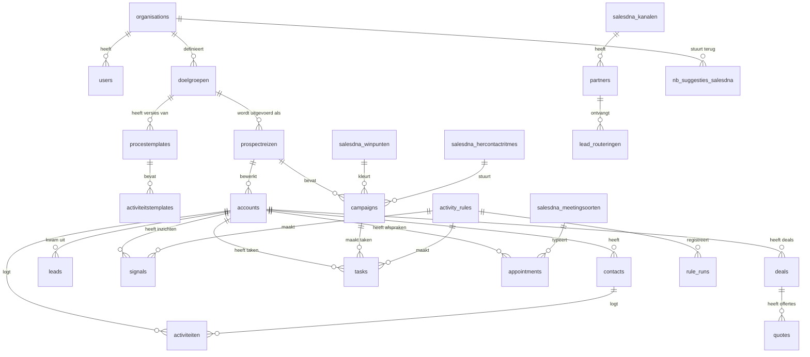
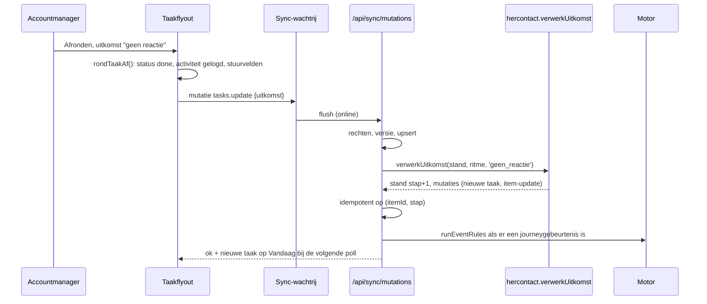
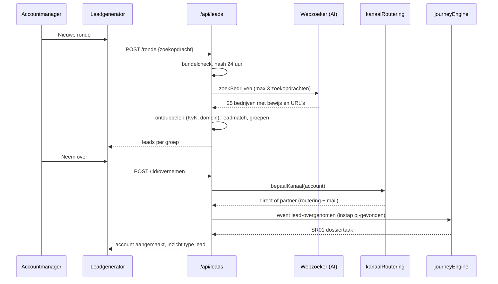
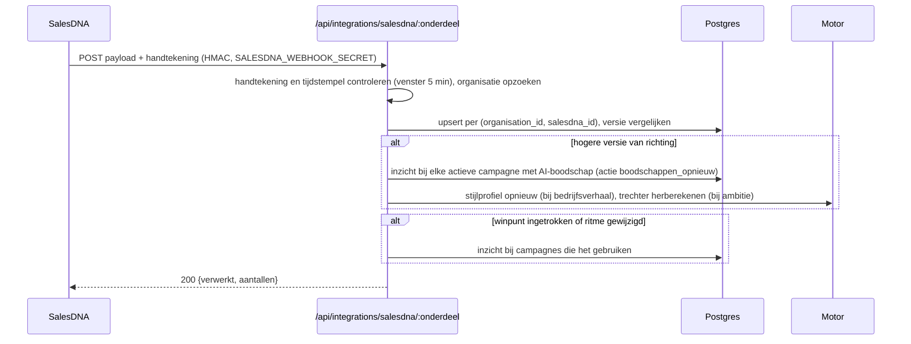

# Architectuurplan: DealDrive New Business

> Versie 1.0 · 2026-10-12 · opgesteld uit vier bronnen: het concept "New Business
> Portal" (Opbouw new business portal.pdf, 4 pagina's), de mock-up "Tien
> bouwstenen voor de New business tool" (SalesDNA-NewBusiness-Mockup.pdf, 51
> pagina's), de bouwprompts `C:\Projecten\newbusiness-docs\prompts\dealdrive-leadgeneratie-bouwprompts.md`
> (onderzoek van de DealDrive-code op commit 1c314ec) en het referentieplan
> `C:\Projecten\dealdrive\docs\Architectuurplan-DealDrive-Pro-Volledig.md` (versie 2.0, als voorbeeld
> van opbouw en diepgang). Het stijlbestand
> `C:\Projecten\newbusiness-docs\prompts\dealdrive-leadgeneratie-stijl.css` en de bijbehorende
> stylelint-regels zijn de basis voor hoofdstuk 12.
>
> **Doelgroep:** founder, ontwerpers, ontwikkelaars (mens en Claude Code),
> sales-engineers en de eerste klantorganisaties. Eén document dat zegt wat we
> bouwen, waarom, en hoe.
>
> **Huisregels in dit document:** Nederlands, geen gedachtestreepjes, data in
> ISO-notatie, beslissingen als ADR met argumenten, elk hoofdstuk met tabellen
> en waar nuttig een schets.

---

## Inhoud

| § | Onderwerp | Bron |
|---|---|---|
| 0 | Executive summary | alle vier |
| 1 | Uitgangspunten en design-principes | concept, mock-up, bouwprompts |
| 2 | Positionering: SalesDNA, New Business, DealDrive | mock-up, ADR-001 en ADR-002 |
| 3 | Het new business-proces: drie fases, prospectreis, statusmachine | concept, bouwprompts |
| 4 | Datamodel: vijf lagen, SalesDNA-spiegel, kern en afgeleide tabellen | concept, mock-up, bouwprompts |
| 5 | Rollen, rechten en tenantgrens | bouwprompts, referentieplan |
| 6 | Modules in zeven lagen | alle vier |
| 7 | De motor en de prospectreis-engine | bouwprompts, mock-up |
| 8 | AI-architectuur | concept, mock-up, bouwprompts |
| 9 | Agents: wie doet wat, en met welk mandaat | founder, concept, ADR-005 en ADR-006 |
| 10 | Kanalen en consent | concept, mock-up |
| 11 | Technische architectuur | bouwprompts, referentieplan |
| 12 | Design-systeem en UI-patronen | stijlbestand |
| 13 | Paginasjablonen (12 schetsen) | mock-up, bouwprompts |
| 14 | Succescriteria: KPI's per stakeholder | concept, mock-up |
| 15 | Feedbacklus, rapportage en terugkoppeling naar SalesDNA | concept, mock-up |
| 16 | Datakwaliteit, deduplicatie en herkomst | concept, bouwprompts |
| 17 | Risico's en mitigaties | referentieplan, eigen analyse |
| 18 | AVG, consent en security | referentieplan, concept |
| 19 | Fasering: acht sprints | mock-up, bouwprompts |
| 20 | Definition of Done en teststrategie | referentieplan, bouwprompts |
| 21 | Architecture Decision Records (ADR-001 tot ADR-010) | eigen analyse |
| 22 | Open vragen | alle vier |
| 23 | Bijlagen en woordenlijst | bouwprompts |

---

## 0. Executive summary

| Onderdeel | Waarde |
|---|---|
| **Productnaam** | DealDrive New Business (werknaam; zie §22 open vraag 1) |
| **Categorie** | Acquisitie-workspace voor new business: van onbekende naam naar klant, gestuurd door het SalesDNA van de organisatie |
| **Plaats in het portfolio** | SalesDNA legt vast hoe de organisatie verkoopt; New Business voert het acquisitieprogramma uit; DealDrive neemt de klant over zodra er een deal is |
| **Primaire gebruikers** | Accountmanager new business (hunter), salesmanager (stuurt op prospectmix, tempo en campagnes) |
| **Secundaire gebruikers** | Beheerder (inrichting), founder (beheer over organisaties), partner (bevestigt een gerouteerde lead zonder login) |
| **Portfolio-orde** | 200 tot 600 suspects en prospects per accountmanager, 30 tot 80 accounts per campagne, 5 tot 10 campagnes tegelijk per team |
| **Kernbelofte** | "Open de tool 's ochtends en je weet welke prospect je vandaag belt, mailt of bezoekt, met welke opening uit jullie eigen verhaal, en wat je doet als hij niet reageert." |
| **Drie fases** | Pre-data en kwalificatie (vinden, verrijken, kwalificeren), prospectfase (bewerken op ritme met campagnes), verbindingsfase (eerste afspraak, offerte, deal, overdracht) |
| **Vijf lagen in het model** | Doelgroep (ICP), procestemplate, campagne, prospectreis (uitvoering per account), activiteitenlog |
| **Tien SalesDNA-bouwstenen** | Golden circle, bedrijfsverhaal, ambitie en visie, waarde en belofte, verkoopkanalen (richting); winpunten (onderscheid); prospectmix, hercontactritme, meetingsoorten en weekritme (ritme); campagnesoorten (uitvoering) |
| **Anders dan een CRM** | Een CRM registreert wat gebeurd is; deze tool zegt wat vandaag moet gebeuren, waarom, en meet of het werkte |
| **Anders dan een outreach-tool** | Geen sequences zonder verhaal: elke boodschap opent met het waarom, draagt één winpunt en één argument met bewijs, en elke poging volgt het afgesproken hercontactritme |
| **Anders dan DealDrive** | DealDrive is gebouwd op bestaande klanten en hun ritme; deze tool is gebouwd op accounts die nog niets van je willen, met een reis die eindigt in een overdracht |
| **Drie harde principes** | Geen bewijs, geen inzicht · de agent handelt nooit zonder goedkeuring · template en uitvoering gescheiden |
| **Stack** | Nuxt 4, Vue 3.5, Nitro, drizzle op Postgres (Supabase EU) met RLS, offline-first client met sync-wachtrij, Netlify, Claude via de Anthropic API met mock-provider |
| **Hergebruik** | Ongeveer 60 procent van de modules komt letterlijk uit DealDrive (opslaglaag, sync, rechten, motor, journey-engine, AI-beoordeling, Pitstop, campagnes, belblokken, leadgenerator-domein, tokens) |
| **Omvang** | 8 sprints van 2 weken tot een werkende tool voor de eerste organisatie, 10 bouwprompts, 24 modules |
| **Tone of voice** | Rustig, editorial, zakelijk, in de je-vorm, Nederlands zonder Engelse termen waar een Nederlandse bestaat |

### Wat de tool is, in zes zinnen

1. De salesmanager legt in SalesDNA vast wie de organisatie is (richting), waarmee ze het verschil maakt (winpunten) en hoeveel new business er bij wie moet komen (prospectmix, hercontactritme, meetings). De tool leest dat alleen; hij maakt het niet.
2. Per doelgroep (ICP) ligt er een procestemplate met de drie fases en standaardactiviteiten. Een campagne zet dat om in één actie over 30 tot 80 accounts, met een trigger, een kanaalmix, tussendoelen en een einddoel.
3. Elk account doorloopt dezelfde reis maar heeft een eigen status (nieuw, in reis, wachtend, nee, gescoord, klant). De motor plant elke volgende poging als taak, wisselt van kanaal volgens het ritme, parkeert na de laatste poging en haalt het account terug bij een nieuwe trigger.
4. AI verrijkt (dossier, buying committee, signalen), beoordeelt met bewijs, schrijft concepten in de toon van het bedrijfsverhaal en notuleert. Een mens belt, bezoekt, verstuurt en keurt goed.
5. Vandaag is de werkvoorraad: per taak de aanleiding, de bron, het concept, poging n van m, en één klik om af te ronden met een uitkomst.
6. De feedbacklus meet conversie per tussendoel, activiteit, winpunt en doelgroep, houdt templates in versies, stelt maandelijks verbeteringen voor en stuurt suggesties terug naar SalesDNA.

### Wat de tool niet is

Geen tweede CRM, geen tool die zelf mails verstuurt zonder goedkeuring, geen vervanging van DealDrive voor bestaande klanten, geen plek waar SalesDNA-inhoud wordt bewerkt, geen tool die winpunten verzint of bezwaarantwoorden zonder bron geeft.

---

## 1. Uitgangspunten en design-principes

### 1.1 Zeven principes

| Principe | Wat het betekent | Waar het vandaan komt |
|---|---|---|
| **SalesDNA is de bron** | Richting, winpunten, prospectmix, ritmes, meetingsoorten en kanalen komen binnen via gesigneerde webhooks en staan in de tool alleen-lezen. De tool stuurt alleen suggesties terug. | Mock-up, startprompt punt 1 |
| **Geen bewijs, geen inzicht** | Elk inzicht en elke bewering in een briefing draagt bron, datum en citaat. Een AI-oordeel zonder citaat dat letterlijk in het materiaal staat wordt weggegooid. | DealDrive §1, bouwprompts §0.1, concept "AI-kwaliteitscontrole" |
| **De agent handelt nooit zonder goedkeuring** | AI maakt concepten en voorstellen. Verzenden, bellen, bezoeken en het accepteren van een nieuwe template zijn menselijke handelingen. Er is geen schakelaar die dit uitzet. | DealDrive, concept "Verdeling van werk" |
| **Template en uitvoering gescheiden** | Een procestemplate en een activiteitstemplate kunnen verbeteren zonder lopende reizen te breken; elke reis weet welke versie hij volgt, zodat je later ziet welke versie beter werkte. | Concept, datamodel vijf lagen |
| **Meet of het werkte, niet of het gedaan is** | Elke activiteitstemplate heeft een verwacht resultaat. De feedbacklus telt conversie per tussendoel, winpunt en doelgroep, niet alleen afgeronde taken. | Concept "Activiteit-template" |
| **Nee is een datapunt** | Een nee krijgt een reden uit een vaste lijst, een terugkeerdatum en een cooldown per kanaal; een nieuwe trigger kan het account weer activeren. Niemand wordt overvraagd. | Concept "Nee als datapunt", mock-up hercontactritme |
| **Gestuurd, niet lerend (nu)** | Regels en matrices sturen de motor en zijn uitlegbaar. Het maandelijkse AI-verbetervoorstel is een voorstel dat een mens accepteert; er is geen zelflerende lus die regels wijzigt. | DealDrive §10, bouwprompts §0.1 |

### 1.2 UX-patronen (overgenomen uit DealDrive, hier van toepassing)

| Patroon | Wat | Waar in de tool |
|---|---|---|
| Aanleiding boven actie | Elke taak toont eerst waarom (trigger, winpunt, bron), dan wat | Vandaag, taakflyout |
| Eén volgende beste actie | Nooit meer dan één primaire knop per scherm; de rest is secundair of een icoon | Alle flyouts, Vandaag |
| Brontransparantie | Bij elke AI-tekst: welk winpunt, welk argument, welke woorden uit het verhaal | Boodschapstap, Pitstop |
| Geen invulwerk | AI vult dossier, buying committee en concept vooraf in; de mens corrigeert en keurt goed | Leadgenerator, Pitstop |
| Zero-keystroke afronden | Afronden met uitkomst is één klik plus eventueel een datum; loggen gebeurt automatisch | Vandaag, taakflyout |
| Lege staat met één knop | Elke lege lijst zegt in één zin wat er niet is en biedt één handeling | Alle lijsten |
| Maximaal zeven items in beeld | Vandaag toont maximaal 8 taken en 4 prio's met "nog N meer" | Vandaag |
| Instellingen onder beheer, niet in de werkruimte | De zijbalk is werk; inrichting zit onder Beheer en alleen voor beheerders | Schil |

### 1.3 Anti-patronen die we afwijzen

- Een tweede campagnemodule naast de bestaande: campagnes zijn één feature met 26 soorten.
- Boodschappen zonder winpunt, zonder vraag aan het eind of met het "wat" in de openingszin.
- Een eigen tempo- of datumberekening per pagina: elke berekening staat één keer in `shared/` of `server/utils/` als pure functie met tests.
- Winpunten, ritmes, prospectmix of golden circle bewerken in de tool.
- Een account in twee ritmes tegelijk, of pogingen overslaan zonder uitkomst.
- AI-output zonder schema-validatie of zonder bronnen.
- Kleuren of maten buiten de tokens; tekst onder 11 px; schaduwen; hoeken boven 2 px.


## 2. Positionering: SalesDNA, New Business, DealDrive

### 2.1 Drie producten, één keten

```
┌──────────────────────┐    webhooks (gesigneerd)    ┌──────────────────────────┐    overdracht bij deal    ┌──────────────────────┐
│  SalesDNA            │ ──────────────────────────▶ │  DealDrive New Business  │ ────────────────────────▶ │  DealDrive           │
│  hoe wij verkopen    │                              │  van naam naar klant     │                           │  klanten en ritme    │
│  richting, winpunten │ ◀────────────────────────── │  leads, campagnes, reis  │ ◀──────────────────────── │  accountplannen, Dex │
│  mix, ritme, meetings│    suggesties (kader 2)      │  motor, AI, Vandaag      │    klantstatus, gewonnen  │                      │
└──────────────────────┘                              └──────────────────────────┘                           └──────────────────────┘
```

| Product | Vraag die het beantwoordt | Eigenaar van de data | Schrijft naar |
|---|---|---|---|
| SalesDNA | Hoe verkopen wij, voor wie, met welk verschil en in welk ritme? | Salesmanager en directie | New Business (webhooks) |
| New Business | Welke onbekende bedrijven worden klant, en wat doe ik daar vandaag voor? | Accountmanager new business | SalesDNA (suggesties), DealDrive (overdracht) |
| DealDrive | Wat doe ik vandaag voor mijn bestaande klanten, en wat zegt het ritme? | Accountmanager en salesmanager | New Business (klantstatus, signalen) |

### 2.2 Waarom een eigen tool en geen module in DealDrive (ADR-001, samenvatting)

De mock-up ging uit van bouwen in de DealDrive-codebase. Dit plan kiest een eigen app die de DealDrive-code hergebruikt. De argumenten:

| Argument | Toelichting |
|---|---|
| Andere gebruiker, andere dag | Een hunter werkt in campagnes en pogingen, niet in klantritme en accountplannen. DealDrive's zijbalk, Vandaag en Dex zijn gebouwd op bestaande klanten; elke new business-functie erin is een compromis. |
| Andere journey | DealDrive's journey is een klantjourney met gebeurtenissen die nergens afgaan (bouwprompts §1.2 punt 5). De prospectreis heeft eigen fases, gebeurtenissen en een statusmachine per account. |
| Minder ballast | De tool heeft geen Dex, accountplannen, documenten, mailinbox, agenda-sync of HQ-build nodig. Een eigen app start met 24 modules in plaats van 52. |
| Verkoopbaar los van DealDrive | Een organisatie kan met SalesDNA en New Business beginnen en DealDrive later nemen. De overdracht van een klant is een gedefinieerd koppelvlak (§11.6). |
| Dezelfde code waar het telt | Opslaglaag, sync, rechten, motor, journey-engine, AI-beoordeling, Pitstop, campagnes en belblokken komen letterlijk uit DealDrive (bouwprompts §1.1). De huisstijl ook. |

Tegenargument dat we accepteren: twee codebases vragen discipline bij gedeelde modules. Mitigatie: de gedeelde modules leven in `shared/` en `server/utils/` met dezelfde bestandsnamen en tests, zodat een fix in de ene repo in de andere te herhalen is. Heroverweging als beide tools dezelfde organisatie bedienen met meer dan 30 procent gedeelde schermen.

### 2.3 Koppelvlakken

| Koppelvlak | Richting | Mechanisme | Inhoud |
|---|---|---|---|
| SalesDNA naar New Business | inkomend | Webhooks onder `server/api/integrations/salesdna/*`, handtekening met `SALESDNA_WEBHOOK_SECRET`, upsert per `(organisation_id, salesdna_id)`, versienummer per onderdeel | richting (4 onderdelen), winpunten, prospectmix, hercontactritmes, kanalen en partners, meetingsoorten en weekritme, klantfeedback |
| New Business naar SalesDNA | uitgaand | `POST /api/integrations/salesdna/suggesties`, maximaal één keer per kwartaal per sublaag, uit de tabel `nb_suggesties_salesdna` | rapport hercontactritme (bij welke poging de afspraken vallen), belofte en beleving, bewijsvoorstellen uit gewonnen deals, prospectmix-afwijking, winpuntgebruik |
| New Business naar DealDrive | uitgaand | `POST <dealdrive>/api/integrations/newbusiness/overdracht` met het account, de contacten, de deal, het dossier en de reisgeschiedenis; DealDrive antwoordt met het klant-id | bij `deal-gewonnen` of handmatige promotie |
| DealDrive naar New Business | inkomend | `POST /api/integrations/dealdrive/klantstatus` (klant verloren, contract beëindigd) voor winback-campagnes; signalen uit DealDrive's web-connector voor accounts die in beide staan | status, signalen |

Zonder SalesDNA-koppeling werkt de tool met een eigen, beperkte inrichting (één golden circle, drie winpunten, standaardritmes) die de beheerder zelf invult. Dat is de modus voor de eerste organisatie zolang SalesDNA de webhooks nog niet stuurt.

---

## 3. Het new business-proces

### 3.1 Drie fases, één reis

| Fase | Doel | Begint bij | Eindigt bij | Kernactiviteiten | Kernmaat |
|---|---|---|---|---|---|
| **1. Pre-data en kwalificatie** | Van naam naar gekwalificeerde prospect | Lead uit de leadgenerator, import, beurs, referral of signaal | Gebeurtenis `gekwalificeerd` | Zoekronde, dossier met bewijs, buying committee, klasse uit omvang, BAND, kanaalroutering | Dossier compleet in dagen, kwalificatiegraad |
| **2. Prospectfase** | Van gekwalificeerd naar gesprek | `gekwalificeerd` | Gebeurtenis `eerste-afspraak-gepland` | Campagnes per soort, pogingen volgens het hercontactritme, belblokken, winpunt in elke boodschap, parkeren en terughalen | Pogingen tot afspraak, conversie naar afspraak, prospectdekking |
| **3. Verbindingsfase** | Van gesprek naar klant | `eerste-afspraak-gepland` | `deal-gewonnen` (overdracht) of `deal-verloren` (heropvolging) | Meetings van een vaste soort met uitkomst, offerte en opvolging volgens de offertematrix, BAND compleet, bezwaren uit de waarde | Afspraak naar offerte, offerte naar klant, doorlooptijd |

### 3.2 De prospectreis per doelgroep

Een prospectreis is de uitvoering van een procestemplate op een doelgroep: dezelfde fases, dezelfde standaardactiviteiten, maar per account een eigen voortgang. Een reis heeft een status (concept, actief, gepauzeerd, afgerond), een templateversie en een historie. Campagnes zijn de acties binnen een reis; losse taken uit de motor horen ook bij de reis van het account.

```
Doelgroep (ICP) "Bouw, 20 tot 100 medewerkers, regio Utrecht"
  └── Procestemplate v3 (drie fases, 11 activiteitstemplates)
        └── Prospectreis 2026Q4 (actief, 112 accounts)
              ├── Campagne 42 "Koude belcampagne" (45 accounts, ritme koud 5 in 3 weken)
              ├── Campagne 51 "LinkedIn-campagne" (30 accounts)
              └── Losse taken uit de motor (jaarplanningsvenster, signalen)
                    └── Activiteitenlog per account en contact
```

### 3.3 Statusmachine per account

Het concept noemt zes statussen; de tool neemt ze over als `nb_status` naast de journeyfase. De journeyfase zegt waar in de drie fases het account staat; de status zegt of het account nu bewerkt wordt.

```
                 lead overgenomen / import
                           │
                           ▼
                       ┌───────┐   kwalificatie   ┌─────────┐   geen reactie na laatste poging   ┌──────────┐
                       │ nieuw │ ───────────────▶ │ in reis │ ────────────────────────────────▶ │ wachtend │
                       └───────┘                  └─────────┘ ◀──────────────────────────────── └──────────┘
                           │                        │   │  ▲      terugkomdatum of nieuwe trigger
                 niet geschikt                      │   │  │
                           ▼                        │   │  └──── gesproken, later (gepauzeerd tot datum)
                       ┌───────┐   nee met reden    │   │
                       │  nee  │ ◀──────────────────┘   │ afspraak, offerte, onderhandeling
                       └───────┘                        ▼
                           ▲                        ┌──────────┐    deal gewonnen    ┌───────┐
                           └─────────────────────── │ gescoord │ ──────────────────▶ │ klant │ ──▶ overdracht naar DealDrive
                              deal verloren         └──────────┘                     └───────┘
```

| Status | Betekenis | Komt erin door | Gaat eruit door |
|---|---|---|---|
| `nieuw` | Bekend, nog niet gekwalificeerd | leadgenerator, import, signaal, referral | `gekwalificeerd` of niet geschikt |
| `in reis` | Wordt actief bewerkt in een campagne of op ritme | kwalificatie, terugkomst uit wachtend | laatste poging zonder reactie, nee, afspraak |
| `wachtend` | Geparkeerd met terugkomdatum, of gepauzeerd tot een datum | laatste poging zonder resultaat, "gesproken, later" | terugkomdatum, nieuwe trigger, nurturecampagne |
| `nee` | Afgewezen met reden en cooldown per kanaal | uitkomst "niet geschikt", "geen interesse" | terugkeerdatum of nieuwe trigger (dan weer `nieuw` of `in reis`) |
| `gescoord` | Eerste afspraak gepland tot en met onderhandeling | `eerste-afspraak-gepland` | `deal-gewonnen` of `deal-verloren` |
| `klant` | Deal gewonnen; overgedragen aan DealDrive | `deal-gewonnen`, handmatige promotie | niet; een verloren klant komt via DealDrive terug als winback-kandidaat |

Regels: automatische overgang zodra een tussendoel of einddoel gehaald is; verlaten van de reis bij een nee of een afspraak; nooit twee ritmes tegelijk op één account; elke overgang is een auditregel en een regel in de reisgeschiedenis.

### 3.4 De journeyfases (groepering van de drie fases)

De prospect journey uit de bouwprompts (prompt 3) blijft de fijnmazige positie; de drie fases zijn de hoofdfases. Starterset van elf fases:

| Hoofdfase | Fase-id | Label | Pitstop-accent |
|---|---|---|---|
| pre-data | `pj-gevonden` | Gevonden | Alleen feiten uit het dossier; geen aannames over behoefte. |
| pre-data | `pj-verrijkt` | Dossier compleet | Benoem één concrete aanleiding uit het dossier. |
| prospect | `pj-gekwalificeerd` | Gekwalificeerd | Kennismaken: één reden voor contact, geen pitch. |
| prospect | `pj-benaderd` | Benaderd | Verwijs naar het eerdere contact en stel één vraag. |
| prospect | `pj-in-gesprek` | In gesprek | Onderscheid benoemen en vergelijkingscriteria opvragen. |
| verbinding | `pj-afspraak` | Eerste afspraak | Behoefte, beslisser, noodzaak, draagvlak toetsen. |
| verbinding | `pj-offerte` | Offerte uit | Bezwaren over prijs, voorwaarden en timing voor zijn. |
| verbinding | `pj-onderhandeling` | Onderhandeling | Eén besluitvraag; wat is nodig om te tekenen. |
| klant | `pj-klant` | Klant | Onboarding: eerste 30 dagen, eerste order. |
| verloren | `pj-verloren` | Verloren | Heropvolging over drie maanden, zonder druk. |
| verloren | `pj-geparkeerd` | Geparkeerd | Alleen bij een nieuwe aanleiding. |

Gebeurtenissencatalogus (vast): `lead-overgenomen`, `dossier-compleet`, `gekwalificeerd`, `eerste-contact`, `eerste-afspraak-gepland`, `offerte-verstuurd`, `deal-gewonnen`, `deal-verloren`, `heropvolging`, `handmatig`, `handmatig-klant`. Elke gebeurtenis is een overgang in de journey, een mogelijke statuswissel in §3.3 en een trigger voor gebeurtenisregels in de motor.

### 3.5 De dag en de week van de gebruiker

| Moment | Accountmanager new business | Salesmanager |
|---|---|---|
| Ochtend (5 min) | Vandaag: taken met poging n van m, briefing per taak, belblok van vandaag | Weekoverleg maandag 08:30 met vooraf gevulde agenda: tempo, prospectmix, campagnes, parkeerlijst |
| Belblok (60 min) | Bellijst uit de motor, afronden met uitkomst, volgende poging wordt gepland | |
| Tussendoor | Mail- en LinkedIn-concepten goedkeuren en versturen, dossiers nakijken | Campagnevoorstel bij achterstand accepteren |
| Meeting | Pitstop met agenda van de meetingsoort, winpunt, bezwaren, golden circle; uitkomst kiezen na afloop | |
| Einde dag (5 min) | Klaargezet door AI nakijken; wat blijft liggen | Dashboard per doelgroep: accounts per fase, conversie, afspraken |
| Maandelijks | | AI-verbetervoorstel beoordelen; suggesties naar SalesDNA goedkeuren |


## 4. Datamodel

### 4.1 Principes

| Principe | Uitwerking |
|---|---|
| Kernkolommen plus `data` jsonb | Een veld krijgt alleen een kolom als erop gefilterd, geteld of gejoind wordt; de hele entiteit staat in `data` en de kolommen worden bij elke schrijfactie afgeleid (`server/utils/appStore.ts` uit DealDrive). `null` in een patch wist de sleutel. |
| Tenantgrens in de database | Elke tabel heeft `organisation_id`; RLS-policy `org_isolation` op `current_org_id()`; de app verbindt met een rol zonder `bypassrls`. |
| Template en uitvoering gescheiden | Templates (procestemplate, activiteitstemplate, campagnesoort, ritme) hebben een versienummer; een reis en een campagne-item verwijzen naar de versie waarmee ze gestart zijn. |
| Bron en datum per gegeven | Velden die uit verrijking, import of AI komen dragen in `data.herkomst[veld] = {bron, op, door}`; de UI toont het bij de waarde. Light provenance, geen volledige veldhistorie (zie §22 open vraag 6). |
| SalesDNA alleen-lezen | Alle `salesdna_*`-tabellen worden uitsluitend door webhooks geschreven; de API biedt er alleen `GET` op. |
| Afgeleide tabellen zijn herberekenbaar | `nb_*`-tabellen (stijlprofiel, bezwaren, conversies, prospectmixstand) komen uit jobs en kunnen zonder dataverlies opnieuw worden berekend. |
| Eén rekenpunt | Elke berekening (tempo, stapberekening ritme, prospectmixstand, ambitietrechter, stijlscore, kanaalroutering, meetinguitkomst, leadmatch) is één pure functie in `shared/` of `server/utils/` met unit-tests, gebruikt door server en client. |

### 4.2 De vijf lagen uit het concept, vertaald naar tabellen

| Laag | Wat | Tabel(len) | Versie |
|---|---|---|---|
| 1. Doelgroep (ICP) | De definitie van de groep: klassen, branches (SBI), regio's, bron, uitsluitingen | `doelgroepen` | ja |
| 2. Procestemplate | Fases en standaardactiviteiten per doelgroep | `procestemplates`, `activiteitstemplates` | ja |
| 3. Campagne | Trigger, kanaalkeuze, prospectmix, tussendoelen en einddoel, capaciteitsschatting | `campaigns` (uitgebreid) | verwijst naar templateversie |
| 4. Prospectreis | De uitvoering per doelgroep met status en historie; per account de voortgang | `prospectreizen`, `accounts.data.reis` | verwijst naar templateversie |
| 5. Activiteitenlog | Elke actie van mens of AI per account en contact, met resultaat | `activiteiten` | n.v.t. |

### 4.3 Entiteitenoverzicht



### 4.4 Kern (hergebruikt uit DealDrive, met uitbreidingen)

| Tabel | Kolommen (buiten `id`, `organisation_id`, `data`, tijdstempels) | Uitbreiding voor New Business |
|---|---|---|
| `organisations` | `name` | `data.pakket`, `data.salesdna {orgId, laatsteSync}`, `data.dealdrive {url, koppelsleutel}` |
| `users` | `email`, `name`, `role` | `data.werkplek`, `data.belblokken`, `data.norm {perMaand, koudMin}` (uit SalesDNA) |
| `org_settings` | `(organisation_id, key)`, `value` | sleutels: `accountfases`, `journeyStages`, `journeyTransitions`, `belmatrix`, `afspraakmatrix`, `offerteOpvolging`, `gebieden`, `customFields`, `verkoopjaarStart`, `kanalenConsent` |
| `accounts` | `name`, `account_kind`, `accountfase`, `journey_stage_id`, `owner_id`, `city`, `contract_end_date`, `last_order_date`, **`nb_status`**, **`nb_bron`**, **`nb_eerste_activiteit_op`**, **`kanaal_id`**, **`partner_id`**, **`doelgroep_id`** | `data.reis {reisId, templateVersie, ritme {ritmeId, stap, volgendeOp, gepauzeerdTot, geparkeerdTot, geschiedenis[]}}`, `data.nee {reden, toelichting, terugOp, voorwaarde, cooldown {kanaal: tot}}`, `data.band`, `data.dossier`, `data.buyingCommittee[]`, `data.herkomst{}` |
| `contacts` | `account_id`, `first_name`, `last_name`, `email`, `is_decision_maker` | `data.rol` (beslisser, beïnvloeder, champion, gebruiker, blokkeerder, onbekend), `data.consent {email, whatsapp, op, bron}`, `data.herkomst{}` |
| `leads` | `naam`, `kvk`, `domein`, `status`, `gevonden_op`, `dossier_op`, `account_id` | zie bouwprompts prompt 6 |
| `signals` | `account_id`, `contact_id`, `rule_id`, `generated_by`, `type`, `relevance_score`, `confidence`, `status`, `acknowledged` | types `lead`, `kwalificatie`, `trigger`, `campagne`, `partner`; `data.winpuntVoorstel` |
| `tasks` | `owner_id`, `account_id`, `contact_id`, `signal_id`, `rule_id`, `executor`, `executor_status`, `action_type`, `title`, `status`, `priority`, `type`, `due_date`, **`uitkomst`**, **`later_op`** | `data.poging {n, van, kanaal, vorige}`, `data.campaignId`, `data.activiteitstemplateId`, `data.winpuntId`, `data.winpuntUitgevoerd` |
| `appointments` | `owner_id`, `account_id`, `type`, `status`, `start_at`, `end_at`, **`meetingsoort_id`**, **`uitkomst_code`**, **`uitkomst_op`** | `data.agenda[]`, `data.verslag {perAgendapunt[], openVragen[], voorgesteldeUitkomst}` |
| `deals`, `quotes` | zie bouwprompts prompt 8 | `data.argumentRef`, `data.bewijsVoorstel` |
| `campaigns` | `owner_id`, `name`, `kind`, `status`, `goal`, `source_segment_id`, **`source_stage_id`**, **`reis_id`**, **`prospectmix_vak`**, `started_at`, `ends_at` | `data.winpuntId`, `data.boodschap {onderwerp, tekst, bron, toon, stijl {score, passend[], vermeden[]}, argumentRef}`, `data.ritme {ritmeId, pogingen, intervalDagen[], kanalen[]}`, `data.berichten[]` (mailreeks), `data.tussendoelen[]`, `data.capaciteit {urenPerWeek, kaarten, belpogingen, kostenCent}`, `data.items[] {…, status incl. geparkeerd, pogingen, volgendePogingOp, volgendKanaal, geparkeerdTot, geparkeerdReden, winpuntUitgevoerd}` |
| `activity_rules`, `rule_runs`, `agent_runs`, `audit_events`, `server_records` | zie bouwprompts prompt 1, 4 en 10 | patronen `hercontact-vervolg`, `geparkeerd-terug`, `partner-te-laat`, `trigger-heractivatie` |

### 4.5 Nieuwe tabellen voor de vijf lagen

```ts
doelgroepen: id, organisation_id, naam, status ('concept'|'actief'|'gearchiveerd'), versie int, data jsonb
  data: omschrijving, klassen[], sbi[], regios[], omvang {min, max}, bron ('koud'|'warm'|'referral'|'winback'), uitsluitingen {kanaalIds[], segmenten[]},
        prospectmixVak, geschatteOmvang, herkomst
procestemplates: id, organisation_id, doelgroep_id, versie int, status ('concept'|'actief'|'vervangen'), data jsonb
  data: fases [{hoofdfase, journeyStageIds[], tussendoel {omschrijving, maat, drempel}}], activiteitstemplateIds[], opmerking, gemaaktDoor
activiteitstemplates: id, organisation_id, procestemplate_id, versie int, data jsonb
  data: naam, hoofdfase, kanaal, uitvoerder ('mens'|'ai'|'beide'), waarom {bron: 'golden_circle'|'winpunt'|'belofte', ref},
        verwachtResultaat {omschrijving, maat, drempel}, benodigdeInput ['dossier'|'buyingCommittee'|'signalen'|'vorigVerslag'],
        instructie, standaardDuurMin, kostenCent
prospectreizen: id, organisation_id, doelgroep_id, procestemplate_id, template_versie int, status ('concept'|'actief'|'gepauzeerd'|'afgerond'), gestart_op, afgerond_op, data jsonb
  data: naam, periode ('2026Q4'), accountIds[], campagneIds[], historie [{op, gebeurtenis, door, toelichting}], telling {perFase, perStatus}
activiteiten: id, organisation_id, account_id, contact_id, task_id, campaign_id, activiteitstemplate_id, uitvoerder ('mens'|'ai'), kanaal, soort, uitkomst, op, data jsonb
  data: titel, samenvatting, bronnen[], kostenCent, duurMin, winpuntId, pogingNummer
```

De activiteitenlog is append-only: afronden van een taak, versturen van een mail, een AI-verrijking, een meetinguitkomst en een statuswissel schrijven elk een rij. Rapportage (§15) leest alleen deze tabel plus `rule_runs`.

### 4.6 SalesDNA-spiegel (alleen-lezen, uit de mock-up)

| Tabel | Inhoud | Sleutel | Gebruikt door |
|---|---|---|---|
| `salesdna_richting` | één rij per onderdeel: `golden_circle {waarom, hoe, wat}`, `bedrijfsverhaal {kort, lang}`, `ambitie_visie {visie, ambitie {jaar, omzetNewBusiness, nieuweKlanten, segmenten[]}}`, `waarde_belofte {belofte, waarde [{segment, argumenten [{tekst, bewijs {type, tekst, bron}}]}]}`; `versie`, `bevestigd_op`, `gesynchroniseerd_op` | `(organisation_id, onderdeel)` | boodschappen, Pitstop, trechter, bezwaren |
| `salesdna_winpunten` | `salesdna_id`, `naam`, `omschrijving`, `fase_id`, `eigenaar_rol`, `klantfeedback` bool, `status` (bevestigd, ingetrokken) | `(organisation_id, salesdna_id)` | campagnes, belscripts, KPI "winpunten uitgevoerd" |
| `nb_winpunt_context` | `winpunt_id`, `context` (koud, warm, na_deal); het enige winpuntveld dat de tool zelf schrijft | `(organisation_id, winpunt_id)` | winpuntvoorstel per campagne |
| `salesdna_prospectmix` | `kwartaal`, `bronnen {koud, warm, referral, winback}`, `segmenten [{accountmatrixVak, branche, omvangKlasse, regio, procent}]`, `norm {perRol {rol: {perMaand, koudMin}}}` | `(organisation_id, kwartaal)` | prospectmixstand, campagnevoorstellen, weekoverleg |
| `salesdna_hercontactritmes` | `salesdna_id`, `naam`, `bron`, `stappen [{volgnummer, dagOffset, kanaal, instructie}]`, `parkeerDagen`, `status` | `(organisation_id, salesdna_id)` | motor (hercontact-vervolg, geparkeerd-terug), campagnewizard |
| `salesdna_kanalen` | `salesdna_id`, `naam`, `type` (direct, indirect), `segment`, `beheerder_rol`, `regels [{id, als {maxWaarde, inPartnerRegio, segment}, dan {routeerNaar, termijnUren, kopieNaarRol}}]` | `(organisation_id, salesdna_id)` | kanaalroutering, campagnewizard |
| `partners` | `kanaal_id`, `account_id` (de partner is ook een account), `regio_ids[]`, `is_hoofd`, `contact_email` | id | routering, partnercampagnes |
| `lead_routeringen` | `account_id`, `regel_id`, `partner_id`, `verstuurd_op`, `bevestigd_op`, `bevestigingstoken`, `status` (verstuurd, bevestigd, te_laat, afgewezen) | id | partnerbevestiging, weekstand per kanaal |
| `salesdna_meetingsoorten` | `salesdna_id`, `slug` (uit de catalogus van 30), `naam`, `type` (klant, intern), `groep`, `doel`, `duur_min`, `locatie`, `fase_id`, `volgorde`, `agenda [{punt, verplicht}]`, `voorbereiding[]`, `uitkomsten [{code, label, gevolg {type, meetingsoortId, termijnDagen, faseId}}]`, `status` | `(organisation_id, salesdna_id)` | afspraken, Pitstop, AI-notulist |
| `salesdna_weekritme_meetings` | `rol`, `extern_per_week`, `intern [{meetingsoortId, dag, tijd, frequentie}]` | `(organisation_id, rol)` | weekstand, belblokvoorstel |
| `salesdna_feedback` | per winpunt `{score, aantal, periode}` | `(organisation_id, winpunt_id, periode)` | belofte en beleving |

### 4.7 Afgeleide tabellen (jobs)

| Tabel | Berekend uit | Wanneer | Door |
|---|---|---|---|
| `nb_stijlprofiel` | bedrijfsverhaal | bij elke nieuwe versie van het verhaal | `nbStijl.maakStijlprofiel` (AI, schema) |
| `nb_bezwaren` | gespreksverslagen (meetinguitkomsten) per segment | wekelijks | `nbBezwaar` (AI normaliseert en telt) |
| `nb_conversies` | activiteitenlog, afspraken, deals | dagelijks voor het lopende kwartaal | `ambitieTrechter` (puur) |
| `nb_prospectmix_stand` | accounts met `nb_bron` en `nb_eerste_activiteit_op`, teams, gebieden | dagelijks | `prospectmixStand` (puur) |
| `nb_suggesties_salesdna` | rapporten per sublaag | bij aanmaken; verzonden maximaal eens per kwartaal | `suggesties` |
| `lead_verbruik` | leadrondes en dossiers | bij elke ronde | `leadBundel` |

### 4.8 Signalen en triggers

Het concept wil de signaalmotor (230 rijen in de activity selling-master) als trigger: jubileum, vacature, nieuwe directeur, verhuizing, subsidie. In dit model is een trigger een inzicht van type `trigger` met bewijs, gemaakt door de motor (AI-regels met web-connector, handmatige invoer met bron, of een registerkoppeling). Een trigger doet drie dingen: hij levert een winpuntvoorstel bij het account (regel `trigger-winpunt`), hij kan een account van `wachtend` of `nee` naar `in reis` zetten (regel `trigger-heractivatie`, mits de cooldown per kanaal verstreken is) en hij komt op Vandaag als aanleiding. Het voorbeeld uit het concept (50 jaar bestaan wordt een bos bloemen) is een standaardregel: patroon `gebeurtenis-extern`, bron `Web: nieuws`, trefwoorden `jubileum|bestaat .* jaar`, voorstel `Felicitatie met winpunt {winpunt}`.


## 5. Rollen, rechten en tenantgrens

### 5.1 Rollen

| Rol | Wie | Ziet | Mag |
|---|---|---|---|
| `accountmanager` | Hunter new business | Eigen Vandaag, alle accounts van de organisatie (filter Van mij), campagnes, leadgenerator | Leads overnemen, kwalificeren, campagnes aanmaken en omzetten, taken afronden, concepten goedkeuren en versturen, deals en offertes |
| `salesmanager` | Stuurt het team | Alles van de organisatie plus dashboard, prospectmix, ambitie, weekoverleg | Alles van de accountmanager, plus doelgroepen en procestemplates beheren, templateversies accepteren, AI-verbetervoorstellen beoordelen, suggesties naar SalesDNA goedkeuren, eigenaar wijzigen |
| `beheerder` | Inrichting | Instellingen en alle data | Alles, plus instellingen, regels, matrices, kanalen-consent, gebruikers, koppelingen |
| `superuser` | Founder, niet uitdeelbaar | Beheer over organisaties | Organisaties aanmaken, instappen met audit, pakket en bundel zetten, platformlaag van de prompts |
| `partner` | Dealer of agent, zonder login | Eén bevestigingspagina per gerouteerde lead | Bevestigen of afwijzen via een eenmalig token |

### 5.2 Rechtenmatrix (server en client spiegelen elkaar)

Niveaus `none`, `own`, `all`; acties `read`, `write`, `delete`, `admin`. Alleen `none` is in sprint 1 een hard slot; `own` is een zachte filter (Van mij) tot sprint 6, waarna `own` op `tasks:delete` en `campaigns:delete` ook server-side telt.

| Resource | accountmanager | salesmanager | beheerder |
|---|---|---|---|
| accounts, contacts | read all, write all | read all, write all, delete all | alles |
| leads | read all, write all | read all, write all | alles |
| doelgroepen, procestemplates, activiteitstemplates, prospectreizen | read | read, write, delete | alles |
| campaigns | read all, write all, delete own | read all, write all, delete all | alles |
| tasks | read all, write all, delete own | read all, write all, delete all | alles |
| signals | read all, write all | read all, write all | alles |
| appointments | read all, write all, delete own | read all, write all, delete all | alles |
| deals, quotes | read all, write all, delete own | read all, write all, delete all | alles |
| activiteiten | read all, write all (append) | read all | alles |
| salesdna_* | read | read | read (schrijven alleen via webhook) |
| nb_suggesties_salesdna | read | read, write, admin (versturen) | alles |
| activity_rules, settings | read | read | write, admin |
| agent_runs, verbruik | none | read | read, admin |
| lead_routeringen, partners | read | read, write | alles |

Een tabel die niet in de matrix staat valt op `none`; `npm run check:rechten` faalt als een synceerbare tabel ontbreekt (DealDrive-les uit het handboek §15).

### 5.3 Tenantgrens

- `organisation_id` op elke tabel, inclusief de SalesDNA-spiegel en de afgeleide tabellen.
- RLS-policy `org_isolation` op alle tabellen behalve `server_records` (conflictgrootboek) en `push_subscriptions`; de app-rol heeft `nobypassrls`; de migratierol omzeilt RLS bewust en wordt alleen door migraties en seeds gebruikt.
- `withOrgContext()` zet `set_config('app.organisation_id', …, true)` per transactie; de organisatie komt uit de sessie, nooit uit de payload.
- Webhooks van SalesDNA dragen het SalesDNA-organisatie-id; de koppeling naar `organisation_id` staat in `organisations.data.salesdna.orgId` en wordt bij het inrichten door de superuser gezet.
- Cross-tenant-tests in de wegwerp-Postgres: organisatie A ziet niets van B via bootstrap, sync, settings, webhookdata, suggesties en de partnerbevestiging.

---

## 6. Modules in zeven lagen

### 6.1 Lagen-diagram

```
┌─────────────────────────────────────────────────────────────────────────────────────┐
│ 7  INTERFACE      Vandaag · Leadgenerator · Prospects · Jaarplanning · Campagnes ·   │
│                   Belblokken · Pipeline · Offertes · Richting · Prospectmix ·         │
│                   Hercontact · Meetings · Kanalen · Dashboard · Beheer                │
├─────────────────────────────────────────────────────────────────────────────────────┤
│ 6  WERKSTROOM     Prospectreis-engine · Statusmachine · Hercontactritme ·             │
│                   Campagnes en bord · Meetinguitkomsten · Kanaalroutering · Vandaag   │
├─────────────────────────────────────────────────────────────────────────────────────┤
│ 5  INTELLIGENTIE  Motor (regels, cadans, dedup) · AI-beoordeling met bewijs ·         │
│                   Web-connector · Boodschap (golden circle, belofte, winpunt, stijl) ·│
│                   Pitstop · AI-notulist · Verbetervoorstel · Bundel en plafond        │
├─────────────────────────────────────────────────────────────────────────────────────┤
│ 4  SALESOBJECTEN  Accounts en contacten · Leads en dossiers · Taken · Inzichten ·     │
│                   Afspraken · Deals en offertes · Activiteitenlog                     │
├─────────────────────────────────────────────────────────────────────────────────────┤
│ 3  SALESDNA       Richting · Winpunten · Prospectmix · Hercontactritmes · Kanalen ·   │
│    (spiegel)      Meetingsoorten en weekritme · Feedback · Suggesties terug           │
├─────────────────────────────────────────────────────────────────────────────────────┤
│ 2  DATA           Doelgroepen · Procestemplates · Activiteitstemplates ·              │
│                   Prospectreizen · Instellingen (klassen, matrices, journey) ·         │
│                   Datakwaliteit en dedupe · Herkomst per veld                         │
├─────────────────────────────────────────────────────────────────────────────────────┤
│ 1  PLATFORM       Organisaties · Gebruikers en rollen · Rechten · RLS · Sync ·         │
│                   Audit · Webhooks (SalesDNA, DealDrive) · Jobs · Mock-modus          │
└─────────────────────────────────────────────────────────────────────────────────────┘
```

### 6.2 Moduletabel

Status: ✅ letterlijk uit DealDrive, 🔁 uit DealDrive met aanpassing, 🆕 nieuw. De sprint verwijst naar §19.

| Nr | Module | Laag | Status | Sprint | Bron in DealDrive |
|---|---|---|---|---|---|
| M01 | Organisaties, gebruikers, rollen, sessie | 1 | ✅ | 1 | `server/utils/session.ts`, `appUsers.ts`, `superuser.ts` |
| M02 | Opslaglaag, RLS, sync-wachtrij, rechtenmatrix, audit | 1 | ✅ | 1 | `appStore.ts`, `rls.sql`, `sync/mutations.post.ts`, `permissions.ts`, `auditStore.ts` |
| M03 | SalesDNA-webhooks en spiegeltabellen | 1 en 3 | 🆕 | 1 | patroon uit `github.ts` (handtekening) |
| M04 | Accounts en contacten, import, eigen velden, segmenten, zoeken | 4 | 🔁 | 2 | zie bouwprompts prompt 2 |
| M05 | Prospect journey (fases, gebeurtenissen, overgangen, overstap naar klant) | 2 | 🔁 | 2 | `journeyEngine.ts` |
| M06 | Doelgroepen, procestemplates, activiteitstemplates, prospectreizen (versies) | 2 | 🆕 | 3 | geen |
| M07 | Statusmachine per account, nee met reden en cooldown | 6 | 🆕 | 3 | geen |
| M08 | Motor: regels, patronen, cadans, dedup, taakgeneratie, editor, Excel | 5 | 🔁 | 3 | `ruleEngine.ts`, `useActivitySellingRules.ts`, `activity-selling.vue` |
| M09 | Accountklassen en ritmematrices (bel, afspraak, offerte) | 2 | ✅ | 3 | `ritmematrix.ts`, `offerteOpvolging.ts`, `accountritme.vue` |
| M10 | Taken, inzichten, Vandaag, flyouts, herinneringen | 4 en 7 | 🔁 | 4 | `taken.vue`, `inzichten.vue`, `VandaagPanel.vue`, `TaakFlyout.vue` |
| M11 | Hercontactritme-engine (stapberekening, parkeren, terughalen, uitkomsten) | 6 | 🆕 | 4 | geen; mock-up bouwsteen 4 |
| M12 | Leadgenerator met server, bundel, webzoeker, dossier, buying committee | 4 en 5 | 🔁 | 5 | `shared/leadGenerator.ts`, `generator.vue`, `webBron.ts` |
| M13 | Kwalificatie: BAND op het account, klassevoorstel, kanaalroutering | 4 en 6 | 🔁 | 5 | `bandKwalificatie.ts`, nieuw `kanaalRoutering.ts` |
| M14 | Prospectdekking, jaarplanning, belblokken en bellijst | 6 en 7 | 🔁 | 5 | `prospectplanning.vue`, `useOmzetpotentie.ts`, `belblokken.vue`, `belblokVuller.ts` |
| M15 | Campagnes: 26 soorten, vijfstapswizard, bord met Geparkeerd, mailreeks, tempo, advies, afsluiter, capaciteit | 6 en 7 | 🔁 | 6 | `campagneSoorten.ts`, `campagnes/[id].vue`, `campagneTempo.ts`, `campagneAdvies.ts` |
| M16 | Winpunten met context en voorstel per campagne | 3 en 5 | 🆕 | 6 | mock-up bouwsteen 1 |
| M17 | Pipeline, deals, offertes en opvolging, overdracht naar DealDrive | 4 en 6 | 🔁 | 6 | `pipeline.vue`, `DealFlyout.vue`, `offertes.vue` |
| M18 | Meetingsoorten, uitkomsten met gevolg, weekritme, Pitstop per soort, AI-notulist | 6 en 5 | 🆕 | 7 | mock-up bouwsteen 10; `agentExecutor.ts`, `verslagAnalyse.ts` |
| M19 | Boodschap: golden circle, belofte en argument, winpunt, stijlprofiel en stijlcheck, toon | 5 | 🆕 | 7 | mock-up bouwstenen 6, 7, 9; `promptBibliotheek.ts` |
| M20 | AI-beoordeling, web-connector, Pitstop, bundel en plafond, kostenlogboek | 5 | ✅ | 7 | `aiInsight.ts`, `webBron.ts`, `agentExecutor.ts`, `aiVerbruik.ts` |
| M21 | Kanalen: e-mail en WhatsApp vanuit de tool met consent en templates; LinkedIn, telefoon, post als taak | 6 | 🆕 | 8 | `mailVersturen.ts` (SMTP) |
| M22 | Prospectmix-stand, ambitietrechter, voorstellen, dashboard per doelgroep | 7 | 🆕 | 8 | mock-up bouwstenen 3 en 8 |
| M23 | Feedbacklus: conversie per tussendoel, templateversies, maandelijks verbetervoorstel, suggesties naar SalesDNA | 5 en 7 | 🆕 | 8 | concept "Feedbackloop" |
| M24 | Datakwaliteit: dedupe, validatie van telefoon, e-mail en adres, verouderingscontrole, herkomst per veld | 2 | 🔁 | 2 en 8 | `import.vue` (dedupe), nieuw `datakwaliteit.ts` |

### 6.3 Moduleformat (verplicht per module in de bouwprompts)

Elke module wordt beschreven met: functie in één zin, eigenaar (rol), sleutelschermen, interactie, datacontract (tabellen en velden), berekeningen (pure functies), endpoints, AI-stappen met schema, hergebruik uit DealDrive, acceptatiecriteria, buiten scope. De bouwprompts (`C:\Projecten\newbusiness-docs\prompts\dealdrive-leadgeneratie-bouwprompts.md`) volgen dit format al voor M01 tot M20; M06, M07, M11, M16, M18, M19, M21, M22, M23 en M24 krijgen een aanvulling in versie 2 van dat document (§22 open vraag 10).

---

## 7. De motor en de prospectreis-engine

### 7.1 Eén motor, twee ingangen

| Ingang | Wanneer | Wat |
|---|---|---|
| Geplande run | elk uur via `POST /api/motor/run-all` met `x-motor-secret`, per organisatie, fouten per organisatie gevangen | afsluiter campagnes, regels in de accountlus en de eigen lussen, hercontact-vervolg, geparkeerd-terug, partner-te-laat, AI-kandidaten, automatisch voorbereiden, belblokvuller |
| Gebeurtenis | direct na `POST /api/journey/event`, een taakuitkomst, een meetinguitkomst of een inkomende webhook | gebeurtenisregels (`gebeurtenis`, `fase-betreden`), statusmachine, trigger-heractivatie |

### 7.2 Regelmodel (uit bouwprompts prompt 4, met de new business-patronen erbij)

| Patroon | Wat vuurt | Parameters | Onderwerp in `rule_runs` |
|---|---|---|---|
| `datum-drempel` | veld binnen N dagen | veld, dagen | account |
| `inactiviteit` | veld ouder dan N dagen; `ookZonderDatum` voor nieuwe prospects | veld, dagen | account |
| `ritme` | altijd; matrix overrulet cadans per accounttype × klasse | actiesoort | account |
| `gebeurtenis` | journeygebeurtenis of `fase-betreden` | gebeurtenis, fase | account |
| `lead-verlopen` | dossier ouder dan N dagen | dagen | lead |
| `jaarplanning-venster` | venster voorbij en niet benaderd dit verkoopjaar | geen | account |
| `offerte-verstuurd` | offerte verstuurd binnen 30 dagen zonder opvolgtaak | dagen (werkdagen) | offerte |
| `deal-onvoldoende-gekwalificeerd` | open deal, waarde boven drempel, ouder dan N dagen, BAND ≤ 1 | dagen, minWaarde | deal |
| `campagne-achterstand` | tempo achter op schema met marge | marge | campagne |
| **`hercontact-vervolg`** | campagne-item of losse taak met `volgendeOp <= nu` | geen (ritme uit SalesDNA) | item |
| **`geparkeerd-terug`** | `geparkeerdTot <= nu` | geen | item |
| **`trigger-heractivatie`** | nieuw inzicht type `trigger` op een account met status `wachtend` of `nee`, cooldown verstreken | triggertypes | account |
| **`partner-te-laat`** | routering zonder bevestiging na termijn | geen (termijn uit de kanaalregel) | routering |
| **`tussendoel-gehaald`** | tussendoel van een activiteitstemplate bereikt (maat ≥ drempel) | geen | account |

Cadanspoort, dedup, taakgeneratie, owner-fallback en het starterspakket van zestien regels: zie bouwprompts prompt 4. Nieuw in de starterset: SR17 `hercontact-vervolg` (Continu), SR18 `geparkeerd-terug` (Dagelijks), SR19 `trigger-heractivatie` (Dagelijks, triggertypes jubileum, vacature, directiewissel, verhuizing, subsidie), SR20 `partner-te-laat` (Dagelijks), SR21 `tussendoel-gehaald` (Continu).

### 7.3 Stapberekening van het hercontactritme (pure functie `shared/hercontact.ts`)

```ts
type Stap = { volgnummer: number, dagOffset: number, kanaal: 'bel'|'mail'|'linkedin'|'whatsapp'|'bezoek'|'kaart', instructie?: string }
type Ritme = { id: string, bron: 'koud'|'warm'|'winback', stappen: Stap[], parkeerDagen: number }
type Stand = { ritmeId: string, stap: number, volgendeOp?: string, gepauzeerdTot?: string, geparkeerdTot?: string, geschiedenis: { stap: number, kanaal: string, op: string, uitkomst: Uitkomst }[] }
type Uitkomst = 'afspraak'|'later'|'geen_reactie'|'niet_geschikt'|'geen_interesse'

verwerkUitkomst(stand, ritme, uitkomst, nu, laterOp?): { stand, mutaties[] }
  'afspraak'       -> item klaar; journeygebeurtenis eerste-afspraak-gepland; status gescoord; afspraak van de startmeetingsoort
  'later'          -> gepauzeerdTot = laterOp; status wachtend; hervat bij stap + 1 op laterOp
  'geen_reactie'   -> stap + 1; als stap <= stappen.length: volgendeOp = nu + (dagOffset[stap] - dagOffset[stap - 1]) in werkdagen, taak met actiesoort = kanaal, poging n van m
                      anders: geparkeerdTot = nu + parkeerDagen; status wachtend; item geparkeerd; inzicht bij de campagne
  'niet_geschikt'  -> item uit de campagne; status nee met reden 'niet geschikt'; cooldown alle kanalen 365 dagen
  'geen_interesse' -> item uit de campagne; status nee met reden (vaste lijst); terugkeerdatum; cooldown per kanaal uit de instelling
```

Regels: idempotent op `(itemId, stap)` zodat een offline afgeronde taak bij synchronisatie niet dubbel telt; een account zit nooit in twee ritmes (de wizard weigert een account met een lopend ritme en legt uit waarom); pogingen overslaan kan niet zonder uitkomst; de taak toont altijd poging n van m, het kanaal, wat er bij de vorige poging gebeurde en het winpunt van de campagne.

### 7.4 Statusmachine en cooldown (pure functie `shared/nbStatus.ts`)

```ts
volgendeStatus(huidig, gebeurtenis, context): { status, auditregel, reisregel }
cooldownActief(account, kanaal, nu): boolean          // account.data.nee.cooldown[kanaal] > nu
magBenaderen(account, kanaal, nu): { ok, reden? }     // status nee met cooldown, wachtend zonder trigger, in ander ritme, partnerregel
```

Vaste redenen voor nee: `geen_behoefte`, `tevreden_met_huidige`, `geen_budget`, `verkeerd_moment`, `niet_de_beslisser`, `niet_geschikt`, `anders` (vrij tekstveld verplicht). Standaardcooldown per kanaal: bel 90 dagen, mail 60, linkedin 90, whatsapp 180, bezoek 180, kaart 365; instelbaar per organisatie onder `kanalenConsent`.

### 7.5 Tussendoelen en einddoel

Een campagne heeft tussendoelen uit de activiteitstemplates (bijvoorbeeld "twee profielbezoeken en de bedrijfspagina volgen", "30 kaarten verstuurd") en één einddoel (bijvoorbeeld "afspraak"). De motor meet per account of een tussendoel gehaald is uit de activiteitenlog (patroon `tussendoel-gehaald`) en schuift het account door naar de volgende activiteit; de campagne telt tussendoelen op het bord als voortgang naast het einddoel. De capaciteitsschatting per week (uren, kaarten, belpogingen, kosten) komt uit de activiteitstemplates maal het aantal accounts, gedeeld door de looptijd, en de wizard weigert een campagne die boven de capaciteit van de eigenaar uitkomt tenzij de salesmanager bevestigt.


## 8. AI-architectuur

### 8.1 Zes AI-lagen

```
┌──────────────────────────────────────────────────────────────────────────────┐
│ 6  VERBETEREN    maandelijks verbetervoorstel per doelgroep (activiteit X     │
│                  werkt niet, vervang door Y) · suggesties naar SalesDNA        │
├──────────────────────────────────────────────────────────────────────────────┤
│ 5  NOTULEREN     AI-notulist per meetingsoort: per agendapunt besproken of    │
│                  niet, open vragen, voorgestelde uitkomst · bezwaren tellen   │
├──────────────────────────────────────────────────────────────────────────────┤
│ 4  VOORBEREIDEN  Pitstop: belscript, mailconcept, LinkedIn-bericht, briefing,│
│                  dealvoorbereiding; bezwaarantwoord uit de waarde             │
├──────────────────────────────────────────────────────────────────────────────┤
│ 3  SCHRIJVEN     boodschap per kanaal: waarom, hoe, vraag · belofte plus één │
│                  argument met bewijs · winpunt · stijlprofiel en stijlcheck  │
├──────────────────────────────────────────────────────────────────────────────┤
│ 2  BEOORDELEN    inzicht met bewijs (geef_oordeel) · trigger uit web-connector│
│                  · winpuntvoorstel per campagne · stijlprofiel uit verhaal   │
├──────────────────────────────────────────────────────────────────────────────┤
│ 1  VERRIJKEN     zoekronde en dossier per lead · buying committee · compacte │
│                  brief per account (samenvatting, nieuws, rollen, bronnen)   │
└──────────────────────────────────────────────────────────────────────────────┘
   Onder alles: één providerlaag (Claude via de Anthropic API, mock zonder sleutel),
   schema-validatie op elk antwoord, kostenlogboek, bundel en plafond per soort.
```

### 8.2 Vangrails die altijd gelden

| Vangrail | Regel | Waar |
|---|---|---|
| Schema op elk antwoord | Elk AI-antwoord heeft een JSON-schema, afgedwongen met tool-use (`tool_choice`), `additionalProperties false`; bij afwijking maximaal één keer opnieuw vragen, daarna fout zonder opslag | `llm-provider.ts`, elke `nb*`-module |
| Bewijsplicht | Citaten tellen alleen als ze na `trim()` letterlijk in het materiaal staan; bewijs-URL's alleen uit echte zoekresultaten; zonder geldig bewijs geen inzicht | `aiInsight.ts`, `webBron.ts` |
| Bronvermelding in elke briefing | Elke bewering in een dossier, brief of boodschap draagt `{bron, url?, datum}`; de UI toont ze; een boodschap toont winpunt, argumentRef en de woorden uit het verhaal | `nbBoodschap.ts`, `nbBrief.ts` |
| Nooit uitvoeren | AI schrijft `draft` en `executorStatus concept-klaar`; verzenden, bellen en bezoeken zijn menselijke handelingen; de knop "Verstuur" verschijnt pas na "Keur goed" | Pitstop, kanalen (§10) |
| Menselijke goedkeuring op templates | Een nieuwe templateversie of een AI-verbetervoorstel wordt pas actief na acceptatie door de salesmanager, met audit | M06, M23 |
| Meting van overname | Per concept wordt gelogd of de mens het ongewijzigd overnam, aanpaste of verwierp; dit is een KPI (§14) en input voor het verbetervoorstel | `agent_runs.data.overname` |
| Plafond per soort | Bundel per organisatie per maand per soort; blokkade vóór de aanroep; melding bij 80 procent; standaard aan | `aiVerbruik.ts`, `aiBundel.ts` |
| Geen PII naar de provider zonder noodzaak | Materiaal bevat bedrijfsfeiten en functietitels; privégegevens van contacten (mobiel, privémail) worden gemaskeerd vóór de aanroep | `aiMateriaal.ts` |
| Model met zero-retention | Anthropic API met `no-train`; EU-dataresidentie waar beschikbaar; vastgelegd in de verwerkersovereenkomst | §18 |

### 8.3 Laag 1: verrijken

| Stap | Invoer | Uitvoer (schema) | Vangrails |
|---|---|---|---|
| Zoekronde (`zoekBedrijven`) | zoekopdracht (klassen, SBI, postcodes, aanleiding) | per bedrijf `{naam, plaats, kvk?, domein?, medewerkers?, sbi?, bewijs[{criterium, oordeel, bewijs, url, publicatiedatum}]}` | maximaal 3 zoekopdrachten, 25 bedrijven, URL's uit echte resultaten, ouderdomsgrenzen, "bij twijfel onbekend" |
| Dossier vernieuwen | lead of account | zes criteria met bewijs, `dossierOp` | kost 1 dossier uit de bundel |
| Buying committee (`bouwCommittee`) | account, website, LinkedIn-info (handmatig ingevoerd of uit verrijking) | `[{naam?, functie, rol: beslisser|beinvloeder|champion|gebruiker|blokkeerder, bron, zekerheid}]` | nooit een naam zonder bron; zekerheid onder 60 wordt "vermoedelijk" |
| Compacte brief per account (`bouwBrief`) | dossier, nieuws, committee, bedrijfsverhaal, winpunten | `{samenvatting, nieuws[{kop, datum, url}], committee[], gespreksverhaalPerRol[{rol, opening, winpunt}], bronnen[]}` | elke zin met bron; maximaal 250 woorden; opnieuw bij een nieuw signaal |

### 8.4 Laag 2: beoordelen

Overgenomen uit DealDrive (bouwprompts prompt 10): kandidaten uit de motor, materiaal zonder AI, toolschema `geef_oordeel` met `relevant`, `confidence`, `titel`, `body`, `commercieleHoek`, `evidence[]`, optioneel `voorgesteldeTaak`; validatie van citaten; `relevanceScore = confidence`; voorstel alleen vanaf 60. Nieuw: het winpuntvoorstel per campagne (`POST /api/newbusiness/winpunten/voorstel`: fase van de doelgroep plus de laatste 20 verslagen geven één `winpuntId` met een motivatie van maximaal 40 woorden) en het stijlprofiel uit het bedrijfsverhaal (`{toon, passend[≤12], vermijden[≤12]}`, opnieuw bij elke nieuwe versie).

### 8.5 Laag 3: schrijven (`server/utils/nbBoodschap.ts`)

```
bouwPrompt({ kanaal, toon, eersteContact, richting, winpunt, argument, stijlprofiel, account, committee, verslagen })
  systeem: veiligheidskader (niets uitvoeren, niets verzinnen buiten het materiaal)
           volgorde bij eersteContact: waarom → hoe → vraag; het "wat" verboden in de eerste alinea
           belofte verplicht (letterlijk of variant); precies één argument met bewijs uit het segment
           winpunt in de openingszin, gemarkeerd
           stijlprofiel: toon, passende woorden, te vermijden woorden
           lengte: mail ≤ 120 woorden, LinkedIn ≤ 80, WhatsApp ≤ 60, belscript ≤ 150, kaart ≤ 40
  antwoord (schema): { onderwerp, tekst, structuur: ['waarom','hoe','vraag'], winpuntId, argumentRef, woordenUitVerhaal[], vermeden[] }
  na het antwoord: stijlscore(tekst, profiel) = 5 + min(5, passend) − 2 × vermijd, begrensd 1..10 (puur, geen AI)
                   score < 7 → één keer opnieuw met de gevonden vermijdwoorden in de instructie
                   schema fout → één keer opnieuw; daarna fout
  opslag: campaigns.data.boodschap {onderwerp, tekst, bron 'ai', toon, stijl {score, passend[], vermeden[]}, argumentRef, winpuntId}
```

Toonkeuze (zakelijk, persoonlijk, kort) verandert de vorm, niet het waarom. Een mailreeks: bericht 1 is eerste contact; berichten 2 en verder krijgen een ander winpunt, mogen het "wat" bevatten en hebben een eigen verzenddag. Een wijziging van golden circle, verhaal of belofte in SalesDNA geeft een inzicht bij elke actieve campagne met AI-boodschappen en de knop "Maak boodschappen opnieuw".

### 8.6 Laag 4: voorbereiden (Pitstop)

Overgenomen uit DealDrive met vier toevoegingen: de golden circle als geheugensteun bovenaan bij een eerste gesprek (met het winpunt als het "hoe" in de praktijk), de visie als openingsvraag bij campagnes voor suspects, de top 3 bezwaren per segment met een antwoord uit de waarde (`nbBezwaar.antwoord(bezwaar, waardeSegment)` met schema `{antwoord, argumentRef, vraagTerug}`; zonder `argumentRef` weigeren en "geen bron in de waarde" tonen), en de agenda van de meetingsoort met de open vragen uit het vorige verslag. De voorbereiding wordt opgebouwd uit de bronnen in `salesdna_meetingsoorten.voorbereiding` in die volgorde.

### 8.7 Laag 5: notuleren

De AI-notulist krijgt de agenda van de meetingsoort als structuur en antwoordt met `{perAgendapunt: [{punt, besproken, samenvatting}], openVragen[], voorgesteldeUitkomst: code, koopsignalen[], bezwaren[]}`. Niet-besproken punten krijgen een pil. De mens kiest de uitkomst; de voorgestelde uitkomst is voorgevuld. Bij het new business-weekoverleg maakt de notulist acties per persoon aan als taken (bestaande verslag-naar-taak-flow). De wekelijkse job normaliseert bezwaren per segment (zelfde bezwaar, andere woorden) en telt ze in `nb_bezwaren`.

### 8.8 Laag 6: verbeteren

Maandelijks per doelgroep: de job verzamelt conversie per tussendoel, activiteit, winpunt en campagnesoort over de laatste drie maanden en vraagt de AI om maximaal drie voorstellen met schema `{voorstel, onderbouwing {cijfers[], bron}, soort: 'vervang_activiteit'|'wijzig_ritme'|'ander_winpunt'|'ander_kanaal'|'stop_campagnesoort', doelgroepId, templateWijziging?}`. Een voorstel wordt een inzicht voor de salesmanager; accepteren maakt een nieuwe templateversie (concept) die de salesmanager activeert. Suggesties voor SalesDNA (hercontactrapport, belofte en beleving, bewijsvoorstel, prospectmix-afwijking) gaan in `nb_suggesties_salesdna` en worden maximaal eens per kwartaal verstuurd.

### 8.9 Modellen, kosten en bundel

| Soort | Model | Verwacht per maand per organisatie (10 gebruikers) | Bundel Starter / Plus / Compleet |
|---|---|---|---|
| lead-ronde | claude-sonnet-5 met web_search | 120 rondes à ~25k tokens | 0 / 0 / 120 |
| dossier | claude-sonnet-5 met web_search | 240 | 0 / 0 / 240 |
| inzicht-beoordeling | claude-sonnet-5 | 2.000 | 0 / 8.000 / 8.000 |
| web-beoordeling (triggers) | claude-sonnet-5 met web_search | 500 | 0 / 0 / 3.000 |
| boodschap | claude-sonnet-5 | 400 | 0 / 1.500 / 1.500 |
| concept (Pitstop) | claude-sonnet-5 | 600 | 0 / 1.500 / 1.500 |
| notulist | claude-sonnet-5 | 150 | 0 / 300 / 300 |
| brief en committee | claude-sonnet-5 | 300 | 0 / 500 / 500 |
| verbetervoorstel | claude-opus-5 | 5 per doelgroep | 0 / 20 / 20 |

Schatting op de tarieven in het kostenlogboek (Sonnet 2/10 USD per miljoen tokens in en uit, websearch 10 USD per 1000): ongeveer 40 tot 70 USD per organisatie per maand bij Compleet, waarvan de helft in de webzoeker. Cache op het stabiele deel van de prompts (`cache_control ephemeral`), retentie van `agent_runs` 13 maanden, melding bij 80 procent van een soort, blokkade bij 100 procent met de tekst "Je maandbundel voor {soort} is op."

### 8.10 Zonder sleutel

Elke laag heeft een mock: vaste fixtures voor de zoekronde (25 bedrijven), een deterministische beoordelaar (contract binnen 90 dagen 80, bestelstilte 70), een boodschapgenerator die de template met winpunt en belofte invult, een notulist die de agendapunten als besproken markeert. Zo werken alle Playwright-specs en de wegwerp-Postgres-suites zonder kosten en zonder netwerk.

---


## 9. Agents: wie doet wat, en met welk mandaat

### 9.1 Waarom agents, en waarom een mandaat

Het concept verdeelt het werk in drie soorten: AI-autonoom voor research, verrijking en concepten; mens-only voor kaarten en bellen; goedkeuring voor verzenden. Die verdeling is het uitgangspunt, maar hij is te grof voor een tool die elke dag honderden handelingen doet. Daarom krijgt elke agent een **mandaat**: een vaste set handelingen die hij zelf mag doen, een set die hij mag doen binnen iets wat een mens eerder goedkeurde, en een set die altijd per stuk goedkeuring vraagt. Het mandaat is instelbaar per organisatie binnen grenzen die de tool stelt, wordt geaudit, en kan nooit boven het platformmaximum uit.

Vier mandaatniveaus:

| Niveau | Betekenis | Voorbeeld |
|---|---|---|
| **A, autonoom** | De agent doet het zelf, logt het, en de mens ziet het achteraf op Vandaag of in de activiteitenlog | Dossier verrijken, nieuws volgen, trigger signaleren, buying committee samenstellen |
| **B, autonoom binnen een goedgekeurd kader** | De mens keurt eenmalig een kader goed (een campagne met boodschap en ritme, een template, een dagplafond); daarbinnen handelt de agent zelf | Mail 2 tot 5 van een goedgekeurde mailreeks versturen, een opvolgmail na "geen reactie", een afmelding verwerken |
| **C, goedkeuring per stuk** | De agent zet het klaar; een mens keurt elk stuk goed voordat het de deur uitgaat | Eerste mail aan een nieuw contact, WhatsApp-bericht, LinkedIn-bericht, elke tekst aan een beslisser |
| **D, mens-only** | De agent bereidt voor en logt de uitkomst; de handeling zelf doet een mens | Bellen, bezoeken, ansichtkaart, cadeau, afspraak houden |

Harde grenzen die geen organisatie kan verleggen: niveau D blijft D; een agent verstuurt nooit iets aan een contact zonder consent of in cooldown; een agent handelt nooit buiten het ritme van het account; een agent wijzigt nooit een template, regel of SalesDNA-gegeven; elke handeling van een agent is herleidbaar (wie, wat, op basis waarvan, met welke bronnen) en terug te draaien waar dat kan (een verzonden mail niet, een ingeplande taak wel).

### 9.2 De agents

| Agent | Doet | Mandaat | Bronnen en gereedschap | Vangrails |
|---|---|---|---|---|
| **Zoeker** | Zoekt bedrijven voor een doelgroep, bouwt een dossier per lead met bewijs per criterium | A | Webzoeker (Claude met `web_search`), KvK-register (open data), bedrijfswebsite | Bundel per maand, maximaal 3 zoekopdrachten per ronde, URL's alleen uit echte resultaten, ouderdomsgrenzen, nooit een naam zonder bron |
| **Verrijker** | Houdt dossiers vers, vult contactgegevens aan (functie, zakelijke e-mail, zakelijk telefoonnummer), valideert telefoon, e-mail en adres, markeert verouderde gegevens | A | Webzoeker, bedrijfswebsite, KvK, validatie-API's (e-mail MX, telefoon formaat), handmatige bronnen | Bron en datum per veld (`herkomst`), overschrijft nooit een handmatig ingevulde waarde zonder markering "vermoedelijk nieuw", geen privégegevens (privémail, privémobiel) |
| **Waarnemer** | Volgt nieuws, vacatures, websitewijzigingen en registers voor alle accounts in reis of wachtend; maakt triggers met bewijs; stelt per trigger een winpunt voor | A | Web-connector (vacatures, nieuws, website), KvK-mutaties, handmatige signaalinvoer | Wekelijkse cadans per account, maximaal 25 per regel per run, zachte en harde ouderdomsgrens, bewijsplicht |
| **Profielbouwer** | Stelt de buying committee samen (wie beslist, beïnvloedt, blokkeert) en schrijft de compacte brief per account met gespreksverhaal per rol | A | Dossier, website, LinkedIn-informatie die een mens heeft ingevoerd of geplakt, verslagen | Zekerheid onder 60 wordt "vermoedelijk"; elke zin met bron; maximaal 250 woorden |
| **Schrijver** | Schrijft boodschappen per kanaal (mail, LinkedIn, WhatsApp, kaart, belscript) met golden circle, belofte, argument, winpunt en stijlprofiel; herschrijft bij een lage stijlscore | A voor het concept, nooit voor het versturen | Richting, winpunten, waarde, stijlprofiel, dossier, verslagen | Schema op elk antwoord, stijlscore boven 7, bronnen in de tekst gemarkeerd, lengtegrenzen per kanaal |
| **Verzender** | Verstuurt e-mails uit goedgekeurde campagnes via de SMTP van de organisatie, plant en verstuurt mail 2 tot 5 van een mailreeks, verwerkt afmeldingen en bounces, registreert open en reactie als de mailserver dat levert | B voor mail 2 en verder en voor opvolgmails binnen het ritme; C voor de eerste mail aan een contact en voor elke mail aan een beslisser | SMTP, opt-out-link, activiteitenlog | Dagplafond per gebruiker (standaard 40 mails), consent en cooldown, nooit buiten de werkuren van de ontvanger, elke mail met afmeldlink en herkenbare afzender, stop bij een bounce of een antwoord (een antwoord wordt een taak voor de mens) |
| **Berichtgever** | WhatsApp-berichten uit goedgekeurde templates; eerste bericht altijd een template met opt-in | C | WhatsApp Business API via een provider | Opt-in verplicht, templatestatus goedgekeurd, dagplafond, geen bericht buiten 08:00 tot 18:00 |
| **LinkedIn-assistent** | Bereidt profielbezoeken, connectieverzoeken en berichten voor; zet ze als taak klaar met de tekst; houdt bij wie wanneer is bezocht | C en D (zie §9.3) | Concepten van de Schrijver, LinkedIn-informatie die de mens ziet | Geen automatisering in het LinkedIn-account van de gebruiker (zie §9.3) |
| **Planner** | Plant pogingen volgens het hercontactritme, vult belblokken, kiest kanaal en tijdstip, parkeert en haalt terug, bewaakt capaciteit | A | Ritmes, matrices, agenda, activiteitenlog | Nooit twee ritmes op één account, nooit buiten cooldown, capaciteitsgrens per gebruiker |
| **Notulist** | Maakt het verslag van een meeting volgens de agenda van de soort, markeert open punten, stelt een uitkomst voor, telt koopsignalen en bezwaren | A voor het verslag; de uitkomst kiest een mens | Transcript of aantekeningen, meetingsoort, vorig verslag | Schema, niet-besproken punten zichtbaar, verslag pas definitief na "Keur verslag goed" |
| **Coach** | Maakt maandelijks per doelgroep het verbetervoorstel en de suggesties voor SalesDNA; signaleert wanneer een accountmanager achterloopt op norm of tempo en stelt een campagne voor | A voor het voorstel; een mens accepteert | Activiteitenlog, conversies, prospectmixstand, trechter | Maximaal drie voorstellen per maand per doelgroep; een voorstel wijzigt nooit zelf een template |
| **Bewaker** | Controleert datakwaliteit, consent, cooldown, bundel en mandaten; blokkeert wat niet mag en legt uit waarom | A | Alle tabellen | Kan alleen blokkeren en melden, nooit versturen |

### 9.3 LinkedIn: wat kan, wat niet, en de keuze

De vraag is of een agent zelf LinkedIn-profielen bezoekt, connecties legt en berichten stuurt. Drie feiten bepalen het antwoord:

1. LinkedIn verbiedt in zijn gebruikersvoorwaarden geautomatiseerde handelingen in een persoonlijk account (bots, scrapers, browserextensies die namens de gebruiker klikken). De straf is een beperking of blokkade van het account van de accountmanager, niet van de tool. Dat risico ligt bij de gebruiker.
2. De officiële API's (Marketing, Sales Navigator Display) geven geen toegang tot profielbezoeken of berichten namens een persoon.
3. Het effect van een profielbezoek komt juist van de mens erachter: een bezoek van een echte persoon gevolgd door een persoonlijk bericht.

De keuze in dit plan:

| Variant | Wat de agent doet | Mandaat | Status |
|---|---|---|---|
| **Standaard: assistent** | Zet per account een rij taken klaar (bezoek profiel X, volg bedrijfspagina, stuur connectie met tekst, stuur bericht met tekst), met de tekst klaar om te kopiëren en een knop die het profiel opent; registreert wanneer de mens het deed; meet het effect (reactie binnen 7 dagen) | C en D | gebouwd in sprint 7 |
| **Optie: browserassistent op de eigen laptop** | Een lokale browserassistent (in de stijl van "Claude in Chrome") voert de klaargezette LinkedIn-taken uit in de browser van de gebruiker, zichtbaar, één voor één, met een pauze tussen handelingen en een dagplafond (bijvoorbeeld 20 bezoeken, 10 connecties, 10 berichten), en stopt bij elke LinkedIn-waarschuwing | B, alleen als de organisatie en de gebruiker het expliciet aanzetten na een waarschuwing over de voorwaarden | open vraag 9; niet in de eerste acht sprints |
| **Niet** | Serverzijdige automatisering met opgeslagen LinkedIn-sessies, scrapers, ingekochte profieldata | nooit | |

Het plan bouwt de standaardvariant en houdt de optie open met een expliciete beslissing (ADR-009). Zo krijgt de gebruiker het werk klaargezet tot op de klik, zonder dat de tool zijn account op het spel zet.

### 9.4 Hoe een agent technisch werkt

Een agent is geen apart proces maar een rol in de motor: een set regels, jobs en AI-aanroepen met één mandaatprofiel. Elke handeling van een agent loopt via dezelfde drie stappen:

```
1. VOORSTEL    de agent bepaalt wat hij wil doen (uit een regel, een ritme, een trigger of een job)
2. BEWAKER     magHandelen(agent, handeling, account, contact, nu) toetst mandaat, consent, cooldown,
               ritme, capaciteit, bundel en werkuren; bij nee: inzicht met de reden, geen handeling
3. UITVOERING  niveau A en B: direct, met een rij in de activiteitenlog en agent_runs
               niveau C: taak met draft en executorStatus concept-klaar; de mens keurt goed en verstuurt
               niveau D: taak voor de mens met de voorbereiding
```

| Onderdeel | Implementatie |
|---|---|
| Mandaatprofiel | `org_settings.agentMandaten = { [agent]: { niveau, dagplafond, werkuren, uitzonderingen } }`, met platformmaxima in `shared/agentMandaten.ts`; alleen de beheerder wijzigt, elke wijziging geaudit |
| Bewaker | `server/utils/agentBewaker.ts` met `magHandelen()` als pure functie plus de tellers van vandaag; elke uitvoeringsroute roept hem aan, ook de handmatige verzendknop |
| Uitvoering | `server/utils/agents/{zoeker,verrijker,waarnemer,profielbouwer,schrijver,verzender,berichtgever,linkedin,planner,notulist,coach}.ts`, elk met één `draai(context)`-functie, aangeroepen door de motor of een job |
| Logging | `agent_runs.data = { agent, handeling, mandaatNiveau, accountId, contactId, bronnen[], overname?, kosten }` en een rij in `activiteiten` met `uitvoerder 'ai'` |
| Zichtbaarheid | Op Vandaag een blok "Door agents gedaan sinds gisteren" (verrijkt, verstuurd, geparkeerd, gesignaleerd) en per account de activiteitenlog met het agentlabel; op het dashboard de verhouding mens en agent per activiteit |
| Stopknop | Elke organisatie en elke gebruiker kan alle agents van niveau B per direct pauzeren ("Agents pauzeren") zonder dat lopende ritmes verloren gaan; de Planner zet de pogingen dan als taak voor de mens |
| Terugdraaien | Een door een agent ingeplande taak, parkering of heractivatie is met één klik terug te draaien; een verzonden mail niet, daarom het dagplafond en niveau C bij het eerste contact |

### 9.5 Wat dit verandert aan de rest van het plan

- Modules: M12 (Zoeker), M24 (Verrijker en Bewaker datakwaliteit), M20 (Waarnemer), M19 (Schrijver), M21 (Verzender en Berichtgever), M18 (Notulist), M23 (Coach), M11 (Planner) krijgen hun agent als eigenaar; een nieuwe module M25 "Agentmandaten en Bewaker" komt in sprint 4.
- Principe 3 uit §1.1 blijft staan en wordt preciezer: "de agent handelt nooit buiten zijn mandaat, en verzenden aan een nieuw contact is altijd niveau C".
- KPI's (§14): overnamepercentage per agent, geblokkeerde handelingen per reden, verhouding mens en agent.
- Risico's (§17): accountblokkade bij LinkedIn, reputatieschade door te veel mail, verkeerde verrijking die een mens overneemt; elk met mitigatie.
- Sprints (§19): de Bewaker en de mandaten in sprint 4, de Verzender in sprint 8, de LinkedIn-assistent in sprint 7.


## 10. Kanalen en consent

### 10.1 Kanalen

| Kanaal | Uitvoering | Vanuit de tool | Consent | Mens of AI |
|---|---|---|---|---|
| Telefoon | taak met belscript; belblokken; uitkomst bij afronden | nee (bellen zelf) | geen opt-in nodig (zakelijk), wel bel-me-niet-controle op nummer | mens belt, AI schrijft script |
| E-mail | concept, goedkeuren, versturen via SMTP van de organisatie; open- en reactiemeting als de mailserver dat levert | ja | zakelijke mail aan functionarissen toegestaan; opt-out verplicht in elke mail; `consent.email` bijhouden | AI schrijft, mens keurt goed en verstuurt |
| WhatsApp | alleen met opt-in en goedgekeurde templates (WhatsApp Business API); eerste bericht altijd een template | ja | opt-in per contact met datum en bron, anders geblokkeerd | AI schrijft binnen de template, mens verstuurt |
| LinkedIn | profielbezoek, connectie, bericht als taak; geen automatisering (voorwaarden van LinkedIn) | nee (taak met concepttekst en knop "Kopieer") | n.v.t. | mens voert uit, AI schrijft |
| Ansichtkaart en post | taak met tekst; bevestigen na versturen; kosten per kaart in de capaciteit | nee | n.v.t. | mens |
| Bezoek | afspraak met meetingsoort; regiodag uit gebieden | nee | n.v.t. | mens |
| Cadeau | taak met aanleiding (trigger) en winpunt | nee | n.v.t. | mens |

### 10.2 Consent en cooldown

- `contacts.data.consent = { email: {status, op, bron}, whatsapp: {status, op, bron} }` met statussen `onbekend`, `ja`, `nee`; `nee` blokkeert het kanaal hard, `onbekend` blokkeert WhatsApp en staat e-mail toe aan zakelijke adressen.
- Elke mail bevat een opt-out-link naar `GET /api/consent/afmelden/:token` (publiek, eenmalig); afmelden zet `email.status nee` en logt een activiteit.
- Cooldown per kanaal (§7.4) wordt gecontroleerd in `magBenaderen()` vóór elke taak en elk verzenden; de motor plant geen poging op een kanaal in cooldown en kiest de volgende stap in het ritme.
- Frequentieplafond per account: maximaal één uitgaand bericht per kanaal per 3 werkdagen buiten het ritme; het ritme zelf bepaalt de rest.
- Templates voor WhatsApp worden beheerd onder Beheer, met status (concept, ingediend, goedgekeurd) en een koppeling naar de template-id van de provider.

### 10.3 Routering via indirecte kanalen

Uit de mock-up (bouwsteen 5): `bepaalKanaal(account, lead)` past de regels van `salesdna_kanalen` in volgorde toe, eerste match wint, met de gebieden-module voor de regiocheck. Direct: taak voor de accountmanager. Indirect: rij in `lead_routeringen`, mail aan de partner met bevestigingslink (`GET /api/partner/bevestig/:token`, publiek, eenmalig), taak voor de kanaalbeheerder om te volgen; zonder bevestiging binnen de termijn een inzicht (`partner-te-laat`). De campagnewizard weigert een account in een directe campagne dat volgens de regels bij een partner hoort (422 met regel-id en leesbare reden) en biedt de partnervariant aan: de doelgroep wordt de lijst partners en de boodschap richt zich tot de partner met het winpunt vertaald naar partnervoordeel.


## 11. Technische architectuur

### 11.1 Stack

| Laag | Keuze | Reden |
|---|---|---|
| Framework | Nuxt 4, Vue 3.5, Nitro, TypeScript strict | Dezelfde stack als DealDrive, zodat modules letterlijk overgaan |
| Database | Postgres op Supabase (EU, regio eu-central-1), drizzle, migraties via generate en apply | Bewezen in DealDrive; RLS, PITR, pooler op 6543 voor de app en 5432 voor migraties |
| Auth | Supabase Auth met e-mail en wachtwoord, server-side sessie, tokens in httpOnly-cookies, JWKS-validatie | Uit DealDrive; SSO later via dezelfde laag |
| Hosting | Netlify (staging bij push naar `develop`, productie bij push naar `main`), geplande functies voor de motor en sweeps | Dit is wat DealDrive in de praktijk draait; het referentieplan noemde Vercel, maar de werkende keten (secrets, functies, deploy-previews) staat op Netlify |
| Client | Offline-first met IndexedDB (Dexie), sync-wachtrij, PWA-manifest, Web Push (VAPID) | Uit DealDrive |
| AI | Anthropic API, `claude-sonnet-5` standaard, `claude-opus-5` voor het verbetervoorstel, mock-provider zonder sleutel | Zie §8.9 |
| Mail | Nodemailer via de SMTP van de organisatie (test-eerst-dan-opslaan), AES-256-GCM voor wachtwoorden | Uit DealDrive `mailVersturen.ts` |
| WhatsApp | WhatsApp Business Cloud API via een provider (open vraag 7) | Nieuw |
| Stijl | Eén globale stylesheet (`app/assets/css/stijl.css`, zie §12), stylelint met de DealDrive-regels, geen Tailwind | Uit het stijlbestand |
| Tests | vitest (unit), databasevrije suites via `tsx`, wegwerp-Postgres (embedded, poort 55433), Playwright (desktop verplicht, mobiel apart), golden masters voor prompts | Uit DealDrive |
| Checks | `tsc` server, `vue-tsc` app, eslint, stylelint, `check:rechten`, `check:omgeving` (beheer versus werkruimte) | Uit DealDrive |

### 11.2 Repo-indeling

```
newbusiness/
  app/
    assets/css/stijl.css            één globale stylesheet
    components/                     flyouts, panelen, lijstrijen (NB-prefix voor eigen componenten)
    composables/                    use* (state als composables, geen Pinia)
    pages/                          vandaag (index), leadgenerator, prospects, jaarplanning, campagnes, belblokken,
                                    pipeline, offertes, accounts/[id], contacten, richting, prospectmix, hercontact,
                                    meetings, kanalen, dashboard, instellingen/*, beheer/*, partner/bevestig/[token]
    plugins/                        sync, motorPoll, reminderEngine, demoKlok (server)
  server/
    api/                            auth, bootstrap, sync, settings, journey, leads, campaigns, tasks, quotes, agent,
                                    newbusiness/* (richting, winpunten, prospectmix, hercontact, meetings, kanalen,
                                    ambitie, belofte, bezwaren, suggesties), integrations/{salesdna,dealdrive}/*,
                                    partner/bevestig, consent/afmelden, motor/* (run, run-all, sweeps), superuser/*
    db/                             schema.ts, migrations/, rls.sql, seed/, e2e-*.ts (databasevrij en wegwerp)
    utils/                          appStore, permissions, session, ruleEngine, journeyEngine, aiInsight, webBron,
                                    agentExecutor, nbBoodschap, nbStijl, nbBezwaar, nbBrief, hercontact, nbStatus,
                                    kanaalRoutering, prospectmixStand, ambitieTrechter, meetingUitkomst, datakwaliteit
  shared/                           types en pure functies die server en client delen: journey, activityRule,
                                    hercontact, nbStatus, campagneSoorten, meetingSoorten, ritmematrix,
                                    offerteOpvolging, leadGenerator, bandKwalificatie, datum, gebieden, settingKeys,
                                    syncTabellen, promptSlots, aiBundel
  netlify/functions/                motor-schedule (@hourly), reminder-schedule (*/5), overzicht-schedule (*/15),
                                    dag-schedule (dagelijks: leads-sweep, offertes-sweep, conversies, prospectmixstand),
                                    week-schedule (bezwaren, weekstand meetings), maand-schedule (verbetervoorstel)
  tools/wegwerpdb/                  run.mjs, repetitie.mjs (uit DealDrive)
  docs/                             HOE-HET-WERKT.md (levend handboek), ARCHITECTUURPLAN.md (dit document), prompts/
```

### 11.3 Componenten en hun verantwoordelijkheid

```mermaid
flowchart LR
  subgraph Client["Browser (PWA)"]
    UI[Pagina's en flyouts]
    ST[Composables als state]
    IDB[(IndexedDB)]
    SQ[Sync-wachtrij]
    UI --> ST --> IDB
    ST --> SQ
  end
  subgraph Server["Nitro op Netlify"]
    API[REST-routes]
    SYNC[/api/sync/mutations]
    MOTOR[Motor en jobs]
    AI[AI-laag met schema's]
    WH[Webhooks SalesDNA en DealDrive]
  end
  subgraph Data["Supabase EU"]
    PG[(Postgres met RLS)]
  end
  subgraph Extern
    SDNA[SalesDNA]
    DD[DealDrive]
    CLAUDE[Anthropic API]
    SMTP[SMTP organisatie]
    WA[WhatsApp provider]
  end
  SQ --> SYNC --> PG
  UI --> API --> PG
  MOTOR --> PG
  MOTOR --> AI --> CLAUDE
  SDNA --> WH --> PG
  API --> DD
  API --> SMTP
  API --> WA
  MOTOR -.-> |elk uur, Netlify scheduled function| MOTOR
```

### 11.4 Kritieke flows

**Taak afronden met uitkomst (offline-proof)**



**Lead naar prospect**



**SalesDNA-webhook**



### 11.5 Endpoints (samenvatting; de volledige lijst staat per prompt in de bouwprompts)

| Groep | Routes |
|---|---|
| Platform | `auth/login`, `auth/logout`, `auth/me`, `bootstrap`, `sync/mutations`, `sync/status`, `sync/conflict-check`, `settings`, `settings/:key`, `me/*`, `users/*`, `superuser/*`, `config/status` |
| Journey en status | `journey/event`, `accounts/:id/status` (nee met reden, terugzetten), `accounts/:id/kwalificeer`, `accounts/:id/verwijder` |
| Leads | `leads`, `leads/ronde`, `leads/:id/dossier`, `leads/:id/overnemen`, `leads/:id/afwijzen`, `leads/verbruik` |
| Templates en reizen | `doelgroepen`, `procestemplates`, `procestemplates/:id/versie`, `procestemplates/:id/activeer`, `activiteitstemplates`, `prospectreizen`, `prospectreizen/:id/start`, `prospectreizen/:id/pauzeer` |
| Campagnes | `campaigns/:id/taken`, `campaigns/:id/capaciteit`, `newbusiness/campagnes/boodschap`, `newbusiness/campagnes/rapport` |
| Taken en afspraken | `tasks/:id/afronden {uitkomst, laterOp?}`, `afspraken/:id/uitkomst {code}`, `motor/reminders-sweep`, `motor/overzicht-sweep` |
| SalesDNA (lezen) | `newbusiness/richting`, `newbusiness/winpunten`, `newbusiness/winpunten/:id/context`, `newbusiness/winpunten/voorstel`, `newbusiness/prospectmix`, `newbusiness/prospectmix/vakken`, `newbusiness/hercontact`, `newbusiness/hercontact/rapport`, `newbusiness/meetings`, `newbusiness/kanalen`, `newbusiness/kanalen/rapport`, `newbusiness/ambitie`, `newbusiness/belofte`, `newbusiness/belofte/rapport`, `newbusiness/bezwaren`, `newbusiness/suggesties` |
| Integraties | `integrations/salesdna/{richting,winpunten,prospectmix,hercontact,kanalen,meetings,feedback}` (webhooks in), `integrations/salesdna/suggesties` (uit), `integrations/dealdrive/overdracht` (uit), `integrations/dealdrive/klantstatus` (in), `partner/bevestig/:token`, `consent/afmelden/:token` |
| AI | `agent/prepare`, `agent/prepare-afspraak`, `agent/prepare-deal`, `agent/kosten`, `ai/verbruik`, `agent-prompts`, `newbusiness/boodschap/stijlcheck` |
| Motor en jobs | `motor/run`, `motor/run-all`, `motor/updates`, `motor/leads-sweep`, `motor/offertes-sweep`, `motor/dag`, `motor/week`, `motor/maand`, `motor/logboek-sweep` |

Alle schrijvende routes vereisen een sessie en een rechtencheck; de `motor/*`-routes het geheim `x-motor-secret`; de webhooks een HMAC-handtekening; de twee publieke tokenroutes zijn eenmalig en verlopen na 14 dagen.

### 11.6 Overdracht naar DealDrive (koppelvlak)

Bij `deal-gewonnen` of `handmatig-klant`: de tool stelt een pakket samen `{account, contacten, deal, offertes, dossier, brief, reisgeschiedenis, activiteiten (laatste 90 dagen), winpuntenUitgevoerd}` en stuurt het naar DealDrive (`POST /api/integrations/newbusiness/overdracht`, HMAC met een gedeeld geheim per organisatie). DealDrive maakt of koppelt het account (op KvK, anders domein), zet `accountKind klant`, stapt in op de klantjourney en antwoordt met `{dealdriveAccountId}`. De tool bewaart dat id in `accounts.data.dealdrive.accountId` en zet `nb_status klant`. Zonder DealDrive-koppeling blijft het account als klant in de tool staan en meldt de instellingenpagina dat de overdracht niet is ingericht. Terug: DealDrive meldt `klant-verloren` zodat een winbackcampagne het account kan ophalen.

### 11.7 Omgevingen en deploy

| Omgeving | Doel | Database | AI | Deploy |
|---|---|---|---|---|
| Lokaal mock | ontwikkelen en Playwright | geen (in-memory stores) | mock | `npm run dev:mock` op 3188 |
| Lokaal wegwerp | databasesuites en migratierepetitie | embedded Postgres 55433 | mock | `node tools/wegwerpdb/run.mjs test:*` |
| Staging | acceptatie met de eerste organisatie | Supabase staging-project | echte sleutel met lage bundel | push naar `develop` |
| Productie | | Supabase productie, PITR | echte sleutel | push naar `main` na een getagde release |

Secrets op Netlify per context (`SUPABASE_URL`, `DB_URL`, `DB_URL_MIGRATE`, `ANTHROPIC_API_KEY`, `MOTOR_SECRET`, `SALESDNA_WEBHOOK_SECRET`, `DEALDRIVE_KOPPEL_SECRET`, `CALENDAR_TOKEN_SECRET` voor mailwachtwoorden, `VAPID_*`). Nooit in de repo, nooit in logs, rotatie elk half jaar. Migraties draaien handmatig na een repetitie op de wegwerp-Postgres (procedure uit DealDrive's handboek §17).

### 11.8 Prestatiebudgetten

| Meting | Budget |
|---|---|
| Vandaag eerste render (warm) | onder 1,0 s op desktop, onder 2,0 s op 4G |
| Bootstrap voor 600 accounts en 3.000 contacten | onder 1,5 s, onder 2 MB |
| Sync flush van 50 mutaties | onder 800 ms |
| Motorrun per organisatie (600 accounts, 20 regels) | onder 20 s zonder AI, onder 120 s met 25 AI-kandidaten per regel |
| Webhook | onder 500 ms, antwoord vóór nabewerking (jobs asynchroon) |
| Leadronde | onder 60 s inclusief webzoeker |
| Bundle app | onder 400 kB gezipt |


## 12. Design-systeem en UI-patronen

Het volledige stijlbestand staat in `C:\Projecten\newbusiness-docs\prompts\dealdrive-leadgeneratie-stijl.css`
(1.214 regels, groen onder de DealDrive-stylelint) met de regels in
`C:\Projecten\newbusiness-docs\prompts\dealdrive-leadgeneratie-stylelintrc.json`. Dit hoofdstuk vat de
keuzes samen en koppelt ze aan de schermen.

### 12.1 Tokens

| Groep | Tokens | Regel |
|---|---|---|
| Inkt | `--ink #0a0a0a`, `--ink-soft #2a2a2a`, `--muted #6b6b6b`, `--muted-light #a0a0a0` | tekst en donkere vlakken |
| Vlak | `--bg #fafaf7`, `--surface #f1f1ee`, `--border #e3e1da`, `--border-strong #c8c5bc` | warm wit, nooit kaal #fff als paginakleur |
| Accent | `--yellow #fed800`, `--yellow-dark #d4b400`, `--yellow-zacht` | één accent; CTA, highlight, actieve staat |
| Semantisch | `--red`, `--green`, `--blue`, `--orange`, `--purple`, elk met `-zacht` | rood urgent en verwijderen; groen gewonnen; blauw klant en info; paars hot prospect; oranje let op |
| Typografie | Source Serif 4 (koppen, cijfers), Inter (lopend), IBM Plex Mono (tijden, bedragen, toetsen); schaal 11, 12, 13, 14, 16, 18, 22, 26, 32 | nooit onder 11 px |
| Afstand | 24 buitenmarge, 32 sectie, 16 tussen en binnen kaarten, hoeken 2 px | geen schaduwen |
| Maten | container 1180, smal 920, zijbalk 240 en 64, venster 520, klikdoel 44 en 48 | |
| Z-index | base 1, sticky 10, fixed 20, overlay 30, modal 40, modal-boven 45, toast 50, dialoog 60 | |

Verdeling: 80 procent inkt en vlak, 15 procent accent, 5 procent semantisch.

### 12.2 Componentbibliotheek (klassen uit het stijlbestand)

| Component | Klassen | Gebruik |
|---|---|---|
| Paginakop | `.section`, `.container`, `.sec-head`, `.kicker`, `.title`, `.subtitle`, `.header-actions` | elke pagina; kicker in kapitalen, titel in serif |
| Knoppen | `.dd-actie` met `--primair`, `--secundair`, `--taak`, `--mail`, `--afspraak`, `--deal`, `--gevaar`, `--klein`; `.dd-acties` en `.dd-act` onderin een venster; `.keuzegroep` | geel is wat je zelf doet, zwart is wat je met een ander afspreekt |
| Pillen en tags | `.pil` met kleurvarianten, `.pil-teller`, `.klasse--a..d`, `.hoofdfase--*`, `.tag--intern/extern/…`, `.prio-stip`, `.tempo--voor/schema/achter` | status, klasse, hoofdfase, signaaltag, tempo |
| Cijfers | `.stat-grid`, `.stat-card`, `.stat-strip`, `.stuurstrip` | statkaarten als togglefilter, strook op een kaart |
| Lijsten | `.lijst`, `.rij`, `.initialen`, `.kanaal`, `.tabel` met `--plak`, `.defs`, `.voortgang` | accountrij, tabel met plakkende actiekolom |
| Formulieren | `.veld`, `.veld-label`, `.invoer`, `.keuzeraster`, `.vink`, `.zoekveld`, `.filters`, `.filter-pil` | label boven invoer, 44 px hoog, fout rood |
| Vensters | `.fo-overlay`, `.fo-panel`, `.fo-head`, `.fo-body`, `.fo-foot`, `.fo-blok` met `--accent/--agent/--gevaar`; `.cd-*` dialoog; `.toast` | flyout rechts 520 px, bevestiging boven alles, toast rechtsonder |
| Werkschermen | `.tabbalk`, `.kanban` met vijf kolommen, `.lege-staat`, `.paneel` (Vandaag), `.mobiel-cta`, `.inzicht-kaart` | |

Nieuwe componenten voor deze tool (met NB-prefix, gebouwd op de klassen hierboven): `NbRitmeTijdlijn` (dagen als vakjes, huidige stap geel, parkeren gestippeld), `NbMixBalk` (afspraak en werkelijkheid gestapeld), `NbTrechterKolommen` (vijf kolommen nodig en gedaan), `NbGoldenCircleKaart` (drie ringen in SVG met tokens), `NbPogingRegel` ("poging 3 van 5 · LinkedIn · vorige: voicemail"), `NbUitkomstKnoppen` (vier tot vijf uitkomsten, datumveld bij later), `NbBoodschapKaart` (tekst met gemarkeerd winpunt, pil met stijlscore, woorden geel en rood), `NbStatusMachine` (de zes statussen als pil met overgang in de flyout).

### 12.3 Interactiepatronen

| Patroon | Regel |
|---|---|
| Flyout boven pagina | Detail en bewerken in een flyout rechts; de pagina blijft staan; Escape sluit via de gedeelde stapel; focus-trap en focusherstel |
| Bevestiging | Alleen bij onomkeerbaar (verwijderen, taken in bulk, campagne activeren boven capaciteit, suggestie versturen); gevaar rood, gewoon geel |
| Toast | Rechtsonder, 4 seconden, nooit over de knoppen in de paginakop; één zin met wat er gebeurd is |
| Opslaan | Per veld na 600 ms stilte, zichtbare status (Opslaan…, Opgeslagen, Opslaan mislukt, alleen op dit apparaat) |
| Lege staat | Kicker, één zin, één knop |
| Afkappen | Eén regel met puntjes en de volledige tekst in `title`; nooit intern scrollen in een rij |
| Mobiel | Onder 768 px: onderbalk met vijf ingangen, vaste actiebalk Bellen en Mail op een kaart, kanban in één kolom, flyout over de volle breedte |
| Toegankelijkheid | Zichtbare focus (2 px geel), `role="dialog"` met `aria-labelledby`, klikdoelen minimaal 44 px, contrast AA, reduced motion |

### 12.4 Editorial idioom

Doen: serif voor koppen en cijfers, kickers in kapitalen met letterafstand, één accent per scherm, lijnen in plaats van schaduwen, tabellaire cijfers, zinnen in plaats van labels met een dubbele punt. Niet doen: emoji in de UI, iconen zonder tekst in een primaire knop, gradiënten, afgeronde avatars, meer dan één gele knop per scherm, Engelse termen waar een Nederlandse bestaat.

---

## 13. Paginasjablonen

Twaalf schetsen. Elke schets noemt de route, de module en wat er staat; de maten komen uit §12.

### 13.1 Vandaag `/` (M10, M11)

```
┌ VANDAAG · DINSDAG 13 OKTOBER · WEEK 42 ─────────────────────────────── + Taak  + Afspraak ┐
│ Jouw dinsdag, Sanne.                                                                       │
│ 6 taken · 3 uit campagnes · norm koud 3 van 5 deze maand · volgende koude actie: 10:00     │
├────────────────────────────────┬──────────────────────────────┬────────────────────────────┤
│ TAKEN 6                        │ AFSPRAKEN 2                  │ PRIO 4                     │
│ 09:00 Aannemersbedrijf Kok     │ 10:30 Kennismaking · online  │ TRIGGER Lek Staal          │
│  LinkedIn-bericht · poging 3/5 │  BouwGroep Lek · Pitstop →   │  50 jaar · winpunt kaart   │
│  winpunt 48-uursvoorstel  [AI] │ 14:00 Inventarisatie · Zwolle│ OFFERTE Van Rooijen        │
│ 09:15 BouwGroep Lek · bellen   │  Teeuwen · agenda 4 punten   │  verstuurd 7 okt · 3 dagen │
│  poging 2/5 · vorige: voicemail│                              │ GEPARKEERD terug: Hofman   │
│ 09:30 Hofman · laatste mail 5/5│                              │ PARTNER te laat: Twente    │
│ …  nog 3 meer →                │                              │                            │
├────────────────────────────────┴──────────────────────────────┴────────────────────────────┤
│ BELBLOK 10:00 tot 11:00 · 6 gesprekken · 48 min · Vul aan      KLAARGEZET DOOR AI 4 concepten │
└────────────────────────────────────────────────────────────────────────────────────────────┘
```

### 13.2 Taakflyout met uitkomst (M10, M11)

```
┌ URGENT · OPEN ──────────────────────────────────────────────── × ┐
│ LinkedIn-bericht · Aannemersbedrijf Kok                           │
│ poging 3 van 5 · LinkedIn · vorige: bellen, geen gehoor (3 okt)   │
│ ┌ AANLEIDING ────────────────────────────────────────────────┐    │
│ │ Twee projecten in 2027 waarvan de installateur afhaakte.   │    │
│ │ bron: verslag kennismaking 1 okt                           │    │
│ └────────────────────────────────────────────────────────────┘    │
│ ┌ CONCEPT · stijl 9/10 · winpunt 48-uursvoorstel ────────────┐    │
│ │ Dag Peter, ik zag dat jullie in Leidsche Rijn bouwen …     │    │
│ │ [48 uur] [vaste projectleider]   vermeden: ontzorgen       │    │
│ │ Keur goed   Kopieer   Andere toon   Nieuwe pitstop         │    │
│ └────────────────────────────────────────────────────────────┘    │
│ UITKOMST                                                          │
│ [Gesproken, afspraak] [Gesproken, later ▾ datum] [Geen reactie]   │
│ [Niet geschikt] [Geen interesse ▾ reden]                          │
├───────────────────────────────────────────────────────────────────┤
│ Afronden ●   ⓘ  ⏰  ✎  🗑  Open klantkaart                         │
└───────────────────────────────────────────────────────────────────┘
```

### 13.3 Leadgenerator `/leadgenerator` (M12)

```
┌ LEADGENERATOR · 25 GEVONDEN ─────────────────── Zoekopdracht aanpassen  Nieuwe ronde zoeken ┐
│ Bouw, 20 tot 100 medewerkers, regio Utrecht                                                 │
│ KLASSE B, C   BRANCHE 4120, 4321, 4322 (uit 38 klanten)   WERKGEBIED 34, 35, 36   AANLEIDING werft monteurs │
├──────────────────────────────────────────────────────────────────────────────────────────────┤
│ PASSEND 9        NOG NIET TE BEOORDELEN 6     VERLOPEN 2      AL IN JE CRM 5      VALT AF 3    │
│ ┌ Teeuwen Bouw · Houten · KLASSE B · dossier van vandaag · 5/6 · 6 beoordeeld ──────────────┐ │
│ │ ✓ klasse 45 medewerkers (KvK) ✓ branche 4120 ✓ gebied 3991 ✓ aanleiding vacature monteur  │ │
│ │   (werkenbij.teeuwen.nl, 9 okt) ✓ website actief ? nieuws                                  │ │
│ │ kanaal: direct · buitendienst                                   Neem over   Niet relevant │ │
│ └────────────────────────────────────────────────────────────────────────────────────────────┘ │
├──────────────────────────────────────────────────────────────────────────────────────────────┤
│ Zoekrondes deze maand 14/120 ▓▓░░░░   Dossiers 31/240 ▓░░░░░                                 │
└──────────────────────────────────────────────────────────────────────────────────────────────┘
```

### 13.4 Accountkaart `/accounts/:id` (M04, M07, M13)

```
┌ ← Alle prospects                                                                              ┐
│ [TB] Teeuwen Bouw  KLASSE B  PROSPECT · IN REIS  pj-benaderd                                   │
│ bouw · Houten · NL · 030 123 45 67 · teeuwen.nl · LinkedIn                                     │
│ LAATSTE ACTIE 9 okt · LAATSTE CALL 3 okt · BEZOEK nooit · JOURNEY Benaderd · EIGENAAR Sanne   │
│ Info   Contacten 3   Briefing ●   + Taak   + Afspraak                                          │
├───────────────────────────────────────────────────────────────────────────────────────────────┤
│ OPEN TAKEN 2 (1 over tijd) · INZICHTEN 3 (2 ongezien) · OFFERTES 0 · DEALS 0 · CAMPAGNE 42     │
├───────────────────────────────────────────────────────────────────────────────────────────────┤
│ DOSSIER (9 okt, 6/6)            KWALIFICATIE BAND 3/4 ●●●○        RITME koud 5 in 3 weken      │
│ vacature monteur · 45 mdw ·     Behoefte, Autoriteit, Noodzaak    poging 3 van 5 · volgende    │
│ SBI 4120 · website actief       ingevuld · Draagvlak leeg         do 16 okt · bellen           │
│ Dossier vernieuwen (1 dossier)  Kwalificeer                       Zet nee ▾  Pauzeer tot ▾     │
├───────────────────────────────────────────────────────────────────────────────────────────────┤
│ BUYING COMMITTEE  Peter Kok eigenaar BESLISSER (LinkedIn) · Ilse Bruin werkvoorbereiding       │
│                   BEÏNVLOEDER (verslag 1 okt) · inkoop onbekend (vermoedelijk)                 │
├───────────────────────────────────────────────────────────────────────────────────────────────┤
│ Tijdslijn 14 · Inzichten 3 · Taken 2 · Notities 1 · Afspraken 1 · Deals 0 · Campagnes 1 · Log  │
└───────────────────────────────────────────────────────────────────────────────────────────────┘
```

### 13.5 Campagnewizard `/campagnes/nieuw` (M15, M16)

Vijf stappen: Doelgroep (prospectmixvak of segment of hoofdfase, met suspects nog niet benaderd; kanaal direct of indirect), Soort (acht startsoorten als kaartjes met standaarddoel en ritme, daaronder alle 26 per groep met zoekveld), Winpunt (AI-voorstel met motivatie, voorgevuld), Boodschap (per kanaal, toon in drie pillen, stijlscore, "Andere toon", "Maak opnieuw"), Doel en einddatum (telbaar doel, tussendoelen uit de template, einddatum, capaciteitsschatting per week met waarschuwing). Knop "Opslaan als concept"; activeren vanaf het bord.

### 13.6 Campagnebord `/campagnes/:id` (M15)

```
┌ KOUDE BELCAMPAGNE · ACTIEF ─────────────────────────────────────────────────────────────────┐
│ Bouwbedrijven regio Utrecht                      45 ACCOUNTS · 31% KLAAR · 38% VERWACHT      │
│ Winpunt: Het 48-uursvoorstel · ritme koud 5 in 3 weken · doel 30 afspraken, 14 gehaald       │
│ OP SCHEMA · 11 dagen · tussendoel 1: 40/45 · Zet om naar taken (7) · Voortgang · ✎ · + Accounts│
│ BEGIN HIER · uitgerekend, geen AI: Van Rooijen (nooit contact), Lek (41 dagen), Kok (33)      │
├──────────────┬──────────────┬──────────────┬──────────────┬──────────────────────────────────┤
│ GESPOT 7     │ OPEN 21      │ BEZIG 18     │ KLAAR 14     │ GEPARKEERD 7                     │
│ [filter]     │ Teeuwen 0/5  │ Kok 3/5      │ De Vries     │ Hofman 5/5 · terug 13 apr 2027   │
│ Alles sel.   │ Van Rooijen  │  do 09:00 bel│  afspraak 21 │ Jansen 5/5 · terug 2 feb 2027    │
│ → Open+taak  │  0/5         │ Lek 1/5 mail │  okt         │                                  │
└──────────────┴──────────────┴──────────────┴──────────────┴──────────────────────────────────┘
```

### 13.7 Richting `/richting` (M19, M22)

Vier tabbladen, alleen-lezen met bevestigingsdatum en versie: Golden circle (drie ringen in SVG, waarom, hoe, wat, "opening van elk eerste contact"), Bedrijfsverhaal (korte versie, lange versie uitklapbaar, stijlprofiel met toon, passende en te vermijden woorden), Ambitie (visie als tekst, trechter in vijf kolommen nodig en gedaan, tempo-pil, voorstelkaart), Belofte (belofte groot in serif, waarde per segment als rijen met pil "n argumenten", feedbackkaart score en trend, bezwaren per segment).

### 13.8 Prospectmix `/prospectmix` (M22)

```
┌ PROSPECTMIX Q4 · AFSPRAAK EN WERKELIJKHEID ──────────────────────────────── KOUD LOOPT ACHTER ┐
│ Afspraak uit SalesDNA   ▓▓▓▓▓▓▓▓ koud 40  ▓▓▓▓▓▓ warm 30  ▓▓▓▓ referral 20  ▓▓ winback 10     │
│ Werkelijk, team Midden  ▓▓▓▓ koud 22      ▓▓▓▓▓▓▓▓▓▓ warm 48  ▓▓▓▓▓ referral 24  ▓ winback 6   │
├────────────────────────────────────────────────────────────────────────────────────────────────┤
│ Sanne de Boer   14 nieuwe prospects · 3 koud · norm 12 en 5     KOUD 3 VAN 5   ACHTER          │
│ Mark Jansen      9 nieuwe prospects · 6 koud · norm 12 en 5     TOTAAL 9 VAN 12  OP SCHEMA     │
├────────────────────────────────────────────────────────────────────────────────────────────────┤
│ VOORSTEL  Koude belcampagne van 45 bouwbedrijven (20 tot 100 mdw) voor Sanne brengt het team   │
│           op 36% koud voor kwartaaleinde.                               Open de wizard voorgevuld│
└────────────────────────────────────────────────────────────────────────────────────────────────┘
```

### 13.9 Hercontact `/hercontact` (M11)

Lijst van ritmes uit SalesDNA met tijdlijn (dagen als vakjes 0, 3, 7, 12, 21, P, +180), per ritme bron en parkeerduur, rapport per ritme (afspraken per stap, percentage geparkeerd) met de knop "Stuur als suggestie naar SalesDNA".

### 13.10 Meetings `/meetings` (M18)

Soorten per groep (klant en intern gescheiden) met doel, duur, agenda, uitkomsten en fase; weekstand per persoon ("Sanne 4 van 6 externe meetings, Mark 2 van 6") met de knop "Stel belblokken voor"; het weekoverleg van maandag met de vooraf gevulde agenda.

### 13.11 Dashboard `/dashboard` (M22, M23, salesmanager)

Per doelgroep: accounts per hoofdfase en status, conversie per tussendoel en per stap van de trechter, afspraken deze week, campagnes met tempo, parkeerlijst, winpunten uitgevoerd (norm 90 procent), AI-overname (percentage concepten ongewijzigd verstuurd), forecast op basis van conversie en capaciteit; export als CSV.

### 13.12 Beheer `/instellingen` en `/beheer`

Instellingen (beheerder): Gebruikers, Organisatie, Accountklassen en ritme, Prospect journey, Activity selling-regels, Doelgroepen en templates, Kanalen en consent, Eigen velden, Segmenten, Gebieden, Agent-prompts, Verbruik, Koppelingen (SalesDNA, DealDrive, SMTP, WhatsApp). Beheer (superuser): organisaties, instappen, pakket en bundel, platformprompts.

---

## 14. Succescriteria: KPI's per stakeholder

### 14.1 Accountmanager new business

| KPI | Doel | Meting |
|---|---|---|
| Tijd tot de eerste actie van de dag | onder 5 minuten | tijd tussen inloggen en eerste afgeronde taak |
| Taken uit campagnes afgerond op de dag zelf | boven 80 procent | activiteitenlog versus `due_date` |
| Pogingen tot afspraak | gemiddeld 4 tot 5 (niet stoppen na 2) | ritmestand bij uitkomst afspraak |
| Conversie prospect naar afspraak | boven 15 procent per campagne (startwaarde 20 procent in de trechter) | campagne-items met uitkomst afspraak / items |
| Winpunten uitgevoerd | boven 90 procent | `winpuntUitgevoerd ja` / afgeronde items met winpunt |
| AI-concept ongewijzigd of licht aangepast verstuurd | boven 60 procent | `agent_runs.data.overname` |
| Koude norm gehaald | elke maand | prospectmixstand per gebruiker |

### 14.2 Salesmanager

| KPI | Doel | Meting |
|---|---|---|
| Prospectmix binnen 10 procentpunten van de afspraak | elk kwartaal | `nb_prospectmix_stand` |
| Tempo op de ambitie | op schema (marge 10) | `ambitieTrechter.tempo` per week |
| Campagnes op schema | boven 70 procent | tempo-oordeel per campagne |
| Geparkeerde accounts met terugkomdatum | 100 procent | items zonder `geparkeerdTot` is een regressie |
| Accounts in "nee" met reden en cooldown | 100 procent | `data.nee.reden` gevuld |
| Partnerleads bevestigd binnen de termijn | boven 85 procent | `lead_routeringen` |
| Verbetervoorstellen beoordeeld binnen een maand | 100 procent | inzichten type verbetervoorstel met status |

### 14.3 Organisatie

| KPI | Doel | Meting |
|---|---|---|
| Nieuwe klanten uit new business per kwartaal | volgens de ambitie | overdrachten naar DealDrive |
| Kosten per afspraak (AI plus tijd) | dalend per kwartaal | `agent_runs` en activiteitenlog |
| Belofte en beleving | feedbackscore boven 4,0 per winpunt | `salesdna_feedback` |
| Datakwaliteit | boven 95 procent van de accounts met geldig telefoonnummer en e-mail, dossier jonger dan 120 dagen bij actieve prospects | `datakwaliteit`-job |
| Suggesties naar SalesDNA die worden overgenomen | boven 50 procent | status in SalesDNA (webhook terug) |

### 14.4 Techniek

| KPI | Doel |
|---|---|
| Offline afgeronde taken correct verwerkt | boven 99 procent, geen dubbele pogingen |
| Sync-conflicten | onder 2 procent van de mutaties |
| Motorrun binnen budget | 100 procent van de uren |
| Webhookfouten | onder 0,5 procent, met retry door SalesDNA |
| AI-antwoorden die het schema halen in één keer | boven 95 procent |
| Playwright desktop groen bij elke commit | 100 procent |


## 15. Feedbacklus, rapportage en terugkoppeling naar SalesDNA

### 15.1 Meten of het werkte

De activiteitenlog (§4.5) is de enige bron. Elke rij heeft een activiteitstemplate, een kanaal, een uitkomst en een winpunt. Daaruit rekent een dagelijkse job de conversies:

| Niveau | Maat | Formule |
|---|---|---|
| Tussendoel | gehaald per account | accounts met tussendoel gehaald / accounts in de campagne |
| Activiteit | verwacht resultaat gehaald | uitkomsten die aan `verwachtResultaat.drempel` voldoen / uitvoeringen |
| Winpunt | reactie na boodschap met winpunt X | reacties / verzonden boodschappen met winpunt X |
| Campagnesoort | conversie naar afspraak | items met uitkomst afspraak / items |
| Doelgroep | prospect naar afspraak, afspraak naar offerte, offerte naar klant | uit `nb_conversies` per kwartaal |
| Ritme | afspraken per stap, percentage geparkeerd | ritmegeschiedenis |
| Agent | overname van concepten (ongewijzigd, aangepast, verworpen), geblokkeerde handelingen per reden | `agent_runs.data.overname`, bewakerlog |

### 15.2 Versiebeheer van templates

Een procestemplate en een activiteitstemplate hebben een versienummer; een reis start op een versie en blijft erop. Een nieuwe versie ontstaat uit een handmatige wijziging of een geaccepteerd verbetervoorstel, begint als concept, wordt actief voor nieuwe reizen na "Activeer", en kan worden teruggedraaid naar de vorige versie (de vorige wordt weer actief; lopende reizen blijven op hun versie). Het dashboard vergelijkt versies: conversie per tussendoel per versie, met het aantal accounts erbij zodat kleine aantallen niet misleiden (minimaal 20 accounts per versie voor een vergelijking).

### 15.3 Maandelijks verbetervoorstel

De Coach (§9.2) maakt per doelgroep maximaal drie voorstellen met cijfers en bron. Een voorstel is een inzicht voor de salesmanager met drie knoppen: Accepteer (maakt een conceptversie van de template), Wijs af (met reden, telt mee voor de volgende maand), Later. De tool meet welk deel van de voorstellen wordt overgenomen; onder 30 procent in drie maanden is een signaal dat de voorstellen te weinig onderbouwd zijn.

### 15.4 Dashboard en export

Per doelgroep: accounts per hoofdfase en status, trechter met conversie, afspraken deze week en komende week, campagnes met tempo, parkeerlijst met terugkomdata, winpunten uitgevoerd, agentverhouding, forecast (verwachte nieuwe klanten dit kwartaal uit conversie en capaciteit). Vergelijking tussen campagnes en prospectmixen (dezelfde soort, andere doelgroep). Export als CSV per tabel en als samengesteld rapport per kwartaal.

### 15.5 Terugkoppeling naar SalesDNA

| Sublaag in SalesDNA | Suggestie uit de tool | Trigger |
|---|---|---|
| Hercontactritme (kader 2) | bij welke stap de afspraken vallen, percentage geparkeerd, voorstel om een stap te verplaatsen | elk kwartaal |
| Waarde en belofte | belofte en beleving (feedbackscore per winpunt onder 4,0 over minstens 8 antwoorden), bewijsvoorstel uit een gewonnen deal | bij de drempel, bij de knop "Stel voor als bewijs" |
| Winpunten | winpunt dat in geen enkele campagne wordt gebruikt of dat onder 70 procent uitgevoerd wordt | elk kwartaal |
| Prospectmix | afwijking tussen de kwartaalnorm uit de ambitietrechter en de prospectnorm in SalesDNA boven 20 procent | bij de berekening |
| Meetingsoorten | uitkomst die in 80 procent van de gevallen "geen vervolg" is | elk kwartaal |

Een suggestie is een rij in `nb_suggesties_salesdna` met status `open`; de salesmanager keurt ze goed; de tool verstuurt ze gebundeld, maximaal eens per kwartaal per sublaag. SalesDNA meldt via een webhook of een suggestie is overgenomen.

---

## 16. Datakwaliteit, deduplicatie en herkomst

### 16.1 Regels

| Onderwerp | Regel |
|---|---|
| Dubbele accounts | KvK-nummer gelijk is altijd een duplicaat; anders domein zonder `www.`; anders Sørensen-Dice op de genormaliseerde naam (zonder b.v., n.v., holding, group) met 80 procent als duplicaat en 60 procent als mogelijk duplicaat; bij een samenvoeging blijven beide id's bewaard in `data.samengevoegdUit[]` zodat koppelingen (DealDrive, SalesDNA, partners) blijven werken |
| Dubbele contacten | exact op e-mail binnen de organisatie, anders volledige naam binnen het bedrijf; een contact dat bij een ander bedrijf opduikt wordt "verhuisd" met een datum |
| Validatie | e-mail: syntaxis plus MX-controle van het domein; telefoon: E.164 na normalisatie, landcode uit het adres; adres: postcode vier cijfers plus twee letters voor NL, plaats uit de postcodetabel; URL: bereikbaar bij verrijking |
| Veroudering | elk verrijkt veld heeft `herkomst[veld].op`; een dossier ouder dan 30 dagen is "verlopen", ouder dan 120 dagen wordt het bewijs geschrapt; een contact zonder bevestiging in 12 maanden krijgt de pil "controleren"; de Verrijker plant een controle vóór een eerste contact |
| Herkomst per veld | `data.herkomst = { [veld]: { bron: 'kvk'|'web'|'import'|'hand'|'ai'|'salesdna'|'dealdrive', op, door?, url? } }`; de UI toont bron en datum bij hover; een handmatige waarde wordt nooit stilzwijgend overschreven (de Verrijker zet een voorstel "vermoedelijk nieuw" ernaast) |
| Bronprioriteit | hand boven kvk boven salesdna boven dealdrive boven web boven ai boven import; een lagere bron overschrijft een hogere alleen na expliciete bevestiging |
| Geen verzonnen gegevens | de Verrijker vult nooit een telefoonnummer of e-mailadres in dat niet op een bron staat; een patroon ("voornaam.achternaam@domein") is een voorstel met de pil "aanname" en telt niet als geldig totdat een mens het bevestigt of een reactie binnenkomt |

### 16.2 Datakwaliteit als onderdeel van de dag

De Bewaker toont op Vandaag en op het dashboard de drie grootste gaten (bijvoorbeeld "12 actieve prospects zonder geldig telefoonnummer") met één knop die een verrijkingsronde start of een taak maakt. Een campagne kan niet worden geactiveerd als meer dan 20 procent van de accounts het kanaal van de eerste stap niet kan (geen e-mail bij een mailreeks); de wizard laat zien welke en biedt verrijking aan.

---

## 17. Risico's en mitigaties

### 17.1 Product en proces

| Risico | Impact | Mitigatie |
|---|---|---|
| Accountmanagers negeren het ritme en stoppen na twee pogingen | conversie blijft laag, de tool lijkt niet te werken | het ritme plant de pogingen als taken op Vandaag; KPI "pogingen tot afspraak" op het dashboard; de Coach signaleert een persoon die onder de 3 blijft |
| Campagnes zonder echte doelgroep ("iedereen in de regio") | ruis, lage conversie, verspilde bundel | doelgroep is verplicht en komt uit prospectmixvakken; de wizard toont suspects nog niet benaderd; capaciteitsschatting weigert te grote campagnes |
| Templates worden nooit verbeterd | de feedbacklus loopt dood | het verbetervoorstel is maandelijks en komt als inzicht op het dashboard; versievergelijking in het dashboard |
| Te veel AI-tekst, te weinig mens | prospects herkennen de toon, reputatieschade | stijlprofiel en stijlcheck; eerste contact altijd niveau C; dagplafond; KPI overname per agent |
| Het winpunt wordt beloofd maar niet uitgevoerd | belofte en beleving lopen uiteen | vraag "Is het winpunt uitgevoerd?" bij elk afgerond item; feedback uit SalesDNA ernaast; suggestie bij een score onder 4,0 |
| SalesDNA stuurt geen of verkeerde data | de tool heeft geen richting | modus zonder SalesDNA met eigen beperkte inrichting; versiecontrole op elke webhook; inzicht bij een intrekking |

### 17.2 Agents en AI

| Risico | Impact | Mitigatie |
|---|---|---|
| LinkedIn blokkeert het account van een gebruiker | gebruiker verliest zijn netwerk | standaard geen automatisering in het LinkedIn-account (§9.3); de optie is uit, met een waarschuwing en dagplafonds als hij ooit aangaat |
| Mailreputatie van de organisatie daalt door te veel of te slechte mail | mails komen in spam, ook de gewone zakelijke mail | SMTP van de organisatie met SPF, DKIM en DMARC als voorwaarde (controle bij koppelen); dagplafond per gebruiker; bounce stopt het ritme; afmeldlink; eerste mail niveau C |
| Verrijking vult verkeerde gegevens in | verkeerde persoon gebeld, verkeerde naam in een mail | bron en datum per veld; geen verzonnen contactgegevens; handmatig gaat voor; "vermoedelijk" bij lage zekerheid |
| AI-antwoord buiten het schema of zonder bewijs | onbruikbare of misleidende inzichten | schema afgedwongen, één keer opnieuw, daarna fout; bewijsplicht; golden masters in CI |
| Kosten lopen op (webzoeker) | bundel op in week twee | plafond per soort standaard aan, melding bij 80 procent, hash-cache 24 uur, cadans minimaal wekelijks per account |
| Een agent handelt buiten zijn mandaat door een fout | vertrouwen weg | elke uitvoeringsroute loopt via de Bewaker; integratietest per agent die elke blokkade aantoont; stopknop; audit |
| Modelwijziging verandert de toon of de kwaliteit | boodschappen klinken anders | model vastgepind per organisatie; golden masters; stijlscore als meetlat |

### 17.3 Techniek en data

| Risico | Impact | Mitigatie |
|---|---|---|
| Dubbele pogingen door offline afronden en sync | prospect twee keer benaderd op één dag | idempotentie op `(itemId, stap)`; versiecontrole in de sync; Bewaker op frequentieplafond |
| Tenantlek via een nieuwe tabel zonder RLS | gegevens van een andere organisatie zichtbaar | migratiecheck op `relrowsecurity` voor elke tabel; cross-tenant-suite in CI; `check:rechten` |
| Webhook met vervalste handtekening | verkeerde richting of winpunten | HMAC met geheim per organisatie, tijdvenster 5 minuten, replay-bescherming op `(organisation_id, onderdeel, versie)` |
| Gedeelde modules met DealDrive lopen uiteen | een bug in één van de twee | dezelfde bestandsnamen en tests; een kwartaalcontrole met `git diff --no-index` tussen de repo's op `shared/` en de gedeelde `server/utils/` |
| Migratie op productie mislukt | downtime of dataverlies | repetitie op de wegwerp-Postgres met een productiedump; expand-migrate-contract; PITR op Supabase |
| Netlify-functie haalt de tijdslimiet niet bij een grote motorrun | run breekt af halverwege | per organisatie een eigen aanroep, fouten per organisatie gevangen, AI buiten de transactie, kandidaten begrensd; bij groei een losse worker (open vraag 8) |

### 17.4 Adoptie

| Risico | Impact | Mitigatie |
|---|---|---|
| De salesmanager richt doelgroepen en templates niet in | de tool start leeg | starterset per branche (drie doelgroepen, één procestemplate, elf activiteitstemplates) bij het aanmaken van de organisatie; onboarding in 30 minuten |
| Te veel schermen voor een hunter | gebruikt alleen Vandaag | dat is goed: Vandaag is het product; de rest is voor de salesmanager en de inrichting |
| Weerstand tegen "AI die mailt" | agents staan uit | mandaten starten op niveau C; de organisatie zet B pas aan na de eerste maand; de overname-KPI laat zien wat de agent waard is |


## 18. AVG, consent en security

### 18.1 Grondslagen

| Verwerking | Grondslag | Toelichting |
|---|---|---|
| Bedrijfsgegevens (naam, KvK, adres, website, SBI) | gerechtvaardigd belang | openbare registers en websites; geen persoonsgegevens |
| Zakelijke contactpersonen (naam, functie, zakelijke e-mail en telefoon) | gerechtvaardigd belang (B2B-acquisitie) met opt-out | informatieplicht bij het eerste contact (afmeldlink, verwijzing naar de privacyverklaring van de organisatie); nooit privégegevens |
| WhatsApp | toestemming (opt-in) | zonder opt-in geblokkeerd |
| Gespreksverslagen en AI-notulen | gerechtvaardigd belang, met informatieplicht bij opname | opname alleen met mededeling; transcript 12 maanden, verslag onbeperkt (business-data) |
| AI-verwerking bij de provider | verwerkersovereenkomst met Anthropic, zero-retention, no-train, EU-residentie waar beschikbaar | privégegevens gemaskeerd vóór de aanroep |

### 18.2 Retentie

| Soort | Bewaartermijn | Mechanisme |
|---|---|---|
| Accounts, deals, campagnes, activiteitenlog (business-data) | onbeperkt zolang de organisatie klant is | |
| Contactpersonen zonder activiteit | 24 maanden na het laatste contact, daarna pseudonimiseren | maandelijkse job, melding 30 dagen vooraf |
| Leads niet overgenomen | 60 dagen (nieuw), 120 dagen (afgewezen) | leads-sweep |
| Dossierbewijs | 120 dagen (harde ouderdomsgrens), daarna alleen de conclusie | |
| `agent_runs` en kostenlogboek | 13 maanden | logboek-sweep |
| Audit | 7 jaar, append-only | |
| Transcripten | 12 maanden | |
| Afgemelde contacten | e-mailadres als hash bewaard op een onderdrukkingslijst (zodat een nieuwe import niet opnieuw mailt) | |

### 18.3 Rechten van betrokkenen

Inzage en verwijdering per contact via Beheer: een export van alle rijen waarin het contact voorkomt, en een verwijdering die het contact pseudonimiseert (naam en gegevens weg, activiteitenlog behoudt "contact verwijderd"), binnen 30 dagen soft-delete. Een verzoek wordt geaudit. De onderdrukkingslijst blijft (dat is in het belang van de betrokkene).

### 18.4 Security

| Onderwerp | Maatregel |
|---|---|
| Authenticatie | Supabase Auth, httpOnly-cookies, JWKS; SSO later; wachtwoordbeleid minimaal 12 tekens; uitnodiging per mail met eenmalige link |
| Autorisatie | rechtenmatrix server en client, RLS in de database, `requireAdmin` op instellingen, superuser niet uitdeelbaar, impersonatie geaudit met start en stop |
| Secrets | alleen op Netlify per context; rotatie elk half jaar; nooit in logs; `config/status` toont alleen of een sleutel bestaat |
| Webhooks | HMAC-SHA256 met geheim per organisatie, tijdvenster, replay-bescherming, payloadlimiet 2 MB |
| Publieke tokens (partner, afmelden) | 32 bytes willekeurig, eenmalig, 14 dagen geldig, rate-limit per IP |
| Mailwachtwoorden | AES-256-GCM met `CALENDAR_TOKEN_SECRET`, nooit teruggestuurd naar de client |
| Afhankelijkheden | wekelijkse audit (`npm audit`, Snyk of Dependabot), patch binnen 7 dagen bij hoog risico |
| Backup | Supabase PITR 7 dagen, wekelijkse dump naar EU-opslag, halfjaarlijkse hersteloefening op de wegwerp-Postgres |
| Incident | meldplicht binnen 72 uur, draaiboek in het handboek, post-mortem zonder schuld |

---

## 19. Fasering: acht sprints van twee weken

De tien bouwprompts (`dealdrive-leadgeneratie-bouwprompts.md`) en de vier sprints uit de mock-up zijn samengevoegd tot acht sprints. Elke sprint eindigt met een werkende, geteste toestand die de eerste organisatie kan gebruiken.

| Sprint | Naam | Inhoud | Modules | Bouwprompt | Klaar als |
|---|---|---|---|---|---|
| 1 | Fundament en SalesDNA-spiegel | organisaties, gebruikers, rollen, RLS, sync, rechten, audit, mock-modus, huisstijl; webhooks en spiegeltabellen voor richting, winpunten, prospectmix, ritmes, meetings, kanalen; pagina Richting (vier tabbladen, alleen-lezen) | M01, M02, M03 | 1 | een lege organisatie met inloggen, een webhook die richting en winpunten vult, Richting zichtbaar |
| 2 | Accounts, contacten en journey | lijsten, kaarten, import met dedupe, eigen velden, segmenten, zoeken; prospect journey met elf fases en gebeurtenissen; overstap naar klant; datakwaliteit basis | M04, M05, M24 | 2, 3 | 500 accounts geïmporteerd met 3 duplicaten gevangen; journey schuift op gebeurtenissen |
| 3 | Templates, reis, motor en ritme | doelgroepen, procestemplates, activiteitstemplates, prospectreizen met versies; statusmachine en nee met cooldown; motor met editor en Excel; accountklassen en matrices; starterset regels | M06, M07, M08, M09 | 4 | een reis op een doelgroep met 40 accounts; de motor maakt de verwachte taken; een nee met reden en cooldown blokkeert een poging |
| 4 | Taken, Vandaag, hercontact en Bewaker | taken en inzichten, Vandaag, flyouts met uitkomst, herinneringen; hercontactritme-engine (stapberekening, parkeren, terughalen); agentmandaten en Bewaker; Planner | M10, M11, M25 | 5 | een account doorloopt een ritme van vijf stappen met uitkomsten, parkeert en komt terug; de Bewaker blokkeert buiten mandaat |
| 5 | Fase 1 en fase 2 | leadgenerator met Zoeker en bundel, dossier, buying committee en brief (Profielbouwer), BAND, klassevoorstel, kanaalroutering met partnerbevestiging; prospectdekking, jaarplanning, belblokken | M12, M13, M14 | 6, 7 | een ronde levert leads in vijf groepen; overnemen maakt een account met dossier en committee; een partnerlead wordt bevestigd |
| 6 | Campagnes, winpunten en verbinding | 26 campagnesoorten, vijfstapswizard, bord met Geparkeerd, mailreeks, tempo, advies, afsluiter, capaciteit; winpunten met context en voorstel; pipeline, deals, offertes en opvolging; overdracht naar DealDrive | M15, M16, M17 | 8, 9 | een koude belcampagne van 30 accounts loopt van gespot tot afspraak en parkering; een gewonnen deal gaat naar DealDrive |
| 7 | Boodschap, meetings en AI-lagen | Schrijver met golden circle, belofte, winpunt, stijlprofiel en stijlcheck; Pitstop per meetingsoort met bezwaren; meetingsoorten en uitkomsten met gevolg; Notulist; Waarnemer (web-connector) en AI-beoordeling; LinkedIn-assistent; bundel en plafond | M18, M19, M20 | 10 | een boodschap haalt stijlscore 7 in één keer; een kennismaking met uitkomst inventarisatie maakt de taak en zet de fase; een trigger uit nieuws haalt een geparkeerd account terug |
| 8 | Kanalen, sturen en terugkoppelen | Verzender (mail uit goedgekeurde campagnes, mailreeks, afmelden, bounces), Berichtgever (WhatsApp met opt-in), consent; prospectmixstand en voorstellen; ambitietrechter en tempo; dashboard; feedbacklus met versievergelijking, Coach en suggesties naar SalesDNA | M21, M22, M23 | aanvulling versie 2 | de eerste organisatie draait één kwartaal met twee campagnes, een mailreeks op niveau B en een maandelijks verbetervoorstel |

Na sprint 8: de open vragen in §22 beslissen (browserassistent LinkedIn, WhatsApp-provider, SSO), een tweede organisatie aansluiten, en de gedeelde modules met DealDrive gelijktrekken.

Bezetting: één bouwer (Claude Code in sessies per prompt) met de founder als productowner en reviewer; per sprint één review-ronde met adversariële controleurs (zoals in de audit van 18 september) voordat de commit naar `develop` gaat. Elke sprint één commit per prompt en een bijgewerkt handboek.

---

## 20. Definition of Done en teststrategie

### 20.1 Per prompt (elke commit)

- [ ] `tsc` server, `vue-tsc` app, eslint, stylelint groen; `check:rechten` en `check:omgeving` groen.
- [ ] Elke nieuwe berekening is een pure functie in `shared/` of `server/utils/` met unit-tests (grenzen, lege invoer, idempotentie).
- [ ] Databasevrije suite van de prompt groen; wegwerp-Postgres-suite groen inclusief cross-tenant.
- [ ] Playwright desktop groen (mobiel apart, niet blokkerend tot sprint 8).
- [ ] Elk AI-antwoord heeft een schema en een mock; golden masters bijgewerkt als een prompt veranderde.
- [ ] Elke nieuwe tabel in de rechtenmatrix, op de sync-allowlist (als synceerbaar) en onder RLS; migratie gerepeteerd op de wegwerp-Postgres.
- [ ] Elke agenthandeling loopt via de Bewaker en schrijft `agent_runs` en `activiteiten`.
- [ ] UI: tokens, geen tekst onder 11 px, klikdoelen 44 px, lege staat met één knop, focus zichtbaar, Escape sluit, mobiel zonder horizontale scroll.
- [ ] Copy: Nederlands, je-vorm, geen gedachtestreepjes, geen Engelse termen waar een Nederlandse bestaat.
- [ ] Handboek bijgewerkt (changelog bovenaan, paragraaf in het hoofdstuk) in dezelfde commit.
- [ ] Geen secrets, geen schermafbeeldingen, geen scratch-scripts in de repo.

### 20.2 Per sprint

- [ ] De "klaar als"-toestand uit §19 is in de browser bevestigd met schermafbeeldingen in het sprintverslag.
- [ ] Een adversariële review (minimaal twee controleurs op de code en in de browser) met alle bevindingen gefixt of bewust open met reden.
- [ ] Prestatiebudgetten uit §11.8 gemeten op staging.
- [ ] Staging bijgewerkt en door de founder doorlopen.

### 20.3 Teststrategie

| Laag | Gereedschap | Wat |
|---|---|---|
| Unit | vitest | pure functies: hercontact, nbStatus, leadmatch, tempo, prospectmixstand, ambitietrechter, stijlscore, kanaalroutering, meetinguitkomst, agentBewaker |
| Databasevrij | `tsx server/db/e2e-*.ts` | motor, journey, taken, campagnes, agents met mock-provider en in-memory stores |
| Database | wegwerp-Postgres 55433 | migraties, RLS, cross-tenant, sync-conflicten, idempotentie van de ritmestap, webhooks |
| End-to-end | Playwright tegen de mock-server | elke pagina, elke flyout, de kernflows (lead naar prospect, campagne naar afspraak, afspraak naar klant), desktop verplicht en mobiel apart |
| AI | golden masters (`test:prompts`) | prompts per slot en schema's; bij een modelwijziging opnieuw |
| Handmatig per sprint | staging | de "klaar als"-toestand, één echte AI-run met kosten in het verslag |


## 21. Architecture Decision Records

Elke ADR: status, context, beslissing, argumenten, afgewezen alternatieven, consequenties, heroverweging.

### ADR-001 Eigen app met hergebruik van DealDrive-code

- **Status:** aanvaard (2026-10-12).
- **Context:** de mock-up ging uit van bouwen in DealDrive; het concept van een portal en de bouwprompts gaan uit van een eigen tool.
- **Beslissing:** een eigen Nuxt-app die de modules uit DealDrive letterlijk hergebruikt (`shared/`, `server/utils/`, componenten), met SalesDNA en DealDrive als koppelvlakken.
- **Argumenten:** andere gebruiker en dag; eigen journey en statusmachine; 24 modules in plaats van 52; los verkoopbaar; dezelfde code waar het telt.
- **Afgewezen:** module in DealDrive (compromissen in schil, Vandaag en journey; HQ-build en Dex als ballast); volledig nieuwe code (verlies van twee jaar bewezen logica).
- **Consequenties:** twee repo's met gedeelde modules; kwartaalcontrole op `shared/`; een overdrachtskoppelvlak naar DealDrive.
- **Heroverweging:** als beide tools dezelfde organisatie bedienen met meer dan 30 procent gedeelde schermen.

### ADR-002 SalesDNA als alleen-lezen bron via gesigneerde webhooks

- **Status:** aanvaard.
- **Beslissing:** alle SalesDNA-inhoud komt binnen via webhooks met HMAC en versienummer, staat alleen-lezen in `salesdna_*`-tabellen; de tool stuurt alleen suggesties terug.
- **Argumenten:** één waarheid; wijzigingen in SalesDNA werken direct door; geen dubbel beheer; de tool blijft bruikbaar zonder SalesDNA via een eigen beperkte inrichting.
- **Afgewezen:** polling van een SalesDNA-API (vertraging, extra sleutels); bewerken in beide tools (conflicten).
- **Consequenties:** SalesDNA moet webhooks sturen; versiecontrole per onderdeel; inzichten bij intrekkingen.
- **Heroverweging:** als SalesDNA een stabiele leesbare API krijgt met wijzigingsmeldingen.

### ADR-003 Template en uitvoering gescheiden met versies

- **Status:** aanvaard.
- **Beslissing:** doelgroep, procestemplate en activiteitstemplate zijn templates met versienummer; prospectreis en campagne verwijzen naar de versie waarmee ze startten.
- **Argumenten:** verbeteren zonder lopende reizen te breken; versies vergelijken; het maandelijkse verbetervoorstel heeft een plek om te landen.
- **Afgewezen:** één bewerkbare template zonder versies (geen vergelijking, onverklaarbare conversiesprongen).
- **Consequenties:** extra tabellen; "Activeer" en "Draai terug" op templates; minimaal 20 accounts per versie voor een vergelijking.

### ADR-004 Prospect journey als fijnmazige positie, hoofdfases als groepering, statusmachine ernaast

- **Status:** aanvaard.
- **Beslissing:** elf journeyfases in vijf hoofdfases (pre-data, prospect, verbinding, klant, verloren) plus een statusmachine met zes statussen (`nb_status`) die zegt of het account nu bewerkt wordt.
- **Argumenten:** de journey stuurt regels en accenten; de status stuurt het ritme en de lijsten; samen dekken ze zowel "waar staat het" als "wat gebeurt er nu".
- **Afgewezen:** alleen een journey (geen onderscheid tussen wachtend en in reis binnen één fase); alleen een status (geen fijnmazige accenten voor de Pitstop).
- **Consequenties:** twee velden die consistent moeten blijven; `volgendeStatus()` als enige plek waar ze samen veranderen.

### ADR-005 Agents met een mandaat in vier niveaus

- **Status:** aanvaard (2026-10-12, op verzoek van de founder).
- **Beslissing:** twaalf benoemde agents, elk met een mandaatprofiel (A autonoom, B binnen een goedgekeurd kader, C per stuk, D mens-only), afgedwongen door één Bewaker; platformmaxima die een organisatie niet kan verleggen.
- **Argumenten:** AI-werk (zoeken, verrijken, volgen, schrijven, plannen, verzenden binnen een kader) moet zonder klik gebeuren om schaal te halen; verzenden aan een nieuw contact en elke handeling aan een beslisser blijft bij de mens; herleidbaarheid en een stopknop houden het vertrouwen.
- **Afgewezen:** alles per stuk goedkeuren (geen schaal, de tool wordt een takenlijst); volledig autonome agents (reputatie- en juridisch risico; strijdig met de kernbelofte "de mens beslist").
- **Consequenties:** `agentMandaten` in de instellingen, `agentBewaker.ts`, `agent_runs.data.agent`, een dagplafond per agent, KPI overname per agent, module M25.
- **Heroverweging:** na twee kwartalen op basis van de overname-KPI en incidenten.

### ADR-006 Geen automatisering in het LinkedIn-account van de gebruiker

- **Status:** aanvaard; optie open.
- **Beslissing:** de LinkedIn-assistent zet alles klaar tot op de klik (tekst, knop naar het profiel, registratie) en meet het effect; serverzijdige automatisering en opgeslagen sessies zijn verboden; een lokale browserassistent is een latere optie die alleen na expliciete toestemming van organisatie en gebruiker aangaat.
- **Argumenten:** LinkedIn verbiedt geautomatiseerde handelingen in persoonlijke accounts; de straf treft de gebruiker; het effect van een bezoek komt van de mens erachter.
- **Afgewezen:** scrapers, ingekochte profieldata, extensies die namens de gebruiker klikken als standaard.
- **Consequenties:** LinkedIn-stappen in een ritme zijn taken van niveau C en D; de KPI meet reactie binnen 7 dagen.
- **Heroverweging:** als LinkedIn een API voor berichten namens een persoon opent, of als de browserassistent (open vraag 9) aantoonbaar binnen de voorwaarden blijft.

### ADR-007 Verzenden van e-mail door de Verzender op niveau B binnen een goedgekeurde campagne

- **Status:** aanvaard.
- **Beslissing:** mail 2 tot 5 van een goedgekeurde mailreeks en opvolgmails binnen het ritme verstuurt de Verzender zelf; de eerste mail aan een contact en elke mail aan een beslisser is niveau C.
- **Argumenten:** het kader (boodschap, winpunt, ritme, doelgroep) is al goedgekeurd; de eerste indruk en de beslisser verdienen een menselijke blik; dagplafond, bounce-stop en afmeldlink beschermen de reputatie.
- **Afgewezen:** elke mail per stuk (geen schaal); alles autonoom (reputatierisico).
- **Consequenties:** SPF, DKIM en DMARC als voorwaarde bij het koppelen van SMTP; dagplafond standaard 40; een antwoord stopt het ritme en wordt een taak.

### ADR-008 Netlify en Supabase EU als deploy-keten

- **Status:** aanvaard.
- **Beslissing:** Netlify (staging op `develop`, productie op `main`, geplande functies) en Supabase EU (eu-central-1) met RLS.
- **Argumenten:** dit is de keten die DealDrive al draait, inclusief secrets per context, deploy-previews en de valkuilen die bekend zijn; het referentieplan koos Vercel op papier, maar de praktijk staat op Netlify.
- **Afgewezen:** Vercel (geen praktijkervaring in het portfolio); zelf-hosted Postgres (beheerlast).
- **Consequenties:** functies met tijdslimiet, daarom een motorrun per organisatie en AI buiten de transactie; bij groei een losse worker (open vraag 8).

### ADR-009 Schema-validatie op elk AI-antwoord en bewijsplicht

- **Status:** aanvaard (overgenomen uit DealDrive).
- **Beslissing:** elk AI-antwoord via tool-use met een JSON-schema; bij afwijking maximaal één keer opnieuw; citaten alleen letterlijk uit het materiaal; bewijs-URL's alleen uit echte zoekresultaten; zonder bewijs geen inzicht.
- **Argumenten:** betrouwbaarheid van de output is de hele waarde; verzonnen bronnen zijn erger dan geen bronnen.
- **Consequenties:** sommige antwoorden vallen weg; dat is zichtbaar in `agent_runs` (status fout of niet-relevant) en wordt gemeten.

### ADR-010 Light provenance in plaats van volledige veldhistorie

- **Status:** aanvaard; heroverweging gepland.
- **Beslissing:** bron, datum, door en URL per veld in `data.herkomst`, bronprioriteit, en "vermoedelijk nieuw" naast een handmatige waarde; geen volledige veldhistorie met time-travel zoals het referentieplan beschrijft.
- **Argumenten:** het concept vraagt bron en datum per gegeven; een volledige historie is zwaar en levert in de eerste kwartalen weinig op.
- **Afgewezen:** volledige `FieldHistoryEntry`-laag (open vraag 6).
- **Heroverweging:** als meer dan één organisatie vraagt om "wie heeft dit wanneer gewijzigd" op veldniveau.

---

## 22. Open vragen

| # | Vraag | Huidige keuze | Beslist door | Wanneer |
|---|---|---|---|---|
| 1 | Productnaam: DealDrive New Business, SalesDNA New Business of een eigen merk | DealDrive New Business (werknaam) | founder | vóór sprint 1 |
| 2 | Stuurt SalesDNA de webhooks al, of bouwen we eerst de modus zonder SalesDNA | modus zonder SalesDNA in sprint 1, webhooks in sprint 1 met een testafzender | founder | sprint 1 |
| 3 | Pakketten en prijzen voor New Business (Starter, Plus, Compleet; per gebruiker of per organisatie) | Starter zonder agents, Plus met agents op C, Compleet met agents op B en de webzoeker; prijs later | founder | vóór sprint 5 |
| 4 | Eerste organisatie: Sales Legends zelf, of een klant | Sales Legends, daarna één klant in sprint 8 | founder | vóór sprint 4 |
| 5 | Zakelijke e-mail zonder opt-in: welke tekst in de eerste mail en welke privacyverklaring per organisatie | standaardtekst met afmeldlink en verwijzing naar de privacyverklaring; jurist controleert | founder met jurist | vóór sprint 8 |
| 6 | Light provenance of volledige veldhistorie | light (ADR-010) | founder | na twee kwartalen |
| 7 | WhatsApp Business-provider (Meta rechtstreeks, Twilio, MessageBird) en wie de templates laat goedkeuren | nog open; sprint 8 bouwt de laag met één provider | founder | vóór sprint 8 |
| 8 | Losse worker voor de motor bij groei (Netlify-functies hebben een tijdslimiet) | niet nodig tot 10 organisaties; dan een worker op Fly.io of een Supabase-cron | founder | bij 10 organisaties |
| 9 | Browserassistent voor LinkedIn op de eigen laptop (ADR-006 optie) | niet in de eerste acht sprints; eerst het effect van de assistentvariant meten | founder | na sprint 8 |
| 10 | Versie 2 van de bouwprompts met M06, M07, M11, M16, M18, M19, M21, M22, M23, M24 en M25 | schrijven in sprint 2 op basis van dit plan | founder met Claude Code | sprint 2 |
| 11 | SSO (Microsoft, Google) voor organisaties die dat eisen | na sprint 8, via dezelfde Supabase Auth-laag als DealDrive | founder | op aanvraag |
| 12 | Transcriptie voor de Notulist (eigen opname, of alleen aantekeningen en bestaande transcripten) | aantekeningen en geplakte transcripten in sprint 7; opname later | founder | sprint 7 |
| 13 | Capaciteit per gebruiker: vaste uren per week of uit de agenda | vaste uren per week in `users.data`, agenda later | founder | sprint 6 |

---

## 23. Bijlagen en woordenlijst

### 23.1 Bronnen

| Document | Pad | Gebruik |
|---|---|---|
| Concept New Business Portal | `C:\Users\bresi\Downloads\Opbouw new business portal.pdf` | vijf lagen, statusmachine, activiteitstemplates, Vandaag, feedbacklus, datakwaliteit, signaalmotor, nee als datapunt, kanalen |
| Mock-up tien bouwstenen | `C:\Users\bresi\Downloads\SalesDNA-NewBusiness-Mockup.pdf` | SalesDNA-bouwstenen, 26 campagnesoorten, 30 meetingsoorten, hercontactritme, prospectmix, kanaalroutering, webhooktabellen, sprintindeling |
| Bouwprompts | `C:\Projecten\newbusiness-docs\prompts\dealdrive-leadgeneratie-bouwprompts.md` | tien prompts, hergebruik uit DealDrive, 24 bekende gaten, bronbestanden met regelnummers |
| Referentieplan | `C:\Projecten\dealdrive\docs\Architectuurplan-DealDrive-Pro-Volledig.md` | opbouw, diepgang, DoD, governance, AVG, ADR-vorm |
| Stijlbestand | `C:\Projecten\newbusiness-docs\prompts\dealdrive-leadgeneratie-stijl.css`, `C:\Projecten\newbusiness-docs\prompts\dealdrive-leadgeneratie-stylelintrc.json` | hoofdstuk 12 |
| DealDrive-handboek | `C:\Projecten\dealdrive\docs\HOE-DEALDRIVE-WERKT.md` | werking van de hergebruikte modules |

### 23.2 Bronbestanden in DealDrive per module

Zie bijlage 13 van de bouwprompts voor de volledige lijst met regelnummers. De belangrijkste per laag: platform `server/utils/appStore.ts`, `server/db/rls.sql`, `server/api/sync/mutations.post.ts`, `server/utils/permissions.ts`; motor `server/utils/ruleEngine.ts`, `activityRulesStore.ts`; journey `server/utils/journeyEngine.ts`; AI `server/utils/aiInsight.ts`, `webBron.ts`, `agentExecutor.ts`, `promptBibliotheek.ts`, `aiVerbruik.ts`; campagnes `shared/campagneSoorten.ts`, `server/utils/campagneTempo.ts`, `campagneAdvies.ts`, `campagneAfsluiter.ts`; leads `shared/leadGenerator.ts`; belblokken `shared/belblokken.ts`, `server/utils/belblokVuller.ts`; ritme `shared/ritmematrix.ts`, `shared/offerteOpvolging.ts`; huisstijl `app/assets/css/tokens.css`.

### 23.3 Woordenlijst

- **Activiteitstemplate**: een standaardactiviteit in een procestemplate met waarom (golden circle, winpunt of belofte), verwacht resultaat, uitvoerder (mens, AI, beide) en benodigde input.
- **Agent**: een rol in de motor met een mandaatprofiel die AI-werk uitvoert (zoeken, verrijken, volgen, schrijven, plannen, verzenden, notuleren, coachen) binnen de grenzen van de Bewaker.
- **Bewaker**: de functie die elke agenthandeling toetst aan mandaat, consent, cooldown, ritme, capaciteit, bundel en werkuren.
- **Buying committee**: wie bij een account beslist, beïnvloedt, blokkeert of gebruikt, met bron en zekerheid.
- **Campagne**: één actie over een groep accounts met een soort, een winpunt, een boodschap, een ritme, tussendoelen en een einddoel.
- **Cooldown**: de periode per kanaal waarin een account na een nee niet benaderd wordt.
- **Dossier**: het bewijs per criterium van een lead of prospect; verloopt na 30 dagen.
- **Doelgroep (ICP)**: de definitie van een groep bedrijven (klassen, branches, regio's, bron) waarop een procestemplate en een prospectreis draaien.
- **Hercontactritme**: de afspraak uit SalesDNA wat je doet als een prospect niet reageert: pogingen, intervallen, kanalen, parkeerduur.
- **Hoofdfase**: pre-data, prospect, verbinding, klant, verloren.
- **Mandaat**: wat een agent zelf mag (A), binnen een kader mag (B), per stuk moet laten goedkeuren (C) of nooit doet (D).
- **Prospectmix**: de afgesproken verdeling van de new business-inspanning over bronnen en segmenten per kwartaal.
- **Prospectreis**: de uitvoering van een procestemplate op een doelgroep, met status, versie en historie.
- **Statusmachine**: de zes statussen van een account (nieuw, in reis, wachtend, nee, gescoord, klant) en hun overgangen.
- **Trigger**: een inzicht met bewijs (jubileum, vacature, directiewissel, verhuizing, subsidie) dat een winpunt voorstelt en een account kan heractiveren.
- **Tussendoel**: een meetbare stap binnen een campagne (bijvoorbeeld twee profielbezoeken) vóór het einddoel.
- **Winpunt**: een moment in de klantreis waarop de organisatie het anders doet dan de concurrent; de kern van elke boodschap.

---

## Wijzigingenlog

| Versie | Datum | Wijziging |
|---|---|---|
| 1.0 | 2026-10-12 | Eerste versie uit de vier bronnen; hoofdstuk 9 Agents toegevoegd op verzoek van de founder (mandaten in vier niveaus, twaalf agents, LinkedIn-keuze als ADR-006) |
