# Deel A · Fundament

Dit deel beschrijft het fundament waarop elk scherm van Dealtrace staat: lettertypen, alle tokens, de typografie, links, iconen, maten, lagen en tijd, de reset, focus en scrollbalken, en de app-schil met zijbalk, paginakop, paginaraster, statkaarten en mobiele schil. Alles is afgeleid uit de hele DealDrive-app (`C:\Projecten\dealdrive`, commit 75bee61 van 14 oktober 2026): `tokens.css`, `fonts.css`, `tailwind.config.ts`, `.stylelintrc.json`, `nuxt.config.ts`, `app.vue` en de style-blokken van 232 componenten en pagina's (11.300 CSS-regels geteld). Maten zijn gemeten met `getComputedStyle` op de draaiende app (werkplek op poort 3088, HQ op 3096) op 1440 bij 900 en 390 bij 844.

Het stijlbestand is `a-fundament.css`; het voorbeeld met alle varianten is `a-fundament.html`. Knoppen, formulieren en filters staan in deel B; flyouts, vensters, toasts, tabellen, kaarten en lege staten in deel C.

## Tokens

### Wat het is

Eén set CSS-variabelen op `:root` waar alle kleuren, maten, tijden en lagen vandaan komen. Dealtrace neemt de 47 variabelen van DealDrive (`app/assets/css/tokens.css`) letterlijk over, met dezelfde naam en waarde. Daarnaast staan er 57 aanvullende variabelen in het bestand: waarden die DealDrive overal letterlijk schrijft (lettertypen, corpsen, wit, wit op donker, overlays, zachte tinten, duren, flyout- en knopmaten). Totaal 104. tokens.css bevat daarnaast drie herdefinities voor de zonlicht- en handschoenmodus; die staan er ook in.

### Wanneer

- Altijd. Een kleur, afstand, hoek, duur of laag schrijf je als `var(--naam)`.
- Ook wit en tinten gaan via een token. stylelint van DealDrive laat `#fff` en `rgba()` letterlijk toe (DealDrive schrijft 519 keer `background: #fff`), maar in Dealtrace staat een letterlijke kleur alleen in het tokenblok: wit is `--wit`, wit op donker `--wit-06` tot `--wit-85`, overlays `--overlay-zacht`, `--overlay` en `--overlay-donker`, tinten `--*-zacht` en verwanten. `transparent`, `currentColor` en `inherit` blijven gewoon toegestaan.
- Deel B en C definiëren geen tokens; ze gebruiken alleen wat hier staat. Een maat zonder token (een losse padding, een uitzonderlijke breedte) staat daar letterlijk met de opmerking "geen token".
- Bestaat er een DealDrive-naam voor een waarde, gebruik dan die; de aanvulling vult aan wat tokens.css niet heeft.

### De 47 DealDrive-tokens per groep

| Groep | Tokens | Aantal |
|---|---|---|
| Inkt | --ink, --ink-soft, --muted, --muted-light | 4 |
| Achtergrond en oppervlak | --bg, --surface, --border, --border-strong | 4 |
| Accent | --yellow, --yellow-dark | 2 |
| Semantisch | --red, --red-dark, --red-light, --green, --blue, --orange, --orange-dark, --purple | 8 |
| Typografie | --fs-label | 1 |
| Afstanden en hoek | --pagina-marge, --sectie-padding, --kaart-gap, --kaart-padding, --radius | 5 |
| Aanraakdoelen | --touch-target-min, --touch-target-comfortable, --touch-target-glove | 3 |
| Veilige zones | --safe-area-top, --safe-area-right, --safe-area-bottom, --safe-area-left | 4 |
| Mobiele hoogtes | --bottom-nav-h, --mobile-cta-h | 2 |
| Breekpunten | --bp-mobile, --bp-tablet | 2 |
| Animatie | --transition-fast, --transition-base, --transition-slow | 3 |
| Containers | --container-w, --container-narrow | 2 |
| Lagen | --z-base, --z-sticky, --z-fixed, --z-overlay, --z-modal, --z-modal-boven, --z-toast | 7 |

### Aanvulling voor Dealtrace (niet in tokens.css)

Getal tussen haakjes: hoe vaak de waarde letterlijk in DealDrive staat (components en pages).

| Token | Waarde | Rol en herkomst |
|---|---|---|
| --font-serif | 'Source Serif 4', Georgia, serif | koppen en cijfers (515) |
| --font-sans | Inter, system-ui, -apple-system, sans-serif | body in tokens.css |
| --font-mono | 'IBM Plex Mono', ui-monospace, monospace | mono (18), niet geladen |
| --fs-meta / --fs-klein / --fs-body | 12px / 13px / 14px | meta, kaarttekst en knoppen, leestekst (721, 672, 334) |
| --fs-lees / --fs-kaarttitel / --fs-venstertitel | 16px / 18px / 22px | body, kaarttitel, bloktitel en venstertitel |
| --fs-paginatitel / --fs-cijfer | 32px / 32px | instellingentitel, statkaart op taken |
| --wit | #fff | kaarten, velden, menu's, tekst op zwart (519 keer als achtergrond) |
| --wit-06 / --wit-10 / --wit-16 | wit op 0,06 / 0,1 / 0,16 | hover-vlak, scheiding en knoprand op donker |
| --wit-30 / --wit-40 | wit op 0,3 / 0,4 | rand bij hover, scrollbalk, uitgeschakeld op donker |
| --wit-55 / --wit-70 / --wit-78 / --wit-85 | wit op 0,55 / 0,7 / 0,78 / 0,85 | gedempte, zachte, navigatie- en gewone tekst op donker |
| --overlay | inkt (10, 10, 10) op 0,45 | achter een flyout en de globale zoek (29) |
| --overlay-donker | inkt op 0,55 | achter een bevestigingsvenster of modal (14) |
| --overlay-zacht | inkt op 0,32 | achter een contextmenu (ContextMenu) |
| --yellow-zacht | geel op 0,06 | uitgelicht blok: AI-blok, vandaag, voorstel (11) |
| --yellow-licht | geel op 0,1 | open of gekozen rij (10, plus 3 keer 0,08) |
| --yellow-actief | geel op 0,12 | actief item op de zwarte zijbalk (AppSidebar, AdminShell) |
| --yellow-teller | geel op 0,2 | teller in een actieve filterpil, hover op geel (0,18 en 0,2: 18) |
| --yellow-op-donker | geel op 0,85 | gedempte gele tekst op zwart (3) |
| --yellow-dark-zacht | --yellow-dark op 0,24 | bandbadge geel (BandBadge) |
| --red-zacht / --red-pil | rood op 0,08 / 0,12 | hover en foutvlak (28) / pil en badge (6) |
| --green-zacht / --orange-zacht | groen op 0,12 / oranje op 0,1 | pil en zachte achtergrond (elk 6) |
| --blue-zacht / --purple-zacht | op 0,12 | geen vaste waarde in DealDrive, uit de voorganger |
| --kaart-water | #e6f0f5 | kaartvak voor het laden (MiniMap) |
| --z-melding | 100 | toasts boven alles (ToastContainer) |
| --duur-kort | 150ms | hover op statkaart, pil, rij; draaien van een pijl (74) |
| --duur-vervaag | 160ms | vervagen in een uitklapper, zijbalk inklappen (20) |
| --duur-uit | 180ms | sluiten en uitvagen van overlay en venster (19) |
| --duur-in | 220ms | openen van flyout, venster en toast; uitklappen (35) |
| --duur-lang | 600ms | voortgang van scorecirkel en trechter (4) |
| --curve-opveer | cubic-bezier(0.18, 0.89, 0.32, 1.28) | opveren van het bevestigingsvenster (ConfirmDialog) |
| --sidebar-w / --sidebar-w-smal | 240px / 64px | DealDrive zet --sidebar-w op .app-shell in app.vue |
| --venster-w-smal / --venster-w | 480px / 520px | flyout smal (6) en standaard (15); deel C |
| --venster-w-breed / --venster-w-ruim / --venster-w-vol | 560px / 640px / 900px | analyse en verslag (12), AI-analyse en zoekpaneel (2), organisatiebeheer (2) |
| --knop-h-compact / --knop-h-klein / --knop-h-mini | 34px / 32px / 28px | icoonknop in een flyoutvoet; kleine knop, sluitknop, inline bewerken; potlood |
| --teller-h / --keuzeknop-h / --zoekveld-min-w | 18px / 56px / 280px | teller op Filters, knop in een keuzeraster, minimale breedte zoekveld |

De wit-op-donkerschaal brengt ruim twintig verschillende transparanties uit DealDrive samen; elke waarde is afgerond naar de dichtstbijzijnde stap (0,07 naar 0,06, 0,08 en 0,12 naar 0,1, 0,18 en 0,22 naar 0,16, 0,28 tot 0,35 naar 0,3, 0,38 naar 0,4, 0,5 naar 0,55, 0,62 tot 0,72 naar 0,7). Het verschil is op zwart niet te zien.

### Correcties ten opzichte van de voorganger

- `--z-dialoog: 60` is vervallen. Het bevestigingsvenster van DealDrive staat op `var(--z-toast)` (50); een losse z-index 60 komt alleen voor bij zes lokale vensters.
- `--touch-target-glove` en `--bottom-nav-h` ontbraken en staan er nu in.
- `--orange-zacht` was 0,15; DealDrive gebruikt 0,1 (6 keer; 0,15 eenmaal in belblokken). De oranje pil gebruikt nu ook 0,1.
- `--yellow-zacht` was 0,12; de meest gebruikte gele tint in DealDrive is 0,06 (11 keer). De 0,12 van het actieve zijbalkitem heet nu `--yellow-actief`; daarnaast zijn er `--yellow-licht` (0,1, open rij) en `--yellow-teller` (0,2).
- Rood heeft twee tinten met een eigen rol: `--red-zacht` (0,08, hover en foutvlak, 28 keer) en `--red-pil` (0,12, pil en badge, 6 keer).
- De groene bandbadge (0,14 in BandBadge) gebruikt `--green-zacht` (0,12).

### Waar in DealDrive

`app/assets/css/tokens.css`, geladen via `nuxt.config.ts` onder `css`. `tailwind.config.ts` verwijst naar dezelfde variabelen en heeft een vergrendeld thema zonder Tailwind-standaardkleuren, zodat `bg-red-500` of `rounded-2xl` niet bestaan.

## Kleuren

### Wat het is

Een krantenpalet: zwart en warm wit, één accent (krantgeel) en vijf semantische kleuren die spaarzaam gebruikt worden. Diepte komt van randen en vlakken, nooit van schaduw.

### Wanneer en wanneer niet

- Geel is het enige accent: primaire actie, actief item, kickerstreep, focus in een veld, signaal. Geel nooit als tekst op wit in klein corps; gebruik dan `--yellow-dark` en alleen groot of vet.
- Rood alleen voor fout, urgent, risico, verwijderen en de teller op de bel.
- Groen voor goed, positief en gewonnen; oranje voor waarschuwing; blauw voor info en klantstatus; paars voor hot prospect en social signaal.
- De paginakleur is `--bg` (warm wit), nooit `--wit`. Kaarten, velden, menu's en statkaarten zijn wel `--wit` (#fff), op `--bg` of `--surface`.

### Rollen

| Token | Waarde | Rol | Gebruik |
|---|---|---|---|
| --ink | #0a0a0a | primaire tekst, zwarte vlakken | 2582 |
| --ink-soft | #2a2a2a | secundaire tekst, hover op zwart | 559 |
| --muted | #6b6b6b | meta, kickers, labels | 1730 |
| --muted-light | #a0a0a0 | placeholder, uitgeschakeld | 28 |
| --bg | #fafaf7 | paginakleur | 313 |
| --surface | #f1f1ee | afwisselende sectie, hover op licht | 694 |
| --border | #e3e1da | rand van kaarten, scheidingslijn | 911 |
| --border-strong | #c8c5bc | rand van knop en veld | 703 |
| --yellow | #fed800 | accent | 943 |
| --yellow-dark | #d4b400 | hover op geel, gele tekst op licht | 180 |
| --red | #c0392b | fout, urgent, verwijderen | 458 |
| --red-dark | #a02f24 | hover op een rode knop | 7 |
| --red-light | #ff8a80 | rode tekst op donker | 4 |
| --green | #1e7c4a | goed, gewonnen | 274 |
| --blue | #194c8f | info, klant | 172 |
| --orange | #d97706 | waarschuwing, at-risk | 100 |
| --orange-dark | #b45309 | oranje tekst op een lichte pil | 24 |
| --purple | #4c1d95 | hot prospect, social | 108 |

### Semantische kleuren

| Betekenis | Kleur | Zachte achtergrond | Tekst op licht |
|---|---|---|---|
| Goed | --green | --green-zacht | --green |
| Waarschuwing | --orange | --orange-zacht | --orange-dark |
| Fout | --red | --red-zacht | --red |
| Info | --blue | --blue-zacht | --blue |
| Merk en actief | --yellow | --yellow-zacht | --yellow-dark (groot of vet) |

### Op donker

DealDrive heeft geen donkere modus. Wel zijn de zijbalk, de actieve statkaart, de toast en enkele koppen zwart. Daarop gelden vaste transparanties van wit, als token:

| Rol | Token | Voorbeeld |
|---|---|---|
| Tekst | --wit-85 | zijbalk algemeen |
| Navigatietekst | --wit-78 | item in de zijbalk, tekst in een donkere briefingkaart |
| Zachte tekst | --wit-70 | meta in een donkere flyoutkop, detail in de actieve zoekregel |
| Gedempt, groepskop | --wit-55 | groepskop, datum, rol, sluitknop van een toast |
| Scrollbalk bij hover | --wit-40 | duim van de scrollbalk in de zijbalk |
| Rand bij hover, uitgeschakeld | --wit-30 | zoekknop bij hover, uitgeschakeld item |
| Rand van een knop | --wit-16 | zoekknop, inklapknop |
| Scheiding | --wit-10 | onder het merk, streep ingeklapt |
| Hover-vlak | --wit-06 | item bij hover |

Rode tekst op donker is `--red-light`. De focusring op donker is geel.

### Zonlichtmodus

`html[data-sunlight-mode='on']` maakt `--muted` donkerder (#4a4a4a) voor buiten werken. Staat in tokens.css en is in Dealtrace overgenomen.

### Waar in DealDrive

`tokens.css`; de tellingen komen uit `var(--naam)` in alle componenten en pagina's.

## Lettertypen

### Wat het is

Twee families: **Source Serif 4** voor koppen, titels en cijfers, en **Inter** voor al het andere. Mono wordt gedeclareerd maar niet geladen.

### Hoe geladen

1. In de head twee preconnects: `https://fonts.googleapis.com` en `https://fonts.gstatic.com` met `crossorigin` (uit `nuxt.config.ts`).
2. Als eerste regel van het stijlbestand dezelfde `@import` als `app/assets/css/fonts.css`: Source Serif 4 met optische as 8 tot 60 in 400, 600 en 700, en Inter in 400, 500, 600, 700 en 800, met `display=swap`.
3. De browser haalt een gewicht pas op als een pagina het gebruikt. Gemeten op /taken: Inter 400, 600, 700 en 800 en Source Serif 4 400 en 700.

```html
<link rel="preconnect" href="https://fonts.googleapis.com">
<link rel="preconnect" href="https://fonts.gstatic.com" crossorigin>
```

### Families en terugval

| Rol | Familie | Terugval | Gewichten in gebruik |
|---|---|---|---|
| Koppen en cijfers | Source Serif 4 | Georgia, serif | 700 (bijna altijd) |
| Tekst en bediening | Inter | system-ui, -apple-system, sans-serif | 700, 600, 800, 500, 400 |
| Tijden, tellers | IBM Plex Mono (niet geladen) | ui-monospace, monospace | 600, 700 |

### Mono

DealDrive schrijft 18 keer `'IBM Plex Mono', ui-monospace, monospace` (HistorieFlyout, dagstart, Dex) en 3 keer JetBrains Mono, maar laadt geen van beide. Het resultaat is het systeemlettertype (Consolas op Windows, SF Mono op macOS). De Tailwind-preflight geeft `code` en `kbd` de mono uit `tailwind.config.ts` (JetBrains Mono, Consolas). Dealtrace laadt ook geen mono, zodat het er hetzelfde uitziet. Wie mono echt wil laden, voegt `IBM+Plex+Mono:wght@500;600` aan de import toe; dat wijkt dan af van DealDrive.

### Waar in DealDrive

`app/assets/css/fonts.css`, `nuxt.config.ts` (regel 102 tot 107), `tailwind.config.ts` (fontFamily).

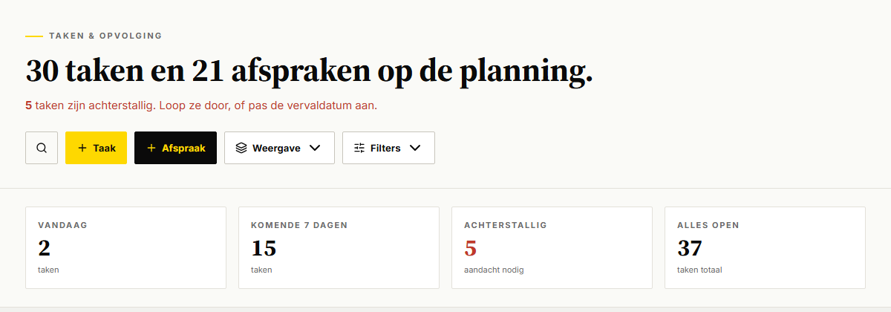

## Typografische schaal en rollen

### Wat het is

Een vaste set rollen met elk één klasse. Koppen en cijfers in serif 700, al het andere in Inter. De ondergrens is 11 px (`--fs-label`): kleiner mag niet, compact maak je met letterafstand.

### Schaal en rollen

| Rol | Klasse | Maat en gewicht | Kleur en afstand |
|---|---|---|---|
| Kicker | .kicker | Inter 11 px 700, kapitalen | --muted, 0,08em |
| Kicker met streep | .kicker--streep | idem, gele streep 24 bij 2 px | 0,2em, 8 px tussenruimte |
| Paginatitel | .title | serif 32 px 700, regel 1,15 | --ink, marge 4 px boven |
| Grote paginatitel | .title--groot | serif clamp(28px, 4vw, 44px), regel 1,1 | -0,01em, marge 12 px |
| Kleine paginatitel | .title--klein | serif 28 px | agenda, campagnedetail |
| Subtitel | .subtitle | Inter 14 px, regel 1,6 | --ink-soft, max 620 px, marge 8 px |
| Subtitel bij grote titel | .subtitle--groot | Inter 15 px, regel 1,55 | --muted, marge 0 |
| Sectiekop | .sec-title | serif clamp(28px, 3.4vw, 40px), regel 1,1 | -0,01em |
| Ondertitel sectie | .sec-sub | Inter 13 px, regel 1,55 | --ink-soft, max 560 px |
| Bloktitel | .kop-blok | serif 22 px 700, regel 1,2 | --ink |
| Kaarttitel | .kop-kaart | serif 18 px 700, regel 1,25 | -0,005em |
| Kleine kop | .kop-klein | serif 16 px 700 | --ink |
| Broodtekst | .tekst | Inter 13 px, regel 1,55 | --ink-soft |
| Leestekst | .tekst--lees | Inter 14 px, regel 1,6 | --ink-soft |
| Meta | .meta | Inter 12 px, regel 1,5 | --muted |
| Label | .label | Inter 11 px 700, kapitalen | --muted, 0,08em |
| Cijfer | .cijfer | serif 22 px 700, tnum | --ink |
| Groot cijfer | .cijfer--groot | serif 32 px 700, tnum | --ink |
| Mono | .mono | mono 12 px 600, tnum | erft |

### Waarom deze keuzes

- **Twee paginakoppen.** DealDrive heeft twee vormen die elk veel voorkomen. Instellingen-, analyse- en detailpagina's: kicker zonder streep (0,08em, 34 regels) en titel 32 px (27 pagina's). Werkpagina's in de navigatie (Taken, Pipeline, Inzichten, Bezoeken, Briefings, Campagnes): kicker met gele streep (0,2em, 25 regels plus 9 keer `.sec-eyebrow`) en titel clamp(28px, 4vw, 44px) of clamp(28px, 4vw, 40px) (19 pagina's). De 44-variant is hier gekozen omdat /taken hem gebruikt en hij gemeten is; de 40-variant (pipeline, offertes, team) is een uitzondering.
- **Broodtekst 13 px in --ink-soft**: de meest voorkomende combinatie in kaarten en lijsten (29 plus 23 regels); in --ink 32 regels. Voor nadruk `.tekst--inkt`.
- **Labels**: 11 px 700 kapitalen met 0,06em tot 0,12em in honderden regels. 0,08em is het midden en gelijk aan de kicker.
- **Gewichten**: 700 (1564 keer), 600 (402), 800 (371). 400 en 500 zijn zeldzaam.
- **Cijfers** altijd met tabellaire cijfers: `.tnum` staat 738 keer op een element.

### HTML

```html
<span class="kicker kicker--streep">Taken en opvolging</span>
<h1 class="title title--groot">30 taken en 21 afspraken op de planning.</h1>
<p class="subtitle subtitle--groot">Geen achterstallige taken. Netjes gehouden.</p>
```

### Toestanden

| Toestand | Klasse | Effect |
|---|---|---|
| Alert in subtitel | .subtitle--alert | tekst en strong in --red |
| Alert in kicker | .kicker--alert | --red |
| Cijfer negatief of urgent | .cijfer--alert | --red |
| Cijfer positief | .cijfer--positief | --green |

### Waar in DealDrive

`.kicker` in 62 bestanden, `.title` in 52, `.subtitle` in 51, `.sec-title` in 11, `.block-title` in 10. Bijvoorbeeld `pages/taken.vue`, `pages/instellingen/werkwijze.vue`, `pages/klanten/index.vue`.

## Links

### Wat het is

Een kale `a` heeft geen stijl: kleur erft en er is geen onderstreping (Tailwind-preflight plus tokens.css). Elke link krijgt daarom een klasse die zegt wat voor link het is.

### Wanneer

- In lopende tekst: `.inline-link`.
- Naam in een tabel of lijst: `.tabel-link` (de hele rij is vaak al klikbaar; de link valt pas op bij hover).
- Terug naar een bovenliggende pagina boven de kicker: `.breadcrumb-link` in `nav.breadcrumb`.
- Terug in een metaregel onder een lijsttitel: `.back-link`.
- Naar een volledige lijst vanuit een sectiekop: `.sec-link`.
- Niet: een link die een actie uitvoert (opslaan, openen van een flyout). Dat is een knop, zie deel B.

### Varianten en toestanden

| Klasse | Rust | Hover | Gebruik in DealDrive |
|---|---|---|---|
| .inline-link | --ink 600, 1 px geel eronder | tekst --yellow-dark | 7 keer, plus .tekst-link 3 keer |
| .tabel-link | --ink 600, geen streep | 1 px gele streep | 4 keer |
| .breadcrumb-link | 12 px 700 kapitalen 0,04em, --muted | --ink | 28 keer |
| .back-link | --ink 700 | --yellow-dark | 8 keer |
| .sec-link | zwart vlak, geel 12 px kapitalen, 44 px | vlak --ink-soft | 7 keer |
| .subtitle-link | onderstreept, 4 px afstand | ongewijzigd | 2 keer |

Focus: 2 px inkt met 2 px afstand (globale focusring). Uitgeschakeld (`aria-disabled="true"`): `--muted-light`, geen streep, niet klikbaar. Overgang 120 ms.

### Extern

Zelfde klasse als intern, met de pijl ↗ achter het label in een `span.link-extern` met `aria-hidden="true"`, en altijd `target="_blank" rel="noopener noreferrer"` (33 keer in DealDrive, steeds met noopener). Voorbeelden van teksten: "LinkedIn ↗", "Deelnemen ↗", "Open meeting-link ↗", "Bekijk de preview ↗". Eén plek gebruikt een Lucide-icoon ExternalLink (DocumentDetailFlyout); de pijl is de standaard.

### HTML

```html
<p class="tekst">Lees de <a class="inline-link" href="/briefings/12">briefing van Bouwgroep Lek</a>.</p>
<nav class="breadcrumb" aria-label="Kruimelpad">
  <a class="breadcrumb-link" href="/mijn-instellingen">← Mijn instellingen</a>
</nav>
<span class="meta"><a class="back-link" href="/klanten">← Klanten</a> · 128 klanten totaal</span>
<a class="inline-link" href="https://linkedin.com/in/henkdevries" target="_blank" rel="noopener noreferrer">LinkedIn<span class="link-extern" aria-hidden="true">↗</span></a>
```

### Teksten

Kruimelpad en terug-link beginnen met "← " gevolgd door de naam van de bestemming ("← Mijn instellingen", "← Klanten", "← Alle klanten"); alleen waar de bestemming niet te noemen is "← Terug". Een sectielink eindigt op " →" ("Alle klanten →").

### Navigatielinks

De links in de zijbalk staan bij het onderdeel Zijbalk.

### Waar in DealDrive

158 regels met een klasse op `-link` in 105 bestanden, onder meer `pages/klanten/index.vue` (.sec-link), `pages/klanten/alle.vue` (.back-link), alle instellingenpagina's (.breadcrumb-link), `components/EditableField.vue` (extern met ↗).

## Iconen

### Wat het is

Lucide (`lucide-vue-next` 0.577, in 104 bestanden). Elk icoon is een svg van 24 bij 24 met `stroke="currentColor"`, lijndikte 2, ronde uiteinden en geen vulling. De kleur volgt dus de tekst eromheen.

### Maten

| Klasse | Maat | Gebruik | Aantal in DealDrive |
|---|---|---|---|
| .icoon--12 | 12 px | in pillen en kleine labels | 19 (:size 12) |
| .icoon--14 | 14 px | naast 12 tot 13 px tekst, pijl in een knop | 20 (:size 14) |
| .icoon | 16 px | standaard naast tekst en in knoppen | 183 (w-4 h-4) |
| .icoon--18 | 18 px | navigatie in de zijbalk | 27 gemeten |
| .icoon--20 | 20 px | los icoon, icoonknop | 18 (:size 20) |
| .icoon--groot | 56 px, lijn 1,5 | lege staat, illustratie | 3 |

### Regels

- Lijndikte 2 (72 keer expliciet, en de standaard van Lucide). Alleen grote illustratieve iconen 1,5 tot 1,75.
- Een icoon naast tekst krijgt `aria-hidden="true"`. Een knop met alleen een icoon krijgt een `aria-label` en een `title` met hetzelfde woord.
- Gedempte iconen (naast meta) met `.icoon--gedempt` (--muted).
- **Let op:** DealDrive schrijft 41 keer `w-3.5 h-3.5`, maar die klasse bestaat niet in de vergrendelde Tailwind-schaal. Gemeten: zulke iconen worden 24 px (bijvoorbeeld de pijl in het gebruikersblok en in de weergaveknop). Bedoeld is 14 px; Dealtrace gebruikt `.icoon--14`.

### HTML

```html
<svg class="icoon" viewBox="0 0 24 24" fill="none" stroke="currentColor" stroke-width="2"
     stroke-linecap="round" stroke-linejoin="round" aria-hidden="true">
  <circle cx="11" cy="11" r="8"/><path d="m21 21-4.3-4.3"/>
</svg>
```

### Iconen per onderdeel in de schil

| Plek | Lucide-icoon |
|---|---|
| Inklappen en uitklappen | PanelLeftClose, PanelLeftOpen |
| Zoeken | Search |
| Notificaties | Bell |
| Gebruikersmenu | UserCog, LifeBuoy, BookOpen, BookMarked, Map, LogOut, ChevronUp |
| Navigatie | Home, Calendar, Inbox, BarChart3, CheckSquare, ClipboardList, MapPin, Video, PhoneCall, CalendarRange, ClipboardCheck, Megaphone, GitBranch, FileText, Briefcase, Users, Contact, Radar, FileBarChart, Settings |

### Waar in DealDrive

`AppSidebar.vue`, `composables/useNavigatie.ts`, `AdminShell.vue` en alle componenten met een import uit `lucide-vue-next`.

## Afstanden

### Wat het is

Eén schaal voor de hele app, vastgelegd in tokens.css (audit van 18 september 2026): 24 px buitenmarge, 16 px tussen kaarten, 16 px binnen een kaart, 32 px boven en onder een sectie.

### Waarden

| Token of stap | Waarde | Gebruik |
|---|---|---|
| --pagina-marge | 24 px | zijmarge van de container, padding van een venster, statstrook boven en onder |
| --sectie-padding | 32 px | boven en onder een sectie |
| --kaart-gap | 16 px | tussen kaarten in een raster |
| --kaart-padding | 16 px | binnen een kaart of statkaart |
| Tussenruimte binnen componenten | 8 px (442), 6 px (327), 12 px (244), 10 px (202), 4 px (124) | gap in flex-rijen |
| Tailwind-schaal | 4, 8, 12, 16, 20, 24, 28, 32, 36, 40, 48, 56, 64, 80, 96 | spacing in tailwind.config.ts |

### Regels

- Buitenmarge altijd 24 px, ook op mobiel (gemeten op 390 px). Zes analysepagina's gaan onder 860 px naar 16 px; dat is een uitzondering.
- Knoppen in een rij: 8 px tussenruimte (zie deel B).
- Geen losse pixels buiten de schaal; DealDrive weert ze via de Tailwind-schaal.

## Randen en hoeken

### Wat het is

Diepte komt van randen, niet van schaduw. Hoeken zijn 2 px.

### Waarden

| Element | Rand | Hoek |
|---|---|---|
| Kaart, statkaart, menu | 1 px --border (402 keer) | 2 px |
| Knop, veld, keuzelijst | 1 px --border-strong (476 keer) | 2 px |
| Scheiding onder een sectie of rij | 1 px --border onderaan (293 keer) | geen |
| Nadruk, actief | 1 px --ink (63 keer) of 2 px --ink onderaan (40 keer) | 2 px |
| Kleurstreep links op een kaart | 3 px in de semantische kleur | 2 px |
| Leeg vlak, sleepdoel | 1 px gestippeld --border-strong (30 keer) | 2 px |

### Regels van stylelint

- `border-radius`: nooit 5 px of meer, nooit 9999, nooit 50%. Praktijk: 742 keer 2px, 186 keer var(--radius). Tailwind kent alleen `rounded-sm` (2 px) en `rounded` (4 px).
- `box-shadow`: verboden, in elke vorm.
- Randkleur alleen via `var()`, `transparent`, `currentColor`, `#fff` of `rgba()`. In Dealtrace altijd via `var()`: ook wit is een token (`--wit`).
- Avatars en stippen zijn vierkant met 2 px hoek, geen cirkels. Het enige ronde element is het merklogo (svg).

## Z-index-lagen

### Wat het is

Een vaste volgorde van lagen zodat zijbalk, flyouts, menu's en meldingen elkaar nooit verkeerd overlappen.

### Lagen

| Token | Waarde | Wat erop staat |
|---|---|---|
| --z-base | 1 | element boven zijn buren in een blok |
| --z-sticky | 10 | plakkende filterstrook (.section--filter), tabelkoppen |
| --z-fixed | 20 | OfflineBanner |
| --z-overlay | 30 | zijbalk (letterlijk 30 in AppSidebar), notificatiepaneel |
| --z-modal | 40 | flyouts, vensters, contextmenu, gebruikersmenu |
| --z-modal-boven | 45 | flyout die op een andere flyout opent |
| --z-toast | 50 | bevestigingsvenster, globale zoek, installatiemelding |
| --z-melding | 100 | toasts, boven alles (aanvulling) |

### Uitzonderingen in DealDrive

- ToastContainer staat op letterlijk 100, boven alles. In Dealtrace is dat het token `--z-melding`.
- Zes lokale vensters op pagina's (pipelines, automatisering, bezoek-analyse, MatrixAnalyse, DexKaart, DexNieuw) gebruiken 60.
- Plakkende koppen binnen een flyout gebruiken 5.

Gebruik in Dealtrace alleen de tokens; de uitzonderingen staan hier om te begrijpen wat je in DealDrive ziet.

## Overgangen en animatie

### Wat het is

Korte, rustige overgangen met `ease-out`. Geen stuiters; de enige uitzondering is het bevestigingsvenster, dat licht opveert (`--curve-opveer`).

### Duur

| Token | Duur | Gebruik | Aantal |
|---|---|---|---|
| --transition-fast | 120 ms ease-out | hover op kleur, rand, achtergrond | 232 plus 44 keer letterlijk |
| --duur-kort | 150 ms | hover op een statkaart, pil of rij, draaien van een pijl | 74 |
| --duur-vervaag | 160 ms | vervagen binnen een uitklapper, in- en uitklappen van de zijbalk | 20 |
| --duur-uit | 180 ms | sluiten en uitvagen van overlay en venster | 19 |
| --transition-base | 200 ms ease-out | transform, opacity, breedte | 64 |
| --duur-in | 220 ms | openen van flyout, venster en toast, uitklappen van de filterstrook | 35 |
| --transition-slow | 500 ms ease-out | voortgang | 2 |
| --duur-lang | 600 ms | ring van de scorecirkel, trechterbalk | 4 |
| --curve-opveer | cubic-bezier(0.18, 0.89, 0.32, 1.28) | bevestigingsvenster springt op | 1 |

De `--duur-*`-tokens zijn alleen een tijd; schrijf de curve erbij: `transition: opacity var(--duur-in) ease-out`.

### Animaties in de schil

- LIVE-stip in de zijbalk: knippert in 1,4 s (opacity 1 naar 0,35), stopt bij OFFLINE.
- Gebruikersmenu: verschijnt in 120 ms vanuit 4 px lager met opacity 0.
- Statkaart bij hover: 1 px omhoog in 150 ms (`--duur-kort`).

### Minder beweging

`@media (prefers-reduced-motion: reduce)` zet alle animatie- en overgangsduren op 0,01 ms en `scroll-behavior` op auto (tokens.css, globaal). Vier componenten zetten daarnaast hun eigen animatie op `none`.

## Breekpunten

### Wat het is

DealDrive schrijft breekpunten letterlijk in media queries; de tokens `--bp-mobile` en `--bp-tablet` zijn er alleen voor JavaScript (`useViewport` via `matchMedia`).

### Breekpunten

| Grens | Query | Wat verandert |
|---|---|---|
| Mobiel | max-width 767px | zijbalk vast als icoonstrook van 64 px; body krijgt ruimte onderaan |
| Tablet | max-width 1023px | alleen in JavaScript (useViewport) |
| Twee kolommen | min-width 700px en 720px | statkaarten naar 4 kolommen (700), rasters naar 2 kolommen (720) |
| Drie of meer | min-width 900px en 1000px | rasters naar 3 kolommen, statstrook naar 6 |
| Smal telefoon | max-width 560px | componentniveau, bijvoorbeeld kaarten onder elkaar |

### Andere media queries

- `(hover: none)`: bediening die normaal pas bij hover verschijnt, is altijd zichtbaar (4 bestanden; `.hover-doel`).
- `(max-width: 767px), (hover: none) and (pointer: coarse)`: de toetsaanduiding in de globale zoek verdwijnt.
- `print`: zie deel C.

### Regel

Tailwind-schermen zijn hernoemd (sm 700, md 800, lg 900, xl 1000, 2xl 1100, 3xl 1180) maar worden in templates nauwelijks gebruikt; de componenten schrijven hun eigen query. Dealtrace houdt de getallen uit de tabel aan.

## Reset en basis

### Wat het is

De basis onder elk element: box-sizing, marges op nul, lettertype en kleur van de pagina. DealDrive krijgt dit van twee bronnen: de basisregels in tokens.css en de Tailwind-preflight via `@nuxtjs/tailwindcss`. Dealtrace heeft geen Tailwind nodig; de preflight staat daarom uitgeschreven in groep 3 van het stijlbestand.

### Wat de basis doet

| Element | Regel | Bron |
|---|---|---|
| alles | box-sizing border-box, rand 0 solid currentColor | tokens.css en preflight |
| html | regelhoogte 1,5, smooth scroll, text-size-adjust 100% | preflight en tokens.css |
| body | --bg, --ink, Inter 16 px, regel 1,6, antialiased, padding op de veilige zones | tokens.css |
| h1 tot h6, p, figure | marge 0; koppen erven corps en gewicht | preflight |
| ul, ol | geen opsommingsteken, geen marge | preflight |
| a | kleur erft, geen onderstreping | tokens.css |
| img, svg | display block | preflight en tokens.css |
| button, input, select | lettertype, corps en kleur erven; knop transparant | preflight |
| placeholder | --muted-light | zie hieronder |
| code, kbd | --font-mono | preflight |

### Gemeten bijzonderheden

- Placeholder in DealDrive is #9ca3af: de standaard van de preflight, geen token. tokens.css wijst `--muted-light` (#a0a0a0) aan voor placeholders; Dealtrace gebruikt die, het verschil is niet te zien.
- Knoppen hebben in DealDrive `cursor: pointer` via de preflight; uitgeschakelde elementen `cursor: default`.
- `body[data-mobile-shell='on']` krijgt onder 768 px ruimte onderaan van `--bottom-nav-h` plus de veilige zone; omdat de onderbalk weg is, is dat alleen de veilige zone.
- Handschoenmodus: `html[data-glove-mode='on']` zet beide aanraakdoelen op 54 px.

### Hulpklassen

| Klasse | Doet |
|---|---|
| .tnum, time, .num | tabellaire cijfers |
| .afkap | één regel met puntjes; zet de volle tekst in title |
| .breekbaar | lange woorden en URL's breken |
| .visueel-verborgen | alleen voor schermlezers |
| .hover-bron en .hover-doel | bediening die bij hover verschijnt, op aanraakschermen altijd |
| .op-donker | zwarte ondergrond met witte tekst en gele focusring |
| .scrollvak | scrollvak met smalle balk (zie Scrollbalken) |
| .staal | kleurvlak voor legenda en documentatie |

## Focusring

### Wat het is

De zichtbare rand om het element dat toetsenbordfocus heeft.

### Regels

| Waar | Ring | Bron in DealDrive |
|---|---|---|
| Knoppen, links, kaarten op licht | 2 px massief --ink, 2 px afstand | 21 van 36 :focus-visible-regels |
| Velden (input, select, textarea) | 2 px --yellow, -1 px afstand (binnen de rand), rand --ink | 37 :focus-regels |
| Op donker (zijbalk, .op-donker) | 2 px --yellow | 7 regels |

### Waarom

DealDrive heeft geen globale focusregel: 24 bestanden zetten er zelf een. Elementen zonder eigen regel tonen de ring van de browser (gemeten: `outline: auto`, bijvoorbeeld op de knoppen in de paginakop en de statkaarten). Dealtrace maakt de meest gebruikte regel globaal, zodat elk element dezelfde ring heeft. De voorganger gebruikte geel voor alles; dat is gecorrigeerd naar inkt op licht, omdat geel op warm wit te weinig contrast heeft en DealDrive het zo meestal doet.

### Gedrag

- Alleen bij toetsenbordfocus (`:focus-visible`), niet bij een muisklik.
- Gebruik nooit `outline: none` zonder vervanging. DealDrive doet dat 18 keer, steeds met een gekleurde rand als vervanging.
- In het voorbeeld toont `.is-focus` dezelfde ring.

## Selectie

DealDrive definieert geen `::selection`; tekstselectie heeft de standaardkleur van de browser (gemeten: geen eigen achtergrond). Dealtrace houdt dat zo en definieert hem ook niet. Geel als selectiekleur zou botsen met de gele markering van actieve items.

## Scrollbalken

### Wat het is

De pagina gebruikt de scrollbalk van de browser. Twee vaste patronen voor scrollvakken binnen een scherm.

### Varianten

| Plek | Breedte | Duim | Baan |
|---|---|---|---|
| Lange flyout-inhoud (.scrollvak) | 10 px | --border-strong, hover --muted, 2 px rand in baankleur | --surface |
| Navigatie in de zijbalk (.sb-nav) | 8 px | wit op 22 procent, hover 40 procent | transparant |

Firefox: `scrollbar-width: thin` met `scrollbar-color` in dezelfde kleuren. Een los scrollvak buiten een flyout krijgt een vaste hoogte met `.scrollvak--beperkt` (160 px).

### Waar in DealDrive

`TaakFlyout.vue` (.tk-body), `InzichtFlyout.vue` (.iz-body), `AppSidebar.vue` (.sb-nav). De overige flyouts gebruiken de standaardbalk; deel C beschrijft hun scrollgedrag.

## Zijbalk

### Wat het is

De vaste zwarte navigatiebalk links op elke pagina van de werkplek (AppSidebar). Hij bevat het merk, de verbindingsstatus, de zoek-ingang, de hoofdnavigatie in groepen, de notificaties en het gebruikersblok met menu.

### Wanneer

- Op elke ingelogde pagina van de werkplek. Niet op login, signup, wachtwoord instellen en SSO afronden: die hebben een eigen kop zonder navigatie.
- HQ heeft een eigen variant (zie Zijbalk HQ).

### Opbouw

```html
<div class="app-shell">
  <aside class="app-sidebar" aria-label="Hoofdmenu">
    <div class="sb-merk">
      <a class="sb-merk-link" href="/">
        <svg class="sb-merk-icoon" viewBox="0 0 32 32" aria-hidden="true">
          <circle class="merk-geel" cx="16" cy="16" r="14"/>
          <circle class="merk-inkt" cx="16" cy="16" r="8"/>
          <circle class="merk-geel" cx="16" cy="16" r="3"/>
        </svg>
        <span class="sb-merk-naam">Dealtrace</span>
      </a>
      <button class="sb-inklap" type="button" aria-label="Zijbalk inklappen" title="Zijbalk inklappen">..</button>
    </div>
    <div class="sb-meta">
      <span class="sb-live"><span class="sb-live-stip"></span><span class="sb-live-tekst">LIVE</span></span>
      <span class="sb-datum tnum">14 okt</span>
    </div>
    <div class="sb-zoek-vak">
      <button class="sb-zoek" type="button" aria-label="Zoeken">
        <svg class="sb-link-icoon">..</svg><span class="sb-zoek-tekst">Zoeken</span><kbd class="sb-kbd">Ctrl K</kbd>
      </button>
    </div>
    <nav class="sb-nav" aria-label="Hoofdnavigatie">
      <div class="sb-groep">
        <div class="sb-groep-kop">Start</div>
        <div class="sb-scheiding"></div>
        <a class="sb-link sb-link--actief" href="/" aria-current="page">
          <svg class="sb-link-icoon">..</svg><span class="sb-link-tekst">Vandaag</span>
        </a>
      </div>
    </nav>
    <div class="sb-voet">
      <button class="sb-bel" type="button">
        <span class="sb-bel-icoon"><svg class="icoon">..</svg><span class="sb-bel-teller tnum">6</span></span>
        <span class="sb-bel-tekst">Notificaties</span>
      </button>
      <div class="sb-gebruiker">
        <button class="sb-gebruiker-knop" type="button" aria-expanded="false">
          <span class="sb-avatar">SB</span>
          <span class="sb-gebruiker-info"><span class="sb-gebruiker-naam">Sanne de Boer</span><span class="sb-gebruiker-rol">Accountmanager</span></span>
          <svg class="sb-gebruiker-pijl">..</svg>
        </button>
        <div class="sb-menu" role="menu">..</div>
      </div>
    </div>
  </aside>
  <main class="app-shell-main">..</main>
</div>
```

De klassenamen zijn die van de voorganger en de Dealtrace-mock-ups. In DealDrive heten ze anders: sb-merk is `.sb-brand`, sb-inklap `.sb-collapse`, sb-groep-kop `.sb-nav-section`, sb-scheiding `.sb-nav-divider`, sb-link `.sb-nav-item`, sb-voet `.sb-bottom`, sb-bel `.sb-bell-row`, sb-gebruiker `.sb-user`, sb-menu `.sb-dropdown`. De voorganger had een geel vierkantje als merk (`.sb-merk-stip`); DealDrive gebruikt het gele cirkellogo uit MerkLogo.vue, en dat is hier overgenomen.

### Maten en kleuren (gemeten)

| Onderdeel | Maat | Tekst | Kleur |
|---|---|---|---|
| Zijbalk | 240 px, ingeklapt 64 px | erft 16 px | --ink, tekst wit 85 procent |
| Merkstrook | 56 px hoog, padding 14 12 12 | logo 28 px, naam serif 18 px 700 | naam --yellow, lijn wit 8 procent |
| Inklapknop | 28 bij 28 px | icoon 16 px | rand wit 16 procent, hover geel |
| LIVE-strook | 31 px, padding 6 14 | 11 px 700, 0,12em | --yellow; OFFLINE wit 55 procent |
| Zoekknop | 40 px, padding 8 10 | 13 px 600 | rand wit 16 procent; hover 32 procent |
| Groepskop | 28 px, padding 8 10 2 | 11 px 700 kapitalen 0,18em | wit 55 procent |
| Navigatie-item | 33 px, padding 6 10 | 13 px 600, icoon 18 px | wit 78 procent |
| Actief item | idem, streep 3 px links | idem | --yellow op --yellow-actief |
| Notificaties | padding 8 10 | 13 px 600 | teller --red, 16 px hoog |
| Avatar | 30 bij 30 px | 12 px 800 initialen | --yellow vlak, --ink tekst |
| Naam en rol | | 12 px 700 en 11 px kapitalen | wit en wit 55 procent |
| Gebruikersmenu | 208 px breed, items 39 px | 13 px 500 | wit vlak, rand --border |

### Toestanden

| Toestand | Klasse | Effect |
|---|---|---|
| Hover op item | :hover, .is-hover | vlak wit 6 procent, tekst wit |
| Actief item | .sb-link--actief, aria-current="page" | --yellow-actief, tekst geel, gele streep links |
| Focus | :focus-visible, .is-focus | 2 px gele ring |
| Uitgeschakeld item | aria-disabled="true" | wit 35 procent, niet klikbaar |
| Offline | .sb-live--offline | OFFLINE in wit 55 procent, stip stil |
| Menu open | .sb-gebruiker--open | knop krijgt vlak en rand, pijl omhoog |
| Op een menupagina | .sb-gebruiker--actief | blok --yellow-actief, naam geel |
| Ingeklapt | .app-sidebar--ingeklapt | alleen iconen, groepskop wordt een streep |

### Gedrag

1. **Inklappen**: de knop rechts van het merk wisselt tussen "Zijbalk inklappen" en "Zijbalk uitklappen" (title en aria-label). De breedte animeert in 160 ms (`--duur-vervaag`); het hoofdvlak schuift mee via `--sidebar-w`. De keuze staat in de cookie `dealdrive_sidebar_collapsed` en blijft over pagina's heen.
2. **Ingeklapt**: merk en knop staan onder elkaar, alle labels verdwijnen, elk item krijgt zijn naam in `title`. Het gebruikersmenu opent rechts van de strook (220 px breed).
3. **Actief item**: een item is actief als het pad gelijk is of eronder valt (`/klanten/12` maakt Klanten actief); Vandaag (`/`) alleen op exact `/`.
4. **Scrollen**: 25 items passen niet op 900 px hoogte. De lijst scrollt met een dunne balk en een vervaging van 28 px onderaan laat zien dat er meer staat.
5. **Zoeken**: de zoekknop en Ctrl K (Cmd K op Mac) openen de globale zoek (deel C).
6. **Notificaties**: de rij gaat naar /notificaties; de rode teller toont het aantal ongelezen.
7. **Gebruikersmenu**: opent naar boven bij klik. Sluit bij klik buiten het menu, bij Escape (de focus gaat terug naar de knop) en 250 ms nadat de muis het blok verlaat; terugkeren binnen die tijd houdt het open.
8. **LIVE**: volgt de verbinding (dezelfde bron als de OfflineBanner), zodat strook en banner nooit tegenspreken.

### Teksten

- Merk: "DealDrive" (in Dealtrace de productnaam), nooit de naam van de klantorganisatie.
- "LIVE" of "OFFLINE", datum als "14 okt".
- "Zoeken", toets "Ctrl K".
- Groepen: "Start", "Activiteiten", "Accounts", "Rapportages", "Manager", "Beheer".
- "Notificaties".
- Menu: "Mijn instellingen", "Helpcenter", "Kennisbank", "Playbooks", "Roadmap", scheiding, "Uitloggen" (rood).
- Rol onder de naam in kapitalen, bijvoorbeeld "ACCOUNTMANAGER", "FOUNDER".

### Waar in DealDrive

`app/components/AppSidebar.vue`, `app/components/MerkLogo.vue`, `app/composables/useNavigatie.ts`, `app/composables/useSidebarCollapse.ts`, `.app-shell` in `app/app.vue`.

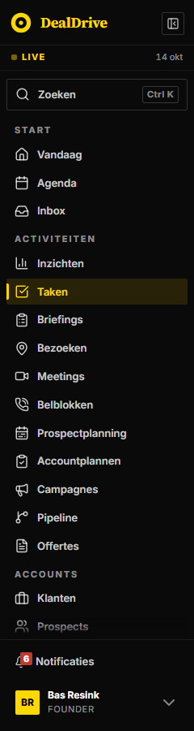

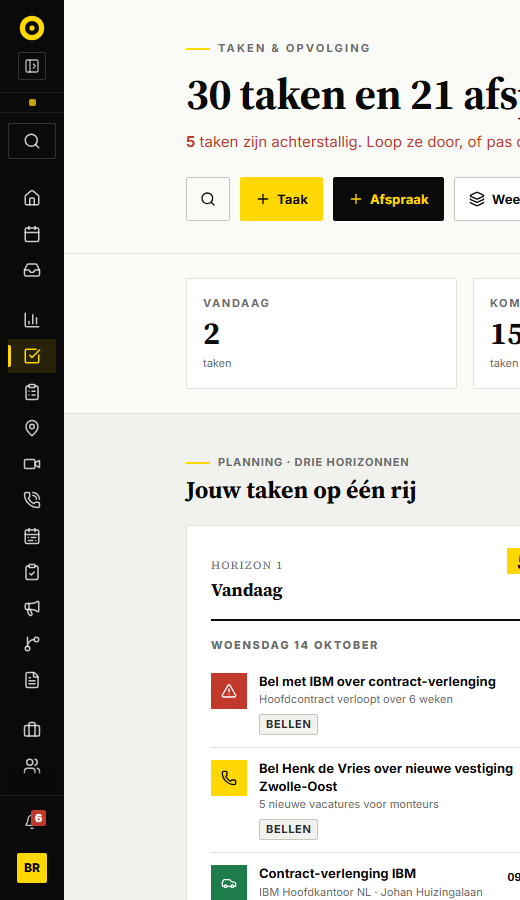

## Zijbalk HQ

### Wat het is

De zijbalk van de founder-console (AdminShell). Zelfde gebaar als de werkplek, zodat je niet twee manieren van navigeren hoeft te leren, maar met eigen maten en een gele rand.

### Wanneer

Alleen in een beheeromgeving voor de eigenaar van het product (in Dealtrace: een eventuele HQ). Niet in de werkplek van de verkoper.

### Opbouw

```html
<div class="app-shell app-shell--hq">
  <aside class="app-sidebar app-sidebar--hq" aria-label="Founder-navigatie">
    <div class="sb-merk">
      <a class="sb-merk-link" href="/admin"><span class="sb-merk-teken">DD</span><span class="sb-merk-tekst">DealDrive <strong>HQ</strong></span></a>
      <button class="sb-inklap" type="button" aria-label="Menu inklappen" aria-expanded="true">..</button>
    </div>
    <nav class="sb-nav" aria-label="Founder-navigatie">
      <div class="sb-groep"><p class="sb-groep-kop">Portfolio</p>
        <a class="sb-link sb-link--actief" href="/admin">.. Klanten <span class="sb-link-teller">2</span></a>
      </div>
    </nav>
    <div class="sb-voet">..gebruiker.. <button class="sb-link">.. Uitloggen</button></div>
  </aside>
  <main class="app-shell-main">..</main>
</div>
```

### Verschillen met de werkplek

| Onderdeel | Werkplek | HQ |
|---|---|---|
| Breedte | 240 px, ingeklapt 64 px | 210 px, ingeklapt 60 px |
| Rand rechts | geen | 3 px --yellow |
| Merk | geel cirkellogo en naam in serif | geel vierkant "DD" 28 px en "DealDrive HQ" 13 px |
| Item | 13 px 600, 33 px hoog, hoek 2 px | 12 px 700, 0,03em, minimaal 44 px, geen hoek |
| Groepskop | 700, 0,18em, wit 55 procent | 800, 0,14em, wit 38 procent |
| Teller op item | rood op de bel | geel vlak met zwart getal op Klanten |
| Inhoud | --bg | --surface |

### Gedrag

- Inklappen met "Menu inklappen" en "Menu uitklappen"; aria-expanded volgt.
- Ingeklapt blijft de teller staan als getal op het icoon.
- Uitloggen toont tijdens het uitloggen "Bezig…" en is dan uitgeschakeld (opacity 0,6).
- Op smal scherm vast op de icoonstrook zonder inklapknop. DealDrive doet dat tot en met 720 px; Dealtrace gebruikt voor beide zijbalken 767 px, zodat er één mobiele regel is.

### Teksten

Groepen "Portfolio", "Geld", "AI", "Bouwen"; items "Klanten", "Abonnementen", "Facturen", "LLM-connector", "Agent-prompts", "Roadmap"; rol "Founder"; "Uitloggen".

### Waar in DealDrive

`app/components/AdminShell.vue`.

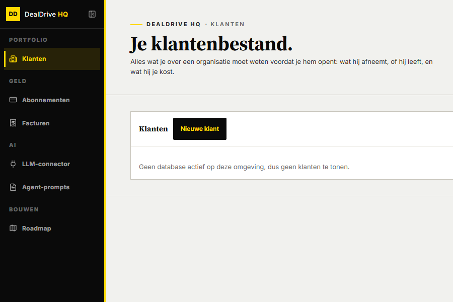

## Paginakop

### Wat het is

De kop bovenaan elke pagina: eventueel een kruimelpad, een kicker, de titel, een subtitel, en rechts de knoppen van de pagina. Altijd in een eigen sectie met een lijn eronder.

### Wanneer

- **Werkpagina** (een lijst of bord uit de navigatie, zoals Taken, Pipeline, Prospects, Campagnes): kicker met streep, `.title--groot`, `.subtitle--groot`, knoppen rechts.
- **Instellingen-, analyse- en detailpagina**: kruimelpad terug, kicker zonder streep, `.title` (32 px), `.subtitle`.
- Niet voor een sectie halverwege de pagina: daar gebruik je `.sec-title` met `.kicker--streep`.

### Opbouw

```html
<section class="section">
  <div class="container">
    <div class="sec-head">
      <div>
        <span class="kicker kicker--streep">Taken en opvolging</span>
        <h1 class="title title--groot">30 taken en 21 afspraken op de planning.</h1>
        <p class="subtitle subtitle--groot">Geen achterstallige taken. Netjes gehouden.</p>
      </div>
      <div class="toolbar-buttons">
        <button class="dd-actie dd-actie--taak" type="button">+ Taak</button>
        <button class="dd-actie dd-actie--afspraak" type="button">+ Afspraak</button>
      </div>
    </div>
  </div>
</section>
```

### Maten (gemeten)

| Onderdeel | Werkpagina (/taken) | Instellingen (/instellingen/werkwijze) |
|---|---|---|
| Sectie | 32 px boven en onder, lijn --border | idem |
| Kruimelpad | geen | 12 px 700 kapitalen, 8 px eronder |
| Kicker | 11 px, 0,2em, streep 24 bij 2 px geel | 11 px, 0,08em |
| Titel | 44 px op 1440, 28 px op 390, marge 12 px | 32 px, marge 4 px boven |
| Subtitel | 15 px --muted, marge 0 | 14 px --ink-soft, max 620 px, marge 8 px |
| Knoppen | 44 px hoog, rechts onderaan uitgelijnd | meestal geen |

### Opbouw van de kop

- `.sec-head` is flex met wrap, tekst links en knoppen rechts, onderaan uitgelijnd, 24 px tussenruimte (32 bestanden). 17 bestanden gebruiken een grid (1fr auto vanaf 720 px) met hetzelfde beeld; de voorganger had die grid, Dealtrace volgt de meerderheid.
- `.toolbar-buttons` houdt de knoppen bij elkaar met 8 px tussenruimte en loopt door op een nieuwe regel als het smal wordt. DealDrive noemt dit `.toolbar-buttons` (21 keer) en soms `.header-actions` (3); beide namen werken.
- Volgorde van de knoppen op /taken: zoeken (icoon), + Taak, + Afspraak, Weergave, Filters. De knoppen zelf staan in deel B.
- Op smal scherm vallen de knoppen onder de tekst.

### Kopniveau

DealDrive zet `.title` op een h2 (46 pagina's) en soms een h1 (5). Gebruik in Dealtrace één h1 per pagina met `.title`; de stijl hangt aan de klasse, niet aan het element.

### Toestanden

- Iets vraagt aandacht: `.subtitle--alert` maakt de subtitel rood, met het getal in strong ("5 taken zijn achterstallig. Loop ze door, of pas de vervaldatum aan.").
- Niets aan de hand: een korte geruststelling ("Geen achterstallige taken. Netjes gehouden.").
- De titel is een zin met de stand van zaken, niet alleen het woord van de pagina ("30 taken en 21 afspraken op de planning."). Instellingenpagina's gebruiken wel de naam ("Werkwijze").

### Sectiekop met navigatielink

Een sectie verderop op de pagina gebruikt `.kicker--streep`, `.sec-title`, `.sec-sub` en rechts een `.sec-link` ("Alle klanten →").

### Waar in DealDrive

`.sec-head` in 49 bestanden, onder meer `pages/taken.vue`, `pages/pipeline.vue`, `pages/klanten/index.vue`, `pages/instellingen/*.vue`.


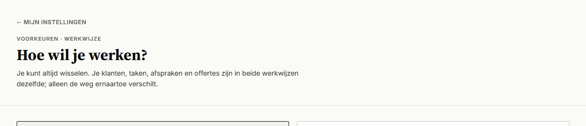

## Paginaraster, secties en containers

### Wat het is

Een pagina is een stapel volle-breedte secties. Elke sectie heeft één container van maximaal 1180 px met 24 px zijmarge. Binnen de container leggen rasters de kaarten neer.

### Opbouw

```html
<main class="app-shell-main">
  <section class="section">            paginakop </section>
  <section class="section section--stats"> statkaarten </section>
  <section class="section section--filter"> filterbalk (deel B) </section>
  <section class="section section--alt">
    <div class="container">
      <div class="raster raster--3"> kaarten (deel C) </div>
    </div>
  </section>
</main>
```

### Secties

| Klasse | Padding | Achtergrond en rand | Gebruik |
|---|---|---|---|
| .section | 32 px boven en onder | lijn --border onderaan | elke sectie (70 van 84 regels) |
| .section--alt | idem | --surface | afwisselend blok (46 bestanden) |
| .section--stats | 24 px boven en onder | lijn onderaan | strook met statkaarten |
| .section--filter | 16 px boven en onder | --bg, plakt bovenaan op --z-sticky | filterbalk (22 bestanden, 7 plakkend) |
| .section--lijst | 32 boven, 56 onder | geen lijn | lange lijst onderaan |
| .section--laatste | 32 px | geen lijn | laatste sectie |

### Containers

| Klasse | Breedte | Zijmarge |
|---|---|---|
| .container | --container-w, 1180 px | 24 px (79 van 86 regels) |
| .container--smal | --container-narrow, 920 px | 24 px |

Gemeten op 1440 breed: het hoofdvlak is 1200 px (1440 min 240 zijbalk), de container 1180 px gecentreerd, de inhoud 1132 px.

### Rasters

| Klasse | Smal | Vanaf 700 of 720 px | Vanaf 1000 px |
|---|---|---|---|
| .raster | 1 kolom | 1 kolom | 1 kolom |
| .raster--2 | 1 | 2 (720) | 2 |
| .raster--3 | 1 | 2 (720) | 3 |
| .raster--4 | 2 | 4 (700) | 4 |

Tussenruimte altijd `--kaart-gap` (16 px). In DealDrive komen `repeat(2, 1fr)` (32), `repeat(3, 1fr)` (30) en `repeat(4, 1fr)` (22) het meest voor.

### Waar in DealDrive

`.section` in 78 bestanden, `.container` in 80, `.section--alt` in 46, `.section--filter` in 22.

## Statkaarten

### Wat het is

Een rij cijferkaarten direct onder de paginakop. Elke kaart toont een label, een groot cijfer en een korte voet, en werkt als filter op de lijst eronder.

### Wanneer

- Op werkpagina's met een lijst die je op een paar emmers kunt filteren (Vandaag, Komende 7 dagen, Achterstallig, Alles open).
- Niet voor cijfers zonder filterfunctie op een detailpagina: gebruik daar de statstrook (`.stat-strip`) zonder kaarten.

### Opbouw

```html
<section class="section section--stats">
  <div class="container">
    <div class="stat-grid">
      <button class="stat-card" type="button" aria-pressed="false">
        <span class="stat-label">Vandaag</span>
        <span class="stat-num tnum">2</span>
        <span class="stat-foot">taken</span>
      </button>
      <button class="stat-card stat-card--alert stat-card--actief" type="button" aria-pressed="true">
        <span class="stat-label">Achterstallig</span>
        <span class="stat-num tnum">5</span>
        <span class="stat-foot">aandacht nodig</span>
      </button>
    </div>
  </div>
</section>
```

### Maten (gemeten op /taken)

| Onderdeel | Maat | Tekst | Kleur |
|---|---|---|---|
| Kaart | 271 bij 111 px, padding 16, tussenruimte 4 | | --wit, rand --border, hoek 2 px |
| Label | 18 px hoog | 11 px 700 kapitalen 0,15em | --muted |
| Cijfer | 34 px hoog | serif 32 px 700, regel 1,05, tnum | --ink |
| Voet | 18 px hoog | 11 px | --muted |
| Raster | 2 kolommen, 4 vanaf 700 px | | 16 px tussenruimte |

### Toestanden

| Toestand | Klasse | Effect |
|---|---|---|
| Hover | :hover, .is-hover | rand --ink, 1 px omhoog in 150 ms (--duur-kort) |
| Focus | :focus-visible, .is-focus | 2 px inkt-ring |
| Actief (filter aan) | .stat-card--actief, aria-pressed="true" | vlak --ink, label, cijfer en voet --yellow |
| Alert | .stat-card--alert | cijfer --red; actief weer geel |
| Laden | .stat-card--laden, aria-busy="true" | cijfer wordt een grijs vlak, voet --muted-light |
| Uitgeschakeld | disabled | opacity 0,5, geen hover |
| Soort | --urgent, --let-op, --positief, --accent, --info, --hot | streep van 3 px links in rood, oranje, groen, geel, blauw, paars |
| Zes kaarten | .stat-grid--6 | 6 kolommen vanaf 720 px (notificaties) |

### Gedrag

1. Klik op een kaart zet het filter op die emmer; de kaart wordt zwart. Nog een keer klikken of een andere kaart kiezen wisselt.
2. De lijst eronder volgt direct, zonder laadscherm.
3. Gebruik `aria-pressed` zodat een schermlezer weet welke kaart aan staat.

### Inconsistentie in DealDrive

Het cijfer is 24 px (pipeline, offertes), 26 px (notificaties), 32 px (taken) of 36 px (inzichten); de letterafstand van het label 0,08em tot 0,16em; de actieve kaart is meestal zwart met geel en op notificaties zwart met wit. Dealtrace volgt /taken: 32 px, 0,15em, zwart met geel. Taken is de pagina die het vaakst open staat en de enige met alle toestanden (actief, alert, actief plus alert). De voorganger gebruikte `--actief`; DealDrive `--active`; beide werken.

### Statstrook (detailpagina)

`.stat-strip` met `.stat-item`: 2 kolommen, 3 vanaf 700 px, 6 vanaf 1000 px. Label als hierboven, waarde serif 22 px (`.stat-value`) of tekst 14 px 600 (`.stat-value-tekst`), voet 11 px, met `.stat-foot--alert` in rood en vet. Gebruikt op de klant- en contactdetailpagina.

### Teksten

Labels in enkelvoud of als periode ("Vandaag", "Komende 7 dagen", "Achterstallig", "Alles open"); voet als eenheid of duiding ("taken", "aandacht nodig", "taken totaal").

### Waar in DealDrive

`pages/taken.vue`, `pages/inzichten.vue`, `pages/notificaties.vue`, `pages/pipeline.vue`, `pages/offertes.vue`; statstrook in `pages/accounts/[id]/index.vue` en `pages/contacten/[id]/index.vue`.

## Mobiele schil

### Wat het is

Wat er op een telefoon anders is. MobileShell wikkelt elke pagina met OfflineBanner, InstallPrompt, IOSInstallModal en PushSoftPrompt (deel C), zet `data-mobile-shell="on"` op body en haalt de offline gegevens op.

### Wat er verandert onder 768 px (gemeten op 390 bij 844)

| Onderdeel | Desktop | Mobiel |
|---|---|---|
| Zijbalk | 240 px of 64 px naar keuze | altijd de icoonstrook van 64 px |
| Hoofdvlak | padding links 240 px | 64 px |
| Container | 24 px zijmarge | 24 px zijmarge (blijft) |
| Paginatitel werkpagina | 44 px | 28 px |
| Knoppen in de kop | rechts naast de tekst | onder de tekst, doorlopend op meerdere regels |
| Statkaarten | 4 kolommen | 2 kolommen |
| Aanraakdoel | 44 px | 44 px, in handschoenmodus 54 px |

### Onderbalk

DealDrive had een menu onderin met vijf ingangen. Dat is vervallen: navigeren gaat via de icoonstrook, zodat alle pagina's bereikbaar blijven en niet alleen de vijf hoofdbestemmingen. `--bottom-nav-h` staat daarom op 0. De klasse `.onderbalk` van de voorganger is in Dealtrace uitgezet; gebruik hem niet in nieuwe schermen.

### Regels

- Elk klikbaar element minimaal `--touch-target-min` (44 px). Uitzondering in DealDrive: de navigatie-items in de zijbalk (33 px), bewust krap om alle items op het scherm te krijgen.
- Bediening die op desktop pas bij hover verschijnt, is op aanraakschermen altijd zichtbaar (`.hover-doel` met `(hover: none)`).
- Veilige zones via `--safe-area-*` op body; de notch en home-indicator dekken geen inhoud af.
- Geen horizontaal scrollen van de pagina; brede inhoud blijft binnen het hoofdvlak (`min-width: 0`).
- Voorbeelden en mock-ups tonen een telefoon in `.kader-telefoon` (390 px) met de schil op `.app-shell--ingeklapt`, omdat een media query op het venster reageert en niet op het kader.

### Waar in DealDrive

`app/components/MobileShell.vue`, `app/composables/useViewport.ts`, `tokens.css` (§16.5), `app.vue` (media query op 767 px).

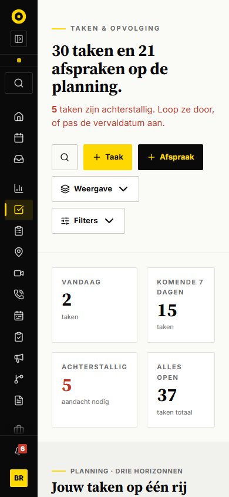

# Deel B · bediening

Dit deel beschrijft alles waarmee je in DealDrive iets doet: knoppen in elke rol, de werkbalk in de paginakop, de actiebalk onderin een flyout, formulieren, inline bewerken, filters, menu's, tabs, paginering, en de kleine labels en meters die een stand laten zien. Alle maten komen uit de code van `C:\Projecten\dealdrive` (commit 75bee61) en uit metingen met `getComputedStyle` in de draaiende app (werkplek op poort 3088, HQ op 3096). De klassen staan in `b-bediening.css`, de voorbeelden in `b-bediening.html`.

Vaste regels voor dit deel:

- Kleuren alleen met tokens uit deel A: de 47 uit `tokens.css` van DealDrive en de aanvulling voor Dealtrace (onder meer `--wit`, `--overlay-zacht`, `--red-pil`, `--yellow-teller`). Letterlijke kleuren staan alleen in de tokendefinities. Maten zonder token staan letterlijk in de CSS met de opmerking "geen token".
- Hoeken 2 px (`--radius`), geen schaduw, nooit rond (stylelint verbiedt `border-radius: 50%`).
- Elk klikbaar element is minimaal 44 px hoog (`--touch-target-min`). Uitzonderingen zijn alleen de knoppen in de actiebalk van een flyout (34 px, `--knop-h-compact`, en 37 px), de kleine knop in een rij en de knoppen van inline bewerken (32 px, `--knop-h-klein`) en het potlood (28 px, `--knop-h-mini`).
- Tekst nooit kleiner dan 11 px (`--fs-label`). Compact maken doe je met letterafstand en kapitalen, niet met een kleiner corps.
- Geel is de enige accentkleur. Rood alleen voor verwijderen, fout en urgent.

Waar DealDrive twee stijlen voor hetzelfde heeft, staat hieronder de meest gebruikte als standaard en de andere als uitzondering, met de telling.

## Knoppen in een paginakop

### Wat het is

De knop rechtsboven op een lijst- of analysepagina: + Klant, + Taak, + Afspraak, Download. In DealDrive is dit de globale klasse `.dd-actie` uit `tokens.css`, gebruikt in 23 bestanden (71 knoppen).

### Wanneer

- Gebruik `.dd-actie` voor elke knop in de paginakop en voor een losse knop op een pagina (Meer laden, Exporteer CSV).
- Niet in een flyoutvoet: daar staat `.dd-act` (kleiner, zie Actiebalk).
- Niet in een tabelrij: daar `.dd-actie--klein`.

### Opbouw

```html
<button type="button" class="dd-actie dd-actie--primair">
  <svg class="dd-actie-icoon">...</svg> Klant
</button>
```

Het plusteken is een Lucide-icoon `Plus` van 16 px, geen tekst "+". De tekst is alleen het zelfstandig naamwoord: "Klant", "Taak", "Afspraak", "Deal", "Campagne", "Prospect", "Accountplan", "Mail".

### Varianten

| Variant | Gebruik | Vlak en tekst | Hover | Telling |
|---|---|---|---|---|
| `--primair` | Hoofdactie van de pagina (+ Klant, + Prospect, + Campagne) | `--ink`, tekst `--yellow` | `--ink-soft` | 11x |
| `--secundair` | Andere acties naast de hoofdactie (+ Taak op een klantenlijst, Meer laden) | `--bg`, rand `--border-strong` | rand `--ink` | 9x |
| `--taak`, `--mail` | Werk dat je zelf doet | `--yellow`, tekst `--ink` | `--yellow-dark` | 21x en 6x |
| `--afspraak`, `--deal` | Werk dat je met een ander afspreekt | `--ink`, tekst `--yellow` | `--ink-soft` | 18x en 4x |
| `--download` | Download, achteraan | gelijk aan primair | `--ink-soft` | 4x (lokaal) |
| `--gevaar` | Verwijderen op een pagina | transparant, rand en tekst `--red` | vlak `--red`, tekst wit | uit `.hq-btn--gevaar` |
| `--icoon` | Alleen een icoon, zoals Zoeken | `--bg`, rand `--border-strong`, 44 x 44 | rand `--ink` | 16x als `.btn-zoek` |
| `--klein` | In een tabelrij | 32 px hoog (`--knop-h-klein`), padding 5px 10px, 11 px | per kleur | uit `.hq-btn--klein` (33x) |

### Maten (gemeten)

| Eigenschap | Waarde |
|---|---|
| Hoogte | 44 px (`--touch-target-min`) |
| Padding | 8px 14px |
| Letter | 13 px, gewicht 700, letterafstand 0.01em, gewone kast |
| Icoon | 16 px, gap 6 px |
| Rand en hoek | 1 px, 2 px (`--radius`) |
| Overgang | achtergrond en rand, `--transition-fast` (120 ms) |

### Toestanden

| Toestand | Uiterlijk |
|---|---|
| Hover | primair en zwart naar `--ink-soft`; geel naar `--yellow-dark`; secundair krijgt rand `--ink` |
| Focus | 2 px `--ink` met 2 px afstand (de focusstijl van 21 van 28 knopregels in de code; `.dd-actie` zelf heeft in DealDrive geen eigen focusstijl en valt terug op de browser) |
| Uitgeschakeld | opacity 0.5, cursor not-allowed |
| Laden | uitgeschakeld en de tekst wordt "Opslaan…" of "Bezig…"; cursor wait. Er is geen draaiend icoon (alleen in 3 Dex-bestanden). |

### Uitzonderingen in DealDrive

- **`.btn-action` in kapitalen** (48 knoppen in 15 bestanden: instellingen, mail-koppeling, inbox, sync): 12 px, kapitalen, letterafstand 0.02em, zwart met geel. Ouder; de opmerking in `tokens.css` zegt dat de hoofdactie op elke pagina dezelfde knop is. Gebruik `.dd-actie`.
- **`.hq-btn`** in HQ (52 knoppen in 6 bestanden): zelfde opbouw als `.dd-actie`, maar 12 px en wit vlak (`--wit`). Alleen voor beheerschermen.
- **Klasse `.dd-actie--secundair` voor + Taak**: op klanten/alle en prospects/alle staan + Taak en + Afspraak secundair, omdat de klant zelf de hoofdactie is. Op /taken zijn ze geel en zwart.

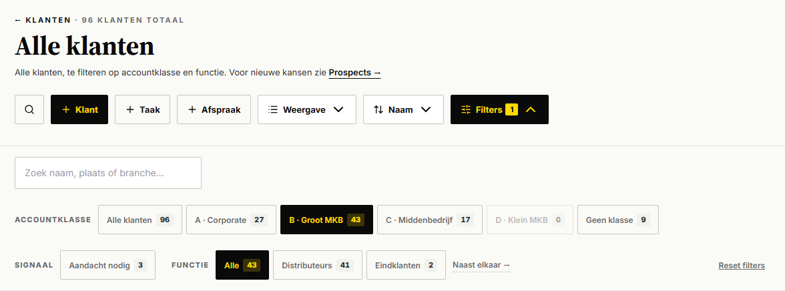

## Knoppen per rol

Deze tabel zegt per rol welke tekst, plek en stijl DealDrive gebruikt. Tellingen komen uit alle `.vue`-bestanden.

| Rol | Tekst in DealDrive | Stijl | Plek en volgorde | Telling |
|---|---|---|---|---|
| Nieuw | "Klant", "Taak", "Afspraak", "Deal" met plus-icoon | `.dd-actie--primair`, of `--taak` en `--afspraak` | Paginakop, direct na Zoeken | 71 knoppen `.dd-actie` |
| Opslaan (nieuw) | Werkwoord met object: "✓ Maak taak", "✓ Plan afspraak", "Deal toevoegen", "Contact aanmaken", "Klant aanmaken" | `.dd-act--primair` | Uiterst rechts in de voet | 34 voeten geteld |
| Opslaan (bewerken) | "✓ Opslaan" (4x) of "Opslaan" (7x); tijdens opslaan "Opslaan…" (12x) | `.dd-act--primair` | Uiterst rechts, Annuleren er direct voor of uiterst links | |
| Annuleren | "Annuleren" (36 knoppen; 1x "Annuleer" in DealFlyout) | `.dd-act` (wit met rand) | Links in de voet (17 van 19), in bewerkstand direct links van Opslaan (2 van 19) | 36 |
| Bewerken | Potlood-icoon, tooltip "Bewerken" (7x) of "Wijzigen" (6x) | `.dd-act--icoon` | In de icoonrij, na Vraag AI en Snooze | 13 |
| Verwijderen | Prullenbak-icoon, tooltip "Verwijderen"; vraagt altijd bevestiging met knop "Verwijderen" | `.dd-act--icoon.dd-act--gevaar`; in de dialoog `.cd-btn--danger` | Voorlaatste in de icoonrij, voor Open klantkaart | 7 in voeten, 16x confirmLabel "Verwijderen" |
| Sluiten | Kruis "×" met aria-label "Sluiten"; in een alleen-lezen venster de knop "Sluiten" | `.dd-sluit`; als woord `.dd-act` | Rechtsboven in de flyoutkop; als woord links in de voet | 57 kruisjes |
| Filter | "Filters" met schuifjes-icoon en teller | `.vd-toggle`, zwart zodra een filter aan staat | Paginakop, na Weergave en Sortering | 30 `.vd-toggle` |
| Weergave | "Weergave" met het icoon van de huidige weergave | `.vd-toggle` met menu | Paginakop, na de + knoppen | 5 pagina's |
| Sortering | Label van de huidige sortering ("Naam") met pijltjes-icoon | `.vd-toggle` met menu | Direct na Weergave | 2 pagina's |
| Exporteren | "Download" (4x, opent DownloadFlyout) of "Exporteer CSV" (1x) | `.dd-actie--download` (zwart) of `--secundair` | Achteraan in de werkbalk | 5 |
| Zoeken | Vergrootglas, aria-label en title "Zoeken" | `.dd-actie--icoon` (in DealDrive `.btn-zoek`) | Eerste knop van de werkbalk, opent de globale zoek | 16 in 12 bestanden |
| Meer-menu | Geen drie-puntjesknop in DealDrive; meer acties via rechtsklik of lang drukken | `.ctx-menu` | Op een rij | 7 |
| Toon meer | "Toon meer" of "Meer laden" | `.meer-knop` of `.dd-actie--secundair` | Onder de lijst, gecentreerd | 3 |
| Reset | "Reset filters" (11x), "Reset filter" (2x), "Wis filters" (1x) | `.dd-tekstknop` | Rechts in de filterstrook | 14 |

### Teksten

- Knoppen zeggen wat er gebeurt: werkwoord plus object ("Deal toevoegen", "Plan afspraak"), of alleen het object als het een + knop is.
- Het vinkje "✓ " voor de primaire knop staat in 7 voeten (Maak taak, Plan afspraak, Opslaan). Het is optioneel; gebruik het voor afronden en opslaan, niet voor navigeren.
- Een bevestiging zonder eigen label heet "Bevestigen"; bij een vraag over verwijderen "Verwijderen" (`useConfirm`, standaardLabel). Een rode knop heet nooit "OK".
- Een pijl "→" achter een knoptekst betekent dat je naar een andere pagina gaat ("Open campagnebord →", "Hele kaart in DealDrive →").
- Laden: "Opslaan…" (10x in een ternary), "Bezig…" (44x, vooral HQ), "Aanmaken…" (3x), "Versturen…" (2x). Altijd met het teken "…", niet met drie punten.

## Werkbalk in de paginakop

### Wat het is

De rij knoppen rechts naast titel en subtitel van een lijstpagina. In DealDrive `.toolbar-buttons`, 21 werkbalken in 15 pagina's. De klasse `.toolbar-buttons` zelf en de plaats in de paginakop staan in deel A; dit hoofdstuk gaat over de knoppen erin.

### Volgorde (vast)

1. Zoeken (icoonknop)
2. De primaire + knop van de pagina
3. Andere + knoppen (+ Taak, + Afspraak, + Mail)
4. Weergave
5. Sortering
6. Filters
7. Download of Exporteer

Elke werkbalk in DealDrive volgt deze volgorde. Een pagina laat weg wat ze niet heeft (offertes: Zoeken en + Deal; rapportage-activiteiten: Filters en Download).

### Opbouw

```html
<div class="toolbar-buttons">
  <button class="dd-actie dd-actie--icoon" aria-label="Zoeken" title="Zoeken">...</button>
  <button class="dd-actie dd-actie--primair">... Klant</button>
  <button class="dd-actie dd-actie--secundair">... Taak</button>
  <div class="vd-wrap"><button class="vd-toggle">... Weergave ...</button></div>
  <div class="vd-wrap"><button class="vd-toggle">... Naam ...</button></div>
  <button class="vd-toggle">... Filters ...</button>
</div>
```

### Maten

| Eigenschap | Waarde |
|---|---|
| Gap | 8 px (11x) of 10 px (10x); gebruik 8 px |
| Uitlijning | onderkant (`align-items: flex-end`) |
| Plaats | rechts naast de kop, onder elkaar als de ruimte op is (`.sec-head` met wrap, deel A); alleen klanten/alle zet de werkbalk op een eigen regel (`flex: 1 0 100%`) |
| Telefoon | knoppen lopen door naar de volgende regel; op 375 px gemeten: Zoeken, + Klant, + Taak op regel 1, + Afspraak op 2, Weergave op 3, Sortering en Filters op 4 |

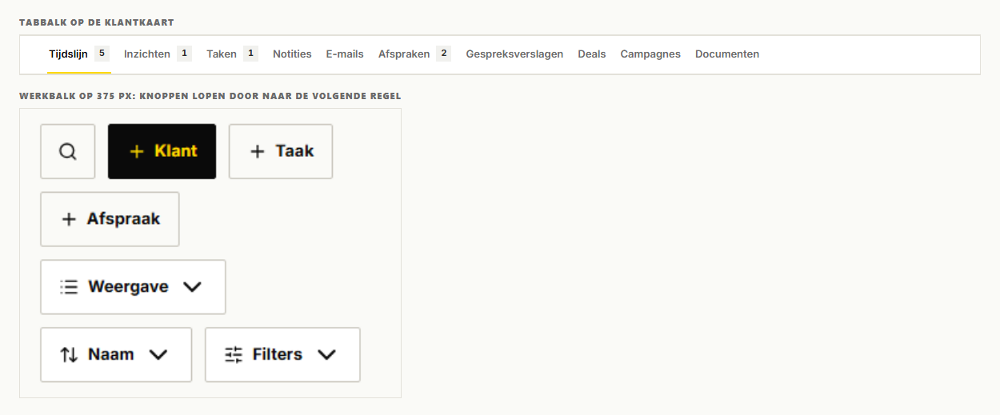

## Dropdownknop met menu: Weergave, Sortering, Filters

### Wat het is

Een witte knop met icoon, label en pijltje. Weergave en Sortering openen een menu eronder; Filters klapt de filterstrook open. In DealDrive `.vd-toggle` (30x in 17 bestanden) met `.vd-menu` en `.vd-item` (5 bestanden).

### Opbouw

```html
<div class="vd-wrap">
  <button class="vd-toggle" aria-expanded="true">
    <svg class="vd-icoon"/> <span class="vd-toggle-value">Weergave</span> <svg class="vd-caret rotate"/>
  </button>
  <ul class="vd-menu">
    <li><button class="vd-item vd-item--active"><svg class="vd-icoon"/> Lijst</button></li>
    <li><button class="vd-item"><svg class="vd-icoon"/> Compact</button></li>
  </ul>
</div>
<button class="vd-toggle vd-toggle--active" aria-expanded="false">
  <svg class="vd-icoon"/> Filters <span class="vd-toggle-count">2</span> <svg class="vd-caret"/>
</button>
```

### Maten en kleuren (gemeten)

| Onderdeel | Waarde |
|---|---|
| Knop | 44 px hoog, padding 8px 14px, 13 px gewicht 700, gap 7 px, vlak `--wit`, rand `--border-strong` |
| Hover | rand `--ink` |
| Actief (Filters open of filter aan) | vlak `--ink`, tekst `--yellow` |
| Teller | 18 px hoog (`--teller-h`), padding 0 7px, 11 px gewicht 800, vlak `--yellow`, tekst `--ink` |
| Pijltje | ChevronDown 14 px, draait 180 graden in 150 ms (`--duur-kort`) als het menu open is |
| Menu | 180 px breed, 4 px van de knop, padding 4 px, vlak `--wit`, rand `--border-strong`, rechts uitgelijnd met de knop |
| Item | 37 px hoog, padding 8px 10px, 13 px gewicht 600, icoon 16 px; hover `--surface`; gekozen zwart met geel |
| Animatie | menu schuift 4 px in en vervaagt, 120 ms |

### Weergaven in DealDrive

| Pagina | Keuzes in het menu |
|---|---|
| Klanten en prospects | Lijst, Compact, Kaarten |
| Taken | Horizon, Lijst |
| Pipeline | Kanban, Lijst |
| Agenda | Werkweek, Week, Maand |

Het knoplabel blijft "Weergave"; het icoon wisselt mee met de gekozen weergave (List, Rows3, LayoutGrid, Kanban, CalendarRange). Een kaartweergave (MiniMap) zit niet in dit menu.

### Sortering

DealDrive heeft geen klikbare kolomkoppen (geen `aria-sort` in de code). Sorteren gaat via de tweede dropdownknop met icoon ArrowUpDown. Het label is de huidige keuze. Opties op klanten en prospects: "Naam" (standaard), "Laatste activiteit", "Score", "Accountklasse".

### Filterteller

- De teller telt het aantal filtergroepen dat afwijkt van de standaard, plus 1 als er een zoekterm staat ("anders staat er een lege lijst onder een knop die zegt dat er niets aan staat").
- Bij nul verdwijnt de teller.
- Op pipeline en campagnes staat "5/7": zichtbare fasen van het totaal.
- De knop is zwart zodra de strook open is of er een filter aan staat.

### Gedrag

1. Klik opent het menu; `aria-expanded` volgt.
2. Een keuze sluit het menu en past de lijst direct aan.
3. Klik naast het menu (mousedown buiten) sluit het.
4. DealDrive sluit dit menu niet met Escape; voeg dat in Dealtrace toe.
5. Een nieuwe weergave of sortering zet "Toon meer" terug op 25 rijen.

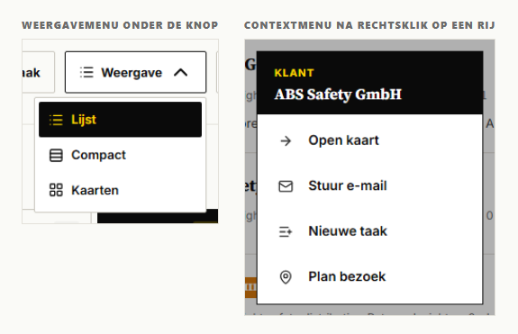

## Actiebalk onderin een flyout of venster

### Wat het is

De rij knoppen onderin een flyout. Deel C beschrijft de voet als onderdeel van de flyout (vlak, rand, plakken); hier staan de knoppen. In DealDrive `.dd-acties` en `.dd-act` uit `tokens.css`: `.dd-act` 82x in 20 bestanden, `--primair` 28x, `--icoon` 25x, `--gevaar` 7x. Van de 34 voeten in de code gebruiken er 16 `.dd-acties`; de andere 18 hebben een eigen klasse met dezelfde volgorde.

### Drie standen

| Stand | Links | Midden | Rechts |
|---|---|---|---|
| Nieuw | Annuleren | vulling | primaire actie ("✓ Maak taak") |
| Lezen | primaire actie met woord ("Afronden", "Open meeting", "Markeer gewonnen") | vulling | iconen: Vraag AI, Snooze 1 dag, Bewerken, Verwijderen, Open klantkaart |
| Bewerken | nevenactie ("Afronden", "Afronden en volgende taak") of Annuleren | vulling | Annuleren (als links iets anders staat) en "✓ Opslaan" |

De volgorde van de iconen is overal gelijk, zoals de code zegt: primair, helpen, uitstellen, wijzigen, weggooien, weggaan. Een venster van 520 px heeft geen ruimte voor zes woorden, daarom houdt alleen de actie waarvoor je het venster opende het woord.

### Opbouw

```html
<footer class="dd-acties">
  <button type="button" class="dd-act">Annuleren</button>
  <span class="dd-acties-vul"></span>
  <button type="submit" class="dd-act dd-act--primair" disabled>✓ Maak taak</button>
</footer>
```

```html
<footer class="dd-acties">
  <button class="dd-act dd-act--primair"><svg class="dd-act-icoon"/> Afronden</button>
  <span class="dd-acties-vul"></span>
  <button class="dd-act dd-act--icoon" title="Vraag AI" aria-label="Vraag AI">...</button>
  <button class="dd-act dd-act--icoon" title="Bewerken" aria-label="Bewerken">...</button>
  <button class="dd-act dd-act--icoon dd-act--gevaar" title="Verwijderen" aria-label="Verwijderen">...</button>
  <a class="dd-act dd-act--icoon" title="Open klantkaart" aria-label="Open klantkaart">...</a>
</footer>
```

Een icoonknop heeft altijd `title` en `aria-label` met hetzelfde woord.

### Maten (gemeten in TaakFlyout en NieuweTaakFlyout)

| Knop | Hoogte | Padding | Letter | Kleuren |
|---|---|---|---|---|
| `.dd-act` | 37 px | 8px 12px | 12 px, 700 | vlak `--bg`, rand `--border-strong`; hover rand `--ink` |
| `--primair` | 37 px | 8px 12px | 12 px, 700 | `--ink`, tekst `--yellow`; hover `--ink-soft` |
| `--icoon` | 34 x 34 | 0 | icoon 16 px | als `.dd-act` |
| `--gevaar` | 34 of 37 px | | | tekst `--red`; hover rand `--red` |
| Rij | | gap 8 px | | geen terugloop, horizontaal scrollen bij te veel knoppen |

Let op: in de bewerkstand van een taak (vier knoppen) is de rij breder dan het venster en valt "✓ Opslaan" half buiten beeld (zie de schermafbeelding). Houd in Dealtrace maximaal drie tekstknoppen in een voet.

### Gedrag

- De primaire knop staat uitgeschakeld (opacity 0.5) tot de verplichte velden gevuld zijn (`:disabled="!canSubmit || submitting"`).
- Tijdens opslaan: uitgeschakeld en de tekst wordt "Opslaan…".
- Na opslaan sluit de flyout en volgt een toast, bijvoorbeeld "Taak toegevoegd. Staat bij Taken." of "Deal bijgewerkt." (deel C).
- Annuleren sluit zonder vragen; die knop indrukken is een keuze. Sluiten met Escape of een klik naast de flyout vraagt eerst bevestiging als er niet opgeslagen invoer is (AccountplanFlyout, deel C).
- Verwijderen opent altijd eerst het bevestigingsvenster.

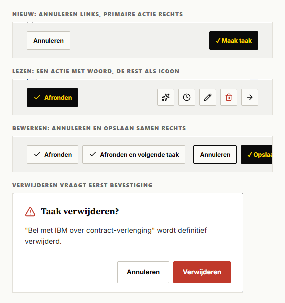

## Knoppen in het bevestigingsvenster

### Wat het is

De twee knoppen in ConfirmDialog. Het venster zelf staat in deel C. Opgeroepen met `useConfirm().ask(...)`, 48x met `variant: 'danger'`.

### Opbouw en volgorde

```html
<footer class="cd-foot">
  <button class="cd-btn cd-btn--ghost">Annuleren</button>
  <button class="cd-btn cd-btn--danger">Verwijderen</button>
</footer>
```

Annuleren links, bevestigen rechts, beide rechts uitgelijnd. De focus start op Annuleren, zodat Enter nooit per ongeluk iets verwijdert (gemeten: `document.activeElement` is `.cd-btn--ghost` direct na openen).

### Varianten

| Klasse | Gebruik | Vlak en tekst | Hover |
|---|---|---|---|
| `--ghost` | Annuleren | transparant, rand `--border-strong`, tekst `--ink` | rand `--ink` |
| `--primary` | Bevestigen zonder gevaar ("Zet in agenda", "Afronden") | `--yellow`, tekst `--ink` | `--yellow-dark` |
| `--danger` | Verwijderen, Verwerpen, Ontkoppelen, Uitschakelen | `--red`, tekst wit | `--red-dark` |

Maten: 44 px hoog, padding 10px 18px, 13 px gewicht 700.

Teksten op de bevestigknop (tellingen): "Verwijderen" 16, "Verwerpen" 3, "Standaardset terugzetten" 3, "Weggooien" 2, "Afronden" 2, en 12 andere eenmalig. De vraag is de titel ("Taak verwijderen?"), de zin eronder zegt wat er gebeurt ("… wordt definitief verwijderd.").

## Tekstknop en sluitknop

### Tekstknop

Een knop die eruitziet als een onderstreepte link, voor een lichte actie die niets aanmaakt: "Reset filters", "Toon alles". In DealDrive `.filter-reset` (14x in 11 bestanden).

| Eigenschap | Waarde |
|---|---|
| Letter | 12 px, gewicht 600, `--muted`, onderstreept |
| Padding | 4px 8px, geen rand, geen vlak |
| Hover | `--ink` |

Niet gebruiken voor navigatie: een link naar een andere pagina is een `<a>` (deel A, links).

### Sluitknop

Het kruis rechtsboven in een flyout of melding: "×" met `aria-label="Sluiten"` (57 knoppen). 44 x 44, teken 28 px, `--muted`, hover `--ink`. De plek in de flyoutkop staat in deel C. In een alleen-lezen venster zonder formulier staat onderin ook een knop "Sluiten" (`.dd-act`, 5 voeten).

## Formulier: veld, label, invoer

### Wat het is

Het formulier in een flyout (nieuwe taak, nieuwe deal, nieuw contact) en op instellingenpagina's. DealDrive heeft geen gedeelde formulierklasse: elke flyout heeft eigen klassen (`.nt-field`, `.nd-field`, `.na-veld`), allemaal met dezelfde opbouw. 122 invoerregels in 71 bestanden; hieronder de meest gebruikte waarden.

### Opbouw

```html
<form class="formulier">
  <label class="veld">
    <span class="veld-label">Titel <span class="veld-verplicht">*</span></span>
    <input class="invoer" type="text" required placeholder="bv. Bel Henk de Vries terug">
  </label>
  <div class="veld veld--rij">
    <label class="veld"><span class="veld-label">Vervaldatum</span><input class="invoer" type="date"></label>
    <label class="veld"><span class="veld-label">Tijd</span><input class="invoer" type="time"></label>
  </div>
  <p class="veld-fout">Opslaan mislukt: taak niet gevonden.</p>
  <footer class="dd-acties">...</footer>
</form>
```

Een groep keuzeknoppen staat in `<fieldset class="veld">` met `<legend class="veld-label">`.

### Maten en kleuren

| Onderdeel | Waarde | Bron |
|---|---|---|
| Label | 11 px, gewicht 800, kapitalen, letterafstand 0.1em, `--muted` | 63x kapitalen in `--muted` |
| Verplicht | rood sterretje "*" achter het label, gewicht 800 | 7 bestanden |
| Invoer | 44 px hoog, padding 10px 12px, 14 px, vlak `--wit`, rand `--border-strong`, hoek 2 px | rand 75x, 44 px 33x |
| Placeholder | `--muted-light`; begint met "bv." (28x) of "Zoek" (24x) of "Optioneel" (3x) | |
| Focus | 2 px `--yellow`, offset -1 px (de lijn valt over de rand) | 31x |
| Uitgeschakeld | vlak `--surface`, tekst `--muted` | |
| Fout in een veld | rand `--red`, regel eronder 12 px `--red` gewicht 600 | zeldzaam (dex/profiel) |
| Foutmelding formulier | blok boven de voet: 13 px `--red`, vlak `--red-zacht` (rood op 8 procent), linkerrand 3 px `--red`, padding 10px 12px | 16x |
| Hulptekst | 11 tot 13 px `--muted` | 57x `--muted` |
| Tekstvak | minimaal 84 px, verticaal te vergroten, regelafstand 1.45 | |
| Keuzelijst | native `<select>` met de pijl van de browser | 137 selects, 3x `appearance: none` |
| Datum en tijd | native `type="date"` (47x) en `type="time"` (13x), naast elkaar met gap 12 px | |
| Compact | 34 px (`--knop-h-compact`), padding 6px 10px, 13 px (panelen en instellingen) | 13 px komt 36x voor |
| Afstand | label en invoer 6 px; velden onder elkaar 14 px | |

### Uitzondering

Instellingenpagina's en kleine panelen gebruiken 13 px en soms `var(--bg)` als vlak (31x). In een flyout is het 14 px op wit (gemeten in NieuweTaakFlyout). Kies 14 px op wit; gebruik `.invoer--klein` voor een compact paneel.

### Gedrag

- Het belangrijkste tekstveld krijgt `autofocus` (3 flyouts, waaronder Nieuwe taak: het veld Titel). Doe dat in Dealtrace in elk formulier dat met een + knop opent.
- De primaire knop is uitgeschakeld tot de verplichte velden gevuld zijn; er is geen rode melding vooraf.
- Een fout van de server komt als `.veld-fout` boven de voet, in een zin: "Opslaan mislukt: taak niet gevonden.", "Vastleggen mislukt. Probeer het opnieuw."
- `aria-invalid` komt in DealDrive niet voor; zet het in Dealtrace wel op een veld met `.invoer--fout`.

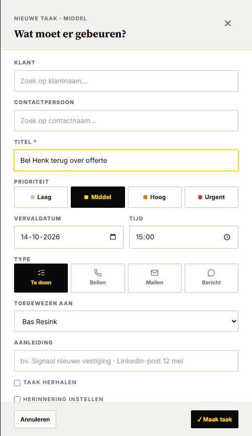

## Vinkje, keuzerondje en schakelaar

### Vinkje en keuzerondje

Native `<input type="checkbox">` (30x) en `type="radio"` (5x) met `accent-color: var(--yellow-dark)` (15x; `--ink` 5x). Het label staat rechts. In een flyout staat een vinkje dat een blok openklapt in de stijl van een veldlabel: 11 px, kapitalen, letterafstand 0.12em, `--muted` ("Taak herhalen", "Herinnering instellen"). Als het vinkje aan staat, krijgt het blok eronder een kader (`.veld-klap--open`: vlak `--surface`, rand `--border`, padding 12 px); uit is er geen kader.

### Schakelaar

Voor een instelling die direct ingaat, zonder Opslaan (meldingen, automatisering). In DealDrive `Toggle.vue`, 8x in 4 bestanden.

```html
<button type="button" class="schakelaar schakelaar--aan" role="switch" aria-checked="true" aria-label="Dagstart per mail">
  <span class="schakelaar-spoor"></span><span class="schakelaar-duim"></span>
</button>
```

| Onderdeel | Uit | Aan |
|---|---|---|
| Knop | 48 x 44 (klikvlak) | |
| Spoor | 44 x 22, `--border-strong` | `--ink` |
| Duim | 16 x 16, wit, rand `--ink`, links | `--yellow`, rechts |
| Focus | 2 px `--ink`, 4 px afstand | |
| Uitgeschakeld | opacity 0.5 | |
| Animatie | spoor en duim schuiven in `--transition-fast` | |

Geef altijd een naam mee met `aria-label` of `aria-labelledby`; de schermlezer hoort verder "Aan" of "Uit".

## Keuzeknoppen in een formulier

### Keuzeraster

Een raster van vier knoppen waarvan er één aan staat, met een icoon boven het woord: type taak "Te doen", "Bellen", "Mailen", "Bericht" (NieuweTaakFlyout, TaakFlyout, NieuweActiviteitFlyout).

| Eigenschap | Waarde |
|---|---|
| Raster | 4 kolommen, gap 6 px; onder 600 px 3 kolommen |
| Knop | 60 px hoog (minimaal 56, `--keuzeknop-h`), padding 10px 8px, 11 px gewicht 700, icoon 16 px |
| Uit | `--wit`, rand `--border-strong`, tekst `--muted`; hover rand en tekst `--ink` |
| Aan | `--ink`, tekst `--yellow` |

Geen hover op de actieve knop: anders wordt het label zwart op zwart (opmerking in de code).

### Prioriteit

Vier knoppen naast elkaar met een gekleurde stip van 8 px: "Laag" (`--border-strong`), "Middel" (`--yellow`), "Hoog" (`--orange`), "Urgent" (`--red`). 44 px hoog, 12 px gewicht 700, letterafstand 0.02em. Aan: zwart met gele tekst; de stip houdt zijn kleur. De gekozen prioriteit staat ook in de kicker van de flyout ("Nieuwe taak · Middel").

## Zoekvelden en keuzechips

### Zoekveld in een filterstrook

`<input type="search">` (20x), eerste element in de filterstrook. 48 px hoog (`--touch-target-comfortable`), minimaal 280 px breed (`--zoekveld-min-w`), padding 8px 14px, 14 px, wit. Focus: 2 px `--ink` met 2 px afstand. Het filtert terwijl je typt; het kruisje van de browser wist de term. Placeholder noemt waarop je zoekt: "Zoek naam, plaats of branche…".

### Type-ahead in een flyout

Voor klant en contactpersoon (6 flyouts). Typen filtert de namen, een klik kiest.

```html
<div class="zoekveld">
  <input class="invoer" placeholder="Zoek op klantnaam…" autocomplete="off">
  <ul class="zoeklijst">
    <li><button class="zoeklijst-item">Bakker Bouw B.V. <span class="zoeklijst-sub">· Bouw</span></button></li>
  </ul>
</div>
```

- Lijst direct onder de invoer, rand `--border-strong` zonder bovenrand, vlak `--bg`, maximaal 240 px hoog.
- Item: padding 10px 12px, 13 px, scheidingslijn `--border`, hover `--surface`. Aanvulling in `--muted` na " · ".
- Niets gevonden: "Geen klant gevonden." in 12 px `--muted` op dezelfde plek.
- Gebruik `mousedown` met `preventDefault` op een item, anders verliest de invoer de focus voor de klik telt.
- Na een keuze wordt het veld een keuzechip.

### Gekozen waarde

```html
<div class="zoek-keuze">
  <span class="zoek-keuze-tekst">Henk de Vries <span class="zoek-keuze-sub">· Inkoper</span></span>
  <button class="zoek-keuze-wis" aria-label="Wis gekozen contactpersoon">×</button>
</div>
```

44 px hoog, vlak `--surface`, rand `--border-strong`, naam 14 px gewicht 600. Het kruisje is 32 x 32, `--muted`, hover `--red`.

### Keuzechips

Een lijst gekozen waarden die je los weghaalt (contactpersonen in een accountplan): `.keuzechip`, padding 4px 8px, 12 px gewicht 600, vlak `--surface`, rand `--border`, met een kruisje in `--muted`.

## Inline bewerken

### EditableField

Een gegeven dat je op zijn plek wijzigt, zonder formulier: telefoon, website, adres in de flyout Bedrijfsgegevens. 43x gebruikt.

```html
<div class="ef">
  <span class="ef-label">Telefoon</span>
  <div class="ef-display">
    <a class="ef-value ef-value--link" href="tel:...">020 123 45 67</a>
    <button class="ef-pencil" aria-label="Bewerk Telefoon">...</button>
  </div>
</div>
```

| Toestand | Uiterlijk |
|---|---|
| Lezen | raster 110 px label en waarde, label 11 px kapitalen `--muted`, waarde 14 px; rij 49 px |
| Hover | stippellijn `--border` onder de rij; potlood 28 x 28 verschijnt rechts |
| Leeg | "+ Voeg postcode toe" (het label in kleine letters) cursief 13 px `--muted-light`; potlood half zichtbaar (0.6) |
| Link | telefoon, e-mail en website als link met lijn `--border-strong`; website met "↗" |
| Bewerken | invoer 36 px met zwarte rand en gele focus; rechts kruis (Annuleren) en vinkje (Opslaan), elk 32 x 32 |
| Opslaan-knop | `--ink` met geel vinkje; Annuleren wit, hover rood |

Gedrag:

1. Klik op de waarde of het potlood opent de invoer met de tekst geselecteerd.
2. Enter of het vinkje slaat op; ongewijzigd opslaan doet niets.
3. Escape of het kruis annuleert.
4. Een keuzelijst met 8 of meer opties wordt een invoer met suggesties (datalist).
5. Op een aanraakscherm is het potlood altijd zichtbaar (`@media (hover: none)`, 4x in de code).

### InlineEditChip

Een woord in een kicker dat je aanklikt om te wijzigen: branche, plaats, land en functie bovenaan de klantkaart (4x). Het neemt de letter van de omgeving over. Onder de muis verschijnt een geel potlood van 11 px. Klik maakt er een kleine invoer van (padding 2px 6px, rand `--border-strong`, focus rand `--ink`). Verlaten van het veld slaat op, Escape annuleert.

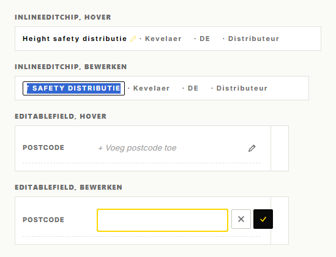

## Filters

### Wat het is

De strook onder de paginakop die openklapt met de knop Filters. Per groep een label in kapitalen en een rij filterpillen; rechts "Reset filters". In DealDrive `.filter-pill` (68x in 18 bestanden), `.filter-group` (78x), `.filter-label` (71x), `.section--filter` (22x in 19).

### Opbouw

```html
<section class="section section--filter">
  <div class="container">
    <div class="filters">
      <div class="filter-groep"><input class="zoekinvoer" type="search" placeholder="Zoek naam, plaats of branche…"></div>
      <div class="filter-groep">
        <span class="filter-label">Accountklasse</span>
        <button class="filter-pil filter-pil--aan">Alle klanten <span class="pil-teller">96</span></button>
        <button class="filter-pil">A · Corporate <span class="pil-teller">27</span></button>
      </div>
      <div class="filter-groep filter-groep--eind"><button class="dd-tekstknop">Reset filters</button></div>
    </div>
  </div>
</section>
```

### Maten en kleuren (gemeten op Alle klanten)

| Onderdeel | Waarde |
|---|---|
| Strook | padding 16px 0, vlak `--bg` (13x; `--surface` 7x), onderrand `--border` |
| Groepen | gap 24 px tussen groepen, 6 px binnen een groep |
| Label | 11 px, gewicht 800, kapitalen, letterafstand 0.1em, `--muted`, 4 px rechts |
| Pil | 44 px hoog, padding 6px 12px, 12 px gewicht 600, tekst `--muted`, transparant, rand `--border-strong` |
| Pil hover | tekst en rand `--ink` |
| Pil aan | `--ink`, tekst `--yellow` |
| Pil uit (0 resultaten) | opacity 0.45, geen hover |
| Teller in pil | padding 1px 6px, 11 px gewicht 800, `--surface` met `--ink-soft`; in een actieve pil geel op `--yellow-teller` (geel op 20 procent) |
| Animatie | openklappen met max-height 220 ms (`--duur-in`) en opacity 160 ms (`--duur-vervaag`) |

### Gedrag

- Elke groep heeft een pil "Alle …" die de groep uitzet.
- Binnen een groep staat er één aan; tussen groepen combineren de filters.
- Een pil met teller 0 is uitgeschakeld, niet verborgen.
- "Eigen periode" opent twee datumvelden (Van, Tot) in dezelfde strook, met het filterlabel als label.
- "Reset filters" zet alle groepen terug en wist ook de zoekterm; staat alleen als er iets aan staat.
- Een lege lijst door filters toont een lege staat met de knop "Toon alles" (deel C).

### Uitzondering

`bezoek-analyse.vue` en enkele rapportages gebruiken `--surface` als strookvlak en padding 14px 0. Gebruik `--bg`.

## Segmentknoppen

Een vaste rij van twee tot vier standen in één kader, waarvan er één aan staat. Zeldzaam in DealDrive: het venster op Verdieping (`.vd-seg`) en de periode in een kaartkop in de organisatieflyout (`.ak-per`). Periodes en weergaven kies je in DealDrive meestal met filterpillen of het menu Weergave; gebruik segmentknoppen alleen als de keuze altijd zichtbaar moet zijn en de lijst kort is.

```html
<div class="keuzegroep" role="group" aria-label="Venster">
  <button class="keuzegroep-knop keuzegroep-knop--aan" aria-pressed="true">Maand</button>
  <button class="keuzegroep-knop" aria-pressed="false">Kwartaal</button>
</div>
```

| Onderdeel | Waarde |
|---|---|
| Kader | rand `--border-strong`, hoek 2 px |
| Knop | 44 px hoog, padding 8px 16px, 13 px gewicht 700, vlak `--bg`, tekst `--muted`, scheidingslijn `--border-strong` |
| Hover | tekst `--ink` |
| Aan | `--ink`, tekst `--yellow`, ook onder de muis |
| Klein (kaartkop) | padding 4px 11px, 11 px |

## Tabbalk

### Wat het is

Tabs binnen een detailpagina: klantkaart en contactkaart (tien tabs), instellingen, accountplan. Onderstreept, geen blokken.

```html
<nav class="tabbalk" aria-label="Klantkaart-tabs">
  <button class="tab tab--actief" aria-current="page">Tijdslijn <span class="tab-teller">5</span></button>
  <button class="tab">Inzichten <span class="tab-teller">1</span></button>
  <button class="tab">Notities</button>
</nav>
```

### Maten (gemeten op de klantkaart)

| Onderdeel | Waarde |
|---|---|
| Balk | wit, onderrand `--border`, plakt bovenaan (sticky, `--z-sticky`) |
| Tab | 47 px hoog, padding 12px 2px, 13 px gewicht 600, `--muted`, afstand 14 px |
| Hover | `--ink` |
| Actief | `--ink`, onderstreep 2 px `--yellow` |
| Teller | padding 1px 6px, 11 px gewicht 700, `--surface` met `--ink-soft`; alleen als het aantal groter is dan 0 |
| Overgang | kleur en rand 150 ms (`--duur-kort`) |

Te veel tabs voor de breedte lopen door naar een tweede regel; geen horizontale scroll ("Documenten stond afgekapt" volgens de code).

Uitzonderingen: accountplan gebruikt gewicht 700 en `--yellow-dark` voor de onderstreep; drie pagina's (bezoeken, playbooks, rechten) hebben tabs als blokknoppen in de stijl van een filterpil. Gebruik de onderstreepte tab.

Tabs in een flyout staan in deel C.

## Paginering: Toon meer

DealDrive bladert niet met paginanummers. Een lange lijst toont 25 rijen, daaronder het aantal en een knop.

```html
<div class="meer-rij">
  <span class="meer-tekst">25 van 96 getoond</span>
  <button class="meer-knop">Toon meer</button>
</div>
```

| Onderdeel | Waarde |
|---|---|
| Rij | gecentreerd, gap 16 px, 16 px onder de lijst |
| Tekst | 12 px `--muted`, tabulaire cijfers, "x van y getoond" |
| Knop | 44 px, padding 8px 20px, 13 px gewicht 700, wit, rand `--border-strong`; hover rand `--ink` |
| Stap | 25 (klanten, prospects); 50 in de auditlog ("Meer laden") |

Een andere filter, zoekterm, sortering of weergave zet de lijst terug op 25. Knop en tekst verdwijnen als alles getoond is.

Paginanummers ("← Vorige", "Pagina 2 / 5", "Volgende →") komen alleen voor in de klantomgeving Eyecatcher, met een eigen huisstijl. Niet overnemen.

## Contextmenu

### Wat het is

Het menu met snelle acties op een rij: rechtsklik op desktop, lang drukken op een telefoon. DealDrive heeft geen knop met drie puntjes; dit is het meer-menu. `ContextMenu.vue`, 7x gebruikt (taken, klanten, prospects).

### Opbouw

```html
<div class="ctx-overlay"></div>
<div class="ctx-menu" role="menu">
  <header class="ctx-head">
    <span class="ctx-head-kicker">Klant</span>
    <span class="ctx-head-title">Bakker Bouw B.V.</span>
  </header>
  <ul class="ctx-list" role="none">
    <li role="none"><button class="ctx-item" role="menuitem">
      <span class="ctx-item-icon"><svg class="ctx-item-svg"/></span>
      <span class="ctx-item-label">Open kaart</span>
    </button></li>
  </ul>
</div>
```

### Maten (gemeten)

| Onderdeel | Waarde |
|---|---|
| Menu | 240 px breed (maximaal 360), wit, rand 1 px `--ink`, geen hoek |
| Kop | `--ink`, padding 14px 18px 12px; kicker 11 px kapitalen `--yellow`; titel `--font-serif` 16 px `--wit` |
| Item | 48 px hoog (`--touch-target-comfortable`), padding 0 18px, raster 24 px icoon en label, gap 12 px |
| Label | 14 px gewicht 600 `--ink`; icoon 16 px `--ink-soft` |
| Meta rechts | 11 px kapitalen `--muted` |
| Hover | `--surface` |
| Gevaar | label en icoon `--red` |
| Overlay | `--overlay-zacht` (inkt op 32 procent), `--z-modal` |

### Gedrag

1. Desktop: het menu opent bij de muis en blijft 12 px binnen het scherm; past het niet onder de muis, dan opent het erboven.
2. Telefoon (onder 768 px): onderblad over de volle breedte, schuift van onder in; ruimte voor de veilige zone onderaan.
3. Een keuze voert de actie uit en sluit het menu.
4. Escape of een klik op de overlay sluit het.
5. Animatie: vervagen in `--transition-fast`; desktop schaalt van 0.96.

Teksten op klanten: "Open kaart", "Bel primaire contact", "Stuur e-mail", "Nieuwe taak", "Plan bezoek". Kicker is het soort ding ("Klant", "Taak"), titel de naam.

## Pillen, klasse, tags, statuslabels en tellers

### Pil

Een klein label in kapitalen voor een stand. 11 px, gewicht 800, letterafstand 0.06em, padding 2px 8px, gemeten 22 px hoog, hoek 2 px.

| Soort | Klasse | Kleuren | Wanneer |
|---|---|---|---|
| Neutraal | `.pil`, `.pil--grijs` | `--surface`, `--muted` | concept, onbekend |
| Accent | `.pil--geel`, `.pil--zwart` | geel met inkt, inkt met geel | nieuw, actief |
| Zacht | `.pil--rood`, `--oranje`, `--groen`, `--blauw`, `--paars` | `--red-pil`, `--orange-zacht`, `--green-zacht`, `--blue-zacht`, `--purple-zacht` (kleur op 12 procent, oranje op 10), tekst in de kleur | stand in een lijst |
| Gevuld | `.pil--rood-vol` en verder | kleur met witte tekst | status die opvalt |
| Leeg | `.pil--leeg` | gestippelde rand `--border-strong` | nog niet gezet ("Geen fase") |

Kleurbetekenis: rood urgent of risico, oranje let op, groen gewonnen of voor op schema, blauw klant of info, paars prospect of social, geel signaal.

### Accountklasse

Op elke lijst en kaart dezelfde kleur per klasse (AccountRow, kaarten, toplijsten). Tekst altijd "A · Corporate" via `labelFor`; zonder klasse "Geen klasse".

| Klasse | Vlak | Tekst |
|---|---|---|
| A | `--ink` | `--yellow` (5x; wit 1x) |
| B | `--blue` | wit |
| C | `--orange` | wit |
| D | `--muted` | wit |
| Overig | `--purple` | wit |
| Geen | transparant, gestippelde rand | `--muted` |

Uitzondering: AccountfasePicker en HistorieFlyout kleuren A rood en overig `--ink-soft` (3x), terwijl de code zegt "zelfde kleurcodering als de fase-pil". Volg de lijst (A zwart). De pil in de klantkaartkop is klikbaar en opent een keuzemenu (`.pil--knop`, helderder onder de muis).

### Signaaltag

Op een inzicht (SignalTag, 15x). Geen hoek, rand 1 px, padding 2px 7px, 11 px gewicht 800, kapitalen 0.06em. Bron: "Intern" zwart met geel, "Extern" geel met zwart, "Overig" grijs. Soort: vacature paars, nieuws zwart, social blauw, website groen, concurrent en directiewissel rood, KvK-mutatie en omzetdaling oranje, kans groen.

### Statuslabel

Status van een account (StatusTag): strategisch rood, klant blauw, at-risk oranje, hot prospect paars, warm prospect groen, prospect grijs met rand, watchlist grijs gestippeld. Geen hoek, padding 2px 8px, letterafstand 0.04em.

### Bandbadge

Drie standen van een dealband (BandBadge): `--red-pil` (rood op 12 procent), `--yellow-dark-zacht` (`--yellow-dark` op 24 procent) met inkt, `--green-zacht` (groen op 12 procent; BandBadge schrijft 14). Geen kapitalen, letterafstand 0.06em. Compact: padding 1px 5px.

### Tellers

| Teller | Waar | Uiterlijk |
|---|---|---|
| `.pil-teller` | in een filterpil, naast een groepskop | `--surface`, `--ink-soft`, 11 px 800 |
| `.pil-teller--zwart` | kolomkop, paneelkop | `--ink`, wit |
| `.pil-teller--geel` | iets dat aandacht vraagt | `--yellow`, `--ink` |
| `.vd-toggle-count` | op de knop Filters | `--yellow`, 18 px hoog |
| `.tab-teller` | achter een tab | `--surface`, 11 px 700 |

Cijfers in een teller zijn tabulair. Een teller met 0 laat je weg, behalve in een filterpil (daar zegt 0 dat de pil uit staat).

## Avatar en portret

### Avatar

Initialen in een vierkant van 32 x 32 met hoek 2 px; nooit rond (stylelint). 11 px, gewicht 800, wit op een vaste kleur per persoon: blauw, groen, paars, oranje of rood, gekozen uit de som van de tekencodes van het id, zodat iemand overal dezelfde kleur houdt. In een rij (AccountRow) maximaal drie, 8 px over elkaar, witte rand 2 px; de rest als "+2" op `--surface` in `--muted`. Zonder contact: "Geen contactpersoon" cursief 11 px `--muted-light`.

Gedrag: klik opent de contactkaart; onder de muis 2 px omhoog; title "Naam · Functie". Focus 2 px `--yellow`.

```html
<div class="initialen-stapel">
  <a class="initialen initialen--blauw" href="/contacten/c-12" title="Henk de Vries · Inkoper">HV</a>
  <span class="initialen initialen--rest" title="Nog 2 contactpersonen">+2</span>
</div>
```

### Portret

Een contactkaart met foto (Portrait.vue, 1x): foto 4:3 met rollabel linksboven (beslisser zwart met geel, beïnvloeder geel, champion groen, gebruiker grijs), zonder foto een donker verloop (`.portret-foto--zonder`, DealDrive kiest per naam een donkere tint) met de initialen in `--font-serif` 56 px `--yellow-op-donker`. Naam Source Serif 22 px, functie 13 px `--muted`. Onder de muis rand `--yellow` en 2 px omhoog in 200 ms.

## Scorecirkel

Een ring met een getal van 0 tot 100 voor de prioriteit van een account (AccountScoreCircle, 10x, meestal lg).

```html
<div class="scorecirkel scorecirkel--lg" title="Score 82 / 100 · Hoge prioriteit">
  <svg class="scorecirkel-svg" viewBox="0 0 100 100">
    <circle class="scorecirkel-baan" cx="50" cy="50" r="46.5" stroke-width="7"/>
    <circle class="scorecirkel-ring scorecirkel-ring--groen" cx="50" cy="50" r="46.5" stroke-width="7"
            stroke-dasharray="239.6 292.2" transform="rotate(-90 50 50)"/>
  </svg>
  <div class="scorecirkel-inhoud"><span class="scorecirkel-getal">82</span><span class="scorecirkel-label">Score</span></div>
</div>
```

| Maat | Doorsnede | Lijndikte (viewBox 100) | Getal |
|---|---|---|---|
| sm | 40 px | 12 | 14 px |
| md | 64 px | 9 | 20 px |
| lg | 96 px | 7 | 28 px |
| xl | 128 px | 6 | 38 px |

- Kleur van de ring: onder 40 `--red` ("Lage prioriteit"), 40 tot 69 `--orange` ("Aandacht waard"), vanaf 70 `--green` ("Hoge prioriteit"). Achterring `--border`.
- Straal = (100 min lijndikte) gedeeld door 2; lengte van de boog = score / 100 maal de omtrek.
- De ring begint bovenaan, recht afgesneden, en groeit in 600 ms (`--duur-lang`).
- Getal in `--font-serif` gewicht 700, tabulair; label "Score" 11 px kapitalen `--muted`, alleen bij lg en xl.

## Voortgangsbalk

Een dunne balk voor voortgang van een plan, campagne of playbook.

```html
<div class="voortgang" role="progressbar" aria-valuenow="62" aria-valuemin="0" aria-valuemax="100">
  <span class="voortgang-vul voortgang-vul--groen" style="width: 62%"></span>
</div>
```

| Onderdeel | Waarde |
|---|---|
| Baan | 6 px hoog (6x), `--surface` (13x), geen rand |
| Vulling | groen voor een plan of campagne, `--ink` voor een playbook, geel voor een meter, rood als je achterloopt |
| Tempostreep | 2 px `--yellow-dark` op de plek waar je volgens schema had moeten zijn (evaluaties) |
| Met rand | 8 px, rand `--border-strong` (meter op de generator) |
| Animatie | breedte in `--transition-base` |

De breedte is data en staat als `style="width: …"` op de vulling. Zet het getal ernaast in tekst ("3 van 8 stappen"); de balk alleen is niet genoeg.

## Telefoon en minder beweging

- Breekpunten van DealDrive: telefoon onder 768 px (`max-width: 767px`), smalle rasters onder 600 px. `var()` werkt niet in een media query; de getallen staan letterlijk in de CSS.
- Onder 768 px: de werkbalk loopt door naar meer regels, het zoekveld in de filterstrook krijgt de volle breedte, "Reset filters" schuift niet meer naar rechts, het contextmenu wordt een onderblad.
- Onder 600 px: het keuzeraster gaat naar drie kolommen, velden naast elkaar gaan onder elkaar.
- Knoppen blijven 44 px hoog; met de handschoenstand (`data-glove-mode`) wordt `--touch-target-min` 54 px en groeien ze mee.
- Op een aanraakscherm zijn potloden van inline bewerken altijd zichtbaar.
- `prefers-reduced-motion`: overgangen en de hover-verschuiving van avatar en portret vallen weg. `tokens.css` zet daarnaast alle animaties op 0.01 ms (deel A).

# Deel C · Lagen en data

Dit deel beschrijft alles wat over de pagina heen komt (flyouts, vensters, toasts, banners, zoeken) en alles wat data toont (tabellen, rijen, kaarten, kanban, tijdlijn, grafieken, kaart), met de lege, laad- en foutstaten en de afdrukstijl. Alle klassen staan in `c-lagen-en-data.css`. Knoppen, pillen, velden en menu's komen uit deel B, tokens, lettertypen en de app-schil uit deel A.

Bronnen: de 41 `*Flyout.vue`-componenten in `C:\Projecten\dealdrive\app\components`, ConfirmDialog, ConflictResolveModal, IOSInstallModal, ToastContainer, OfflineBanner, NotificationBell, GlobaleZoek, AccountRow, LeadCard, BriefingCard, ResultaatTegel, LegeStaat, HydratieLijst, RapportageGrafieken, MiniMap, de composables `useFlyoutA11y`, `useBodyScrollLock`, `useConfirm` en `useToast`, en de pagina's pipeline, campagnes/[id], accounts/[id] en notificaties. Maten zijn gemeten met `getComputedStyle` in de mockapp op localhost:3088 (viewport 1440 bij 900 en 375 bij 812).

Overal geldt: kleuren alleen via tokens uit deel A, ook wit (`--wit`), wit op donker (`--wit-70` en verwant) en de overlays (`--overlay`, `--overlay-donker`); geen schaduw, hoeken hooguit `var(--radius)` (2px), focus is een omlijning van 2px `var(--ink)` met 2px afstand (17x in de app, 6x geel).

## Flyout

### Wat het is

Een paneel dat van rechts over de pagina schuift, over de volle hoogte, met daaronder een donkere laag. Het is in DealDrive het venster voor alles: een record bekijken (taak, afspraak, deal, inzicht), een record aanmaken (Nieuwe taak, Nieuwe afspraak, Nieuwe deal), een cijfer uitdiepen (rapportage) en AI-werk (Dex, transcriptanalyse). Er zijn 41 flyoutcomponenten en 8 pagina's die er zelf een bouwen. Er is geen gedeelde basiscomponent: elke flyout heeft een eigen prefix (`tk-`, `nt-`, `ap-`) met steeds dezelfde opbouw. Dealtrace gebruikt die opbouw één keer, als `.fo-*`.

### Wanneer wel en wanneer niet

- Wel: een record openen vanuit een lijst, kaart, kanban of tijdlijn, zonder de pagina te verlaten.
- Wel: een record aanmaken vanuit een paginakop (+ Taak, + Afspraak, + Deal).
- Wel: een cijfer uit een rapportage uitdiepen tot de lijst erachter.
- Niet voor een ja-of-neevraag: daarvoor is het bevestigingsvenster.
- Niet voor een melding achteraf: daarvoor is de toast.
- Niet voor navigatie naar een volledige pagina: de flyout heeft daarvoor een knop "Open klantkaart" (pijl naar rechts) in de voet.

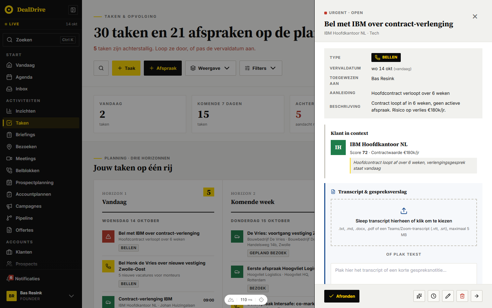

### Opbouw in HTML

```html
<div class="fo-overlay">
  <aside class="fo-panel" role="dialog" aria-modal="true" aria-labelledby="fo-titel" tabindex="-1">
    <header class="fo-head">
      <div class="fo-head-tekst">
        <span class="fo-kicker"><span class="fo-stip fo-stip--urgent"></span>Urgent · Open</span>
        <h2 class="fo-titel" id="fo-titel">Bel met Van Dijk over verlenging</h2>
        <p class="fo-meta">Van Dijk Installatietechniek · Installatie</p>
      </div>
      <button type="button" class="fo-sluit" aria-label="Sluiten">×</button>
    </header>
    <div class="fo-body">
      <dl class="defs">
        <div class="def-rij"><dt>Vervaldatum</dt><dd>wo 14 okt</dd></div>
      </dl>
      <article class="fo-blok">
        <header class="fo-blok-kop"><h3 class="fo-blok-titel">Klant in context</h3></header>
        <p class="fo-tekst">...</p>
      </article>
    </div>
    <footer class="fo-foot dd-acties">
      <button class="dd-act dd-act--primair">Afronden</button>
      <span class="dd-acties-vul"></span>
      <button class="dd-act dd-act--icoon" aria-label="Bewerken" title="Bewerken">...</button>
    </footer>
  </aside>
</div>
```

De volgorde is altijd: overlay, paneel, kop, inhoud, voet. Kop en voet staan vast; alleen `.fo-body` scrolt. Zonder record toont het paneel `.fo-leeg` met één zin ("Geen taak geselecteerd.").

### Gemeenschappelijke opbouw (gemeten op TaakFlyout, geteld over 41 componenten)

| Onderdeel | Standaard | Telling | Afwijking |
|---|---|---|---|
| Overlay | `--overlay` (inkt op 0.45), z-index `--z-modal` (40) | 27x | `--overlay-donker` (0.55) bij 11 analyseflyouts, 0.35 bij DealFlyout |
| Paneel | wit, border-left 1px `--ink`, 100% breed tot max-width | 37x wit, 36x rand | var(--bg) bij AI-flyouts en DealFlyout |
| Kop | padding 24px 28px 16px, `--surface`, onderrand 1px `--border` | 19x (plus 9x met 18px onder) | wit zonder vlak 8x, inkt 2x |
| Kicker | 11px (`--fs-label`), 700, 0.1em (1.1px), kapitalen, `--muted` | 26x | 800 en 0.12em in 5 compacte flyouts |
| Titel | `--font-serif`, 22px (`--fs-venstertitel`), 700, regelhoogte 1.25, marge 6px 0 4px | 32x | sans 18px 800 in 4 compacte flyouts |
| Metaregel | 12px, `--muted` | gemeten | |
| Sluitknop | teken × 28px, `--muted`, vlak 44 bij 44, hover `--ink` | 20x | Lucide X 20px in omlijst vlak 32 bij 32: 12x |
| Inhoud | padding 18px 28px 28px, overflow-y auto | 12x (plus 9x zonder onderruimte) | scroll met vaste balk in Taak en Inzicht |
| Voet | padding 16px 28px, `--surface`, bovenrand 1px `--border`, gap 8px | 14x | wit 10x, geen voet 6x |
| Knoppen in voet | `.dd-act` 37px hoog, primair inkt met geel; icoon 34 bij 34 | gemeten | zie deel B |

### Breedtes

| Breedte (token) | Klasse | Aantal | Voor |
|---|---|---|---|
| 520px (`--venster-w`) | `.fo-panel` | 15 | detail en aanmaken: taak, afspraak, deal, inzicht, briefing |
| 560px (`--venster-w-breed`) | `.fo-panel--breed` | 12 | analyse, accountplan, verslag, document, upload, dagstart |
| 480px (`--venster-w-smal`) | `.fo-panel--smal` | 6 | gegevens, contacten, historie, campagne |
| 640px (`--venster-w-ruim`) | `.fo-panel--analyse` | 2 | AI-analyse van transcript en gesprek |
| 900px (`--venster-w-vol`) | `.fo-panel--vol` | 2 | organisatiebeheer, meeting-achterstand |
| 460, 580, 620px | geen klasse | 4 | uitzonderingen: kies 480 of 560 |

Op een telefoon is elk paneel schermbreed (gemeten 375px bij een scherm van 375px). Er is geen apart volledig-scherm-ontwerp: kop, inhoud en voet blijven gelijk. Zes analyseflyouts verkleinen onder 560px de binnenmarge naar 18px; `.fo-panel` doet dat in Dealtrace altijd.

### Inventaris van alle flyouts

Kop **S** is de standaardkop (grijs vlak, kicker, serif 22px, ×). **A** is de analysekop (grijs vlak, 18px onderruimte, omlijste X van 32px, witte voet, overlay `--overlay-donker`). **C** is de compacte kop (geen vlak, padding 20px 24px, sans 18px 800). **D** is donker (inkt met gele kicker). **W** is wit zonder vlak met serif 22px. Iconen in de voet staan tussen haken; hun naam is het aria-label en de tooltip.

| Flyout | Breedte | Kop | Voetknoppen | Gebruikt op |
|---|---|---|---|---|
| AccountplanFlyout | 560 | A | Nieuw: Annuleren, Plan aanmaken. Bewerken: Annuleren, Opslaan. Bekijken: Verwijderen, Wijzigen, Open accountplan, Sluiten | accountplannen, klantkaart |
| ActiviteitFlyout | 560 | W | Sluiten, Vraag AI | app.vue |
| AfspraakAnalyseFlyout | 640 | D | Sluiten, Open AI-chat over dit transcript | MobileShell |
| AfspraakFlyout | 520 | S | Lezen: Open meeting of Volledige briefing, [Vraag AI] [Volledige briefing] [Bewerken] [Verwijderen] [Open klantkaart]. Bewerken: Annuleren, ✓ Opslaan | app.vue, taken, accountplannen |
| AiChatFlyout | 520 | D | invoerveld met [Verstuur] | app.vue |
| BriefingFlyout | 520 | S | Volledige briefing, Klaar met wijzigen, [Wijzigen] [Open contact] [Open klantkaart] | app.vue, Vandaag |
| BriefingOverviewFlyout | 520 | S | Alle briefings →, Volledige briefing | app.vue, klantkaart |
| CampagneAccountsFlyout | 460 | C | Annuleren, + Voeg toe aan Gespot (n) | campagnebord |
| CampagneFlyout | 480 | S | Lezen: Open campagnebord →, [Wijzigen]. Bewerken: Annuleren, ✓ Opslaan | campagnes, campagnebord |
| CampagneVoortgangFlyout | 460 | C | Sluiten | campagnebord |
| ContactenFlyout | 480 | S | Alle contacten → (tekstlink) | klantkaart |
| ContactInfoFlyout | 480 | S | geen voet; Verwijder contact onderaan de inhoud | contactkaart |
| DagstartFlyout | 560 | A | Bekijk je week, maand en kwartaal → (tekstlink) | Vandaag |
| DashboardKpiFlyout | 580 | A | lijstlink (bijvoorbeeld Open pipeline), Vraag Dex over deze KPI | verdieping, rapportages |
| DealFlyout | 520 | eigen | Markeer gewonnen of Heropen deal, Markeer verloren of Verliesreden, [Vraag AI] [Wijzigen] [Verwijderen] [Open klantkaart] | app.vue |
| DekkingFlyout | 560 | A | Open klantenlijst of Open prospects-lijst | rapportages |
| DocumentDetailFlyout | 560 | A | Verwijderen, Openen | kennisbank, klantkaart, contactkaart |
| DownloadFlyout | 520 | A | Download | 5 analysepagina's |
| FaseDealsFlyout | 560 | A | Open pipeline | rapportages |
| GespreksanalyseFlyout | 640 | W | geen voet | app.vue |
| GespreksverslagFlyout | 520 | S | Open in klantkaart, + Taak hieruit | niet in gebruik |
| HistorieFlyout | 480 | S (titel 28px) | + Taak, + Afspraak, Hele kaart in DealDrive → | dagstart, verdieping |
| InfoFlyout | 480 | S | geen voet; Verwijder account onderaan de inhoud | klantkaart |
| InzichtFlyout | 520 | S | Lezen: Maak taak, [Vraag AI] [Bewerken] [Markeer als gelezen] [Wijs af]. Bewerken: Annuleren, ✓ Opslaan | 8 plekken |
| KennisbankUploadFlyout | 560 | A, laag boven | Annuleren, ↑ Upload n | DealFlyout, klantkaart, contactkaart, kennisbank |
| MeetingAchterFlyout | 900 | A | geen voet | meetingritme |
| NieuwAccountFlyout | 520 | C | Annuleren, Klant aanmaken of Prospect aanmaken | klanten, prospects |
| NieuwContactFlyout | 480 | C | Annuleren, Contact aanmaken | contacten |
| NieuweActiviteitFlyout | 560 | S | Annuleren, + Regel toevoegen | instellingen |
| NieuweAfspraakFlyout | 520 | S | Annuleren, ✓ Plan afspraak | app.vue, accountplannen |
| NieuweCampagneFlyout | 560 | S (32px zijmarge, titel 24px) | Annuleren, Opslaan als concept | campagnes |
| NieuweDealFlyout | 520 | W | Annuleren, Deal toevoegen of Wijzigingen opslaan | app.vue |
| NieuweTaakFlyout | 520 | S | Annuleren, ✓ Maak taak | app.vue, accountplannen |
| NieuwVerslagFlyout | 560 | S | Annuleren, ✨ Analyseer; daarna ↺ Reset, ✓ Keur n goed | niet in gebruik |
| OfferteBriefingFlyout | 520 | S | Open klantkaart →, + Opvolg-taak | 5 plekken |
| OrganisatieFlyout | 900 | A (witte kop op grijs paneel) | geen voet; Opslaan en Annuleren per blok | admin (HQ) |
| RegelsImportFlyout | 560 | S | Samenvoegen, Alles vervangen, Annuleren | instellingen |
| ResultaatVerdiepFlyout | 560 | A | Sluiten | team |
| StartplanArchiefFlyout | 620 | A | Download als tekst, Afdrukken of opslaan als PDF | instellingen |
| TaakFlyout | 520 | S | Lezen: Afronden, [Vraag AI] [Snooze 1 dag] [Bewerken] [Verwijderen] [Open klantkaart]. Leesstand: Open op Taken, [Open klantkaart]. Bewerken: Afronden, Afronden en volgende taak, Annuleren, ✓ Opslaan | 12 plekken |
| VerslagFlyout | 520 | S, laag boven | Vraag AI, Open klantkaart → | app.vue |

### De voet: welke knoppen en in welke volgorde

- **Detailflyout, lezen.** Eén actie houdt het woord: de reden waarom je het venster opende (Afronden, Maak taak, Markeer gewonnen, Open meeting). Die staat links, primair (inkt met geel). Daarna een vuller en de rest als icoonknop van 34 bij 34 met tooltip, altijd in deze volgorde: helpen (Vraag AI), uitstellen (Snooze 1 dag), wijzigen (Bewerken), weggooien (Verwijderen, rood icoon), weggaan (Open klantkaart, pijl). Zo staat het in TaakFlyout, AfspraakFlyout, InzichtFlyout en DealFlyout.
- **Detailflyout, bewerken.** Dezelfde flyout schakelt naar een formulier; de voet wordt Annuleren (secundair) en "✓ Opslaan" (primair). Tijdens opslaan staat er "Opslaan…" en is de knop uitgeschakeld.
- **Aanmaakflyout.** Annuleren links, primaire knop rechts met het werkwoord: "✓ Maak taak", "✓ Plan afspraak", "Contact aanmaken", "Deal toevoegen". Tijdens opslaan "Opslaan…" of "Aanmaken…".
- **Analyseflyout.** Eén of twee knoppen die verder leiden: een lijst openen ("Open pipeline") en eventueel "Vraag Dex over deze KPI". Witte voet.
- **Geen voet** bij flyouts die alleen tonen of die per blok opslaan (ContactInfo, Info, Gespreksanalyse, MeetingAchter, Organisatie). Verwijderen staat daar als laatste blok in de inhoud.
- Uitzondering: RegelsImportFlyout gebruikt de kopknoppen `.dd-actie` in de voet en HistorieFlyout zet + Taak en + Afspraak als gekleurde actieknoppen in de voet. Dealtrace gebruikt in een voet alleen `.dd-act`.

### Blokken in de inhoud

| Klasse | Rand links | Achtergrond | Gebruik |
|---|---|---|---|
| `.fo-blok` | 3px `--border-strong` | wit | gewoon blok (Klant in context, Volgende stap) |
| `.fo-blok--accent` | 3px `--yellow` | `--yellow-zacht` (geel op 0.06) | aanbeveling, belangrijkste blok |
| `.fo-blok--agent` | 3px `--ink` | `--surface` | AI-voorzet, Pitstop |
| `.fo-blok--gevaar` | 3px `--red` | `--red-zacht` (rood op 0.08) | risico, verloren deal |
| `.defs` | geen | `--surface`, padding 14px 16px | gegevenslijst: label 110px breed, 11px kapitalen 0.06em |

Bloktitel: serif 14px 700. Bloktekst: 13px, regelhoogte 1.55. Blokkicker: 11px 800 0.15em. Een link in een flyout is inkt 600 met een gele onderstreep van 2px (`.fo-link`), hover `--yellow-dark`. Te laat is rood 600 (`.fo-over-tijd`). DealFlyout zet bovenaan drie cijfers op een rij (`.fo-cijfers`: Waarde, Kans, Gewogen).

### Gedrag

1. **Openen.** De pagina zet `open` op true. De overlay vervaagt in `var(--transition-base)` (200ms ease-out, gemeten). In de code schuift het paneel met `translateX(100%)` in, maar omdat de binnenste `<Transition>` geen `appear` heeft, verschijnt het paneel in de praktijk zonder schuiven. Geef in Dealtrace de binnenste Transition `appear` mee, dan schuift het paneel in 200ms in.
2. **Focus.** `useFlyoutA11y` (41 van 41) onthoudt welk element de flyout opende, zet `aria-modal="true"` en `tabindex="-1"` op het paneel en zet de focus op het paneel (gemeten: `aside.tk-panel`). Formulieren die zelf hun eerste veld focussen geven `initialFocus: false` mee (6x).
3. **Focusval.** Tab en Shift+Tab blijven binnen het paneel (gemeten: na 60 keer Tab staat de focus nog in het paneel). Alleen de bovenste open laag vangt Tab.
4. **Scrollen.** De pagina eronder scrolt niet mee: `useBodyScrollLock` zet `overflow: hidden` op body (40 van 41, gemeten). Alleen `.fo-body` scrolt; kop en voet staan vast. De voet krimpt nooit (`flex-shrink: 0`).
5. **Sluiten.** Drie wegen, alle drie gelijk: het kruis, een klik op de overlay (`@click.self`) en Escape. Bij sluiten gaat de focus terug naar het element dat de flyout opende.
6. **Escape.** Alleen de bovenste laag sluit. Met `onEscape` in `useFlyoutA11y` (14x) werkt dat via een gedeelde stapel; 25 flyouts luisteren zelf op `keydown`, 2 kennen geen Escape (ActiviteitFlyout, GespreksanalyseFlyout). Gemeten: Escape met een bevestigingsvenster open sluit alleen dat venster, de tweede Escape sluit de flyout. Een veld dat Escape zelf gebruikt (een zoeklijst) stopt het event en houdt de flyout open. Dealtrace gebruikt altijd de stapel.
7. **Geneste flyouts.** Een flyout uit een flyout (upload vanuit de deal, verslag vanuit de afspraak) ligt op `--z-modal-boven` (45) met een eigen overlay (`.fo-overlay--boven`). Dex (AiChatFlyout) en de globale zoek liggen op `--z-toast` (50), zodat ze over elke flyout openen. HistorieFlyout ligt één laag onder `--z-modal`.
8. **Na opslaan.** Een aanmaakflyout sluit en toont een toast: "Taak aangemaakt.", "Afspraak ingepland.", "Deal bijgewerkt.". Een detailflyout in bewerkstand gaat terug naar lezen, zonder toast: de nieuwe waarden staan meteen in beeld. Mislukt opslaan, dan blijft de flyout open en staat er boven de voet een `.fo-fout` ("Opslaan mislukt: taak niet gevonden.").
9. **Verwijderen.** Altijd eerst het bevestigingsvenster ("Taak verwijderen?" met "Verwijderen" in rood). Na ja sluit de flyout en volgt een toast in de infokleur: "Taak verwijderd.", "Deal verwijderd.", "Afspraak verwijderd.".
10. **Niet-opgeslagen wijzigingen.** De meeste flyouts sluiten zonder vraag en gooien een half ingevuld formulier weg. Alleen AccountplanFlyout vraagt het: bij Escape of een klik op de overlay met onbewaarde tekst verschijnt "Wijzigingen weggooien?" met de knop "Weggooien" (rood). De knop Annuleren vraagt niets, want die indrukken is een keuze. Neem dat gedrag in Dealtrace over voor elk formulier met vrije tekst.
11. **Bewegingsgevoeligheid.** Bij `prefers-reduced-motion: reduce` vallen alle overgangen weg (globaal in tokens.css en per groep in dit bestand).

### Varianten en toestanden

| Variant of toestand | Klasse | Maat en kleur |
|---|---|---|
| Standaard | `.fo-panel` | 520px, wit, rand links 1px inkt |
| Donkere AI-kop | `.fo-panel--ai` met `.fo-head--donker` | kop inkt, padding 20px 24px 16px, kicker geel 0.18em, paneel `--bg` |
| Analyse | `.fo-overlay--donker`, `.fo-sluit--kader`, `.fo-foot--wit` | overlay 0.55, X 32 bij 32 met rand `--border`, witte voet |
| Bovenop een flyout | `.fo-overlay--boven` | z-index `--z-modal-boven` (45) |
| Formulier | `.fo-body--formulier` | kolom met gap 14px |
| Lijst tot de rand | `.fo-body--vlak` | padding 0 |
| Geen record | `.fo-leeg` | padding 40px 28px, 14px, `--muted`, gecentreerd |
| Sluitknop hover en focus | `.fo-sluit:hover`, `:focus-visible` | kleur `--ink`; omlijning 2px inkt |
| Fout na opslaan | `.fo-fout` | rand links 3px rood, `--red-zacht`, 13px rood |
| Telefoon onder 560px | media query | kop 18px 18px 14px, inhoud 14px 18px 18px, voet 12px 18px plus veilige zone |

### Teksten

- Sluitknop: teken ×, aria-label "Sluiten".
- Kicker: soort en status met een middenpunt: "Urgent · Open", "Nieuwe taak · Middel", "Kennisbank · upload", "Verdieping · Team · Deze maand".
- Voet: "Annuleren", "✓ Opslaan", "Opslaan…", "Afronden", "Bewerken", "Wijzigen", "Verwijderen", "Vraag AI", "Open klantkaart", "Sluiten".
- Leeg: "Geen taak geselecteerd.", "Geen campagne geselecteerd.", "Dit account bestaat niet in jouw organisatie."

### Waar in DealDrive

`app/components/*Flyout.vue` (41), `app/composables/useFlyoutA11y.ts`, `useBodyScrollLock.ts`, `useScrollLock.ts`. Pagina-eigen flyouts met dezelfde opbouw: `pages/belblokken.vue` (440px), `pages/bezoek-analyse.vue` (900px), `pages/rapportage-activiteiten.vue` (560px), `pages/team.vue` (560px), `pages/team-weekrapport.vue` (560px), `pages/instellingen/pipelines.vue` (520px), `components/MatrixAnalyse.vue` (900px), `components/MailOpstellen.vue` (560px). Die gebruiken `--bg` als paneelkleur en een rand `--border-strong`; kies in Dealtrace de standaard van de componenten.

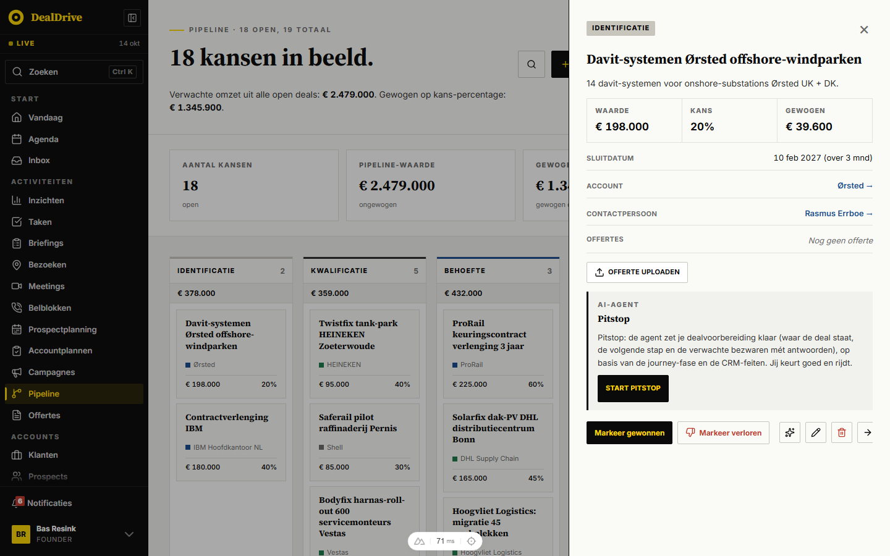

DealFlyout wijkt af: geen kopvlak, het hele paneel scrolt (padding 24px 28px 28px op `--bg`, gap 14px) en de actierij staat in de inhoud in plaats van in een vaste voet. Gebruik dat niet als voorbeeld.

## Bevestigingsvenster

### Wat het is

Een klein venster in het midden van het scherm dat één vraag stelt met twee antwoorden. Het vervangt `window.confirm()`. Eén exemplaar staat in app.vue; elke vraag loopt via `useConfirm().ask(bericht, opties)` en geeft een belofte met ja of nee terug.

### Wanneer wel en wanneer niet

- Wel: vóór alles wat niet terug kan (verwijderen, overschrijven, een deal op gewonnen zetten, ingevulde tekst weggooien).
- Niet als bevestiging achteraf (dat is een toast) en niet voor keuzes met meer dan twee uitkomsten (dat is een flyout).

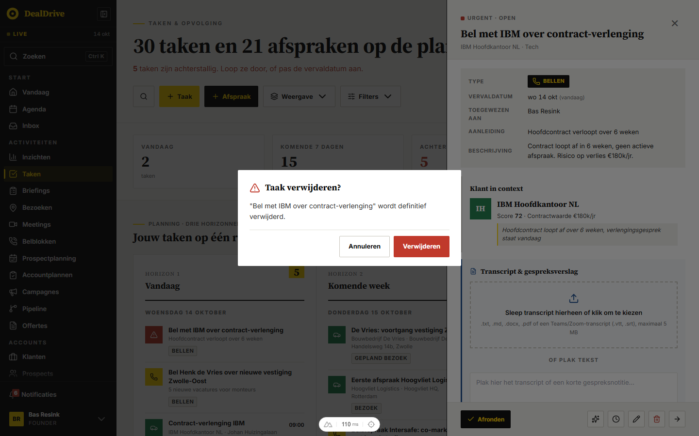

### Opbouw in HTML

```html
<div class="cd-overlay">
  <div class="cd-dialog" role="alertdialog" aria-modal="true" aria-labelledby="cd-titel" aria-describedby="cd-tekst">
    <header class="cd-head">
      <svg class="cd-icon cd-icon--gevaar" aria-hidden="true"><!-- AlertTriangle --></svg>
      <h3 class="cd-title" id="cd-titel">Taak verwijderen?</h3>
    </header>
    <p class="cd-message" id="cd-tekst">"Bel met Van Dijk over verlenging" wordt definitief verwijderd.</p>
    <footer class="cd-foot">
      <button class="cd-btn cd-btn--ghost">Annuleren</button>
      <button class="cd-btn cd-btn--danger">Verwijderen</button>
    </footer>
  </div>
</div>
```

### Maten en kleuren (gemeten)

| Onderdeel | Waarde |
|---|---|
| Overlay | `--overlay-donker` (inkt op 0.55), z-index `--z-toast` (50), padding 24px, inhoud gecentreerd |
| Venster | 460px breed, wit, padding 22px 24px 18px, gap 12px, hoek 2px |
| Icoon | 22px; vraag (HelpCircle) `--blue`, gevaar (AlertTriangle) `--red` |
| Titel | `--font-serif`, 18px (`--fs-kaarttitel`), 700, `--ink` |
| Tekst | 14px, regelhoogte 1.55, `--ink-soft` |
| Voet | rechts uitgelijnd, gap 8px, bovenrand 1px `--border`, padding-top 12px |
| Knoppen | 44px hoog, padding 10px 18px, 13px 700 |
| Annuleren | transparant, rand `--border-strong`, hover rand `--ink` |
| Bevestigen | geel met inkt, hover `--yellow-dark` |
| Gevaar | rood met wit, hover `--red-dark` |

### Gedrag

1. Openen: overlay vervaagt in 180ms (`--duur-uit`); het venster springt op van 92% naar 100% in 220ms (`--duur-in`) met een lichte overshoot (`--curve-opveer`, `cubic-bezier(0.18, 0.89, 0.32, 1.28)`). Sluiten 150ms (`--duur-kort`).
2. De focus start op **Annuleren** (gemeten), zodat Enter nooit per ongeluk iets verwijdert.
3. Escape, een klik naast het venster en Annuleren geven nee. Escape sluit alleen het venster, niet de flyout eronder (gemeten).
4. Dezelfde focusval als de flyouts.
5. Op een telefoon (onder 560px) staan de knoppen in Dealtrace onder elkaar, bevestigen bovenaan. DealDrive laat ze naast elkaar staan.

### Teksten

- Titel is een vraag met vraagteken: "Taak verwijderen?", "Deal verwijderen?", "Contact verwijderen?", "Account verwijderen?", "Gebruiker verwijderen?", "Deal gewonnen?", "Wijzigingen weggooien?".
- Tekst noemt het record tussen aanhalingstekens en zegt wat er blijft: "wordt definitief verwijderd. Offertes en documenten van het account blijven staan."
- Knoppen: "Annuleren" en het werkwoord: "Verwijderen", "Weggooien", "Markeer gewonnen". Zonder label wordt het "Verwijderen" als de vraag over verwijderen gaat, anders "Bevestigen".
- Standaardtitel zonder opgave: "Bevestigen".

### Waar in DealDrive

`app/components/ConfirmDialog.vue`, `app/composables/useConfirm.ts`. De knoppen houden de DealDrive-namen `cd-btn--ghost`, `cd-btn--primary` en `cd-btn--danger` en staan in deel B; dit deel regelt overlay, venster, kop, tekst en voet.

## Overige vensters

### Wat het is

Een venster in het midden (vanaf 768px) of van onderen (telefoon), voor een taak die geen record is: een synchronisatieconflict oplossen (ConflictResolveModal, 760px) of uitleggen hoe je de app installeert (IOSInstallModal, 420px).

### Wanneer wel en wanneer niet

- Wel: een korte, losse taak die de gebruiker moet afmaken of wegklikken, zonder relatie met een record.
- Niet voor recordwerk: dat is een flyout. Niet voor ja of nee: dat is het bevestigingsvenster.

### Opbouw in HTML

```html
<div class="venster-overlay">
  <aside class="venster" role="dialog" aria-modal="true" aria-labelledby="v-titel">
    <header class="venster-kop">
      <div><span class="venster-kicker">Conflict-resolutie</span>
        <h2 class="venster-titel" id="v-titel">Server heeft een nieuwere versie</h2></div>
      <button class="fo-sluit" aria-label="Sluiten">×</button>
    </header>
    <div class="venster-body">...</div>
    <footer class="venster-voet">knoppen uit deel B</footer>
  </aside>
</div>
```

### Varianten en toestanden

| Variant | Klasse | Maat |
|---|---|---|
| Breed venster | `.venster` | max 760px, max 92vh hoog, rand 1px inkt |
| Klein venster | `.venster--klein` | max 420px |
| Kop | `.venster-kop` | padding 18px 22px 14px, kicker 11px 0.08em, titel serif 20px |
| Voet | `.venster-voet` | `--surface`, padding 14px 22px, knoppen rechts, mag afbreken |
| Telefoon | onder 768px | van onderen, schuift met `translateY(100%)` in |
| Groot scherm | vanaf 768px | gecentreerd, padding 32px rondom, schaalt van 96% naar 100% |
| Notitie in venster | `.venster-noot` | `--surface`, rand links 3px `--border-strong` |

### Gedrag

Overlay `--overlay-donker` (0.55) op `--z-modal`. Sluiten via het kruis, de overlay of de knop Annuleren. IOSInstallModal heeft een vervaagde achtergrond (`backdrop-filter: blur(4px)`, 0.65) en één knop "Begrepen". ConflictResolveModal heeft knoppen in kapitalen (12px) van 48px hoog; Dealtrace gebruikt in vensters de gewone knoppen uit deel B.

### Waar in DealDrive

`app/components/ConflictResolveModal.vue` (op `pages/sync.vue`), `app/components/IOSInstallModal.vue` (in MobileShell).

## Toasts

### Wat het is

Een korte melding rechtsonder die na een actie bevestigt wat er gebeurde of wat misging. Zwart vlak, witte tekst, gekleurde rand links en een icoon in dezelfde kleur.

### Wanneer wel en wanneer niet

- Wel: na aanmaken ("Taak aangemaakt."), verwijderen ("Deal verwijderd."), een achtergrondactie ("Weekrapport als tekst gekopieerd.") of een fout zonder vaste plek ("Opslaan mislukt. Probeer het opnieuw.").
- Niet na opslaan in een open detailflyout: daar zie je het resultaat al.
- Niet voor een fout bij een veld of formulier dat open staat: die staat bij het veld of boven de voet.
- Niet om iets te vragen: een toast heeft geen knoppen. Er is geen "Ongedaan maken"; wat niet terug kan, krijgt vooraf een bevestiging.

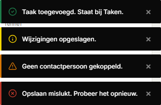

### Opbouw in HTML

```html
<div class="toast-stack" role="status" aria-live="polite">
  <div class="toast toast--succes">
    <svg class="toast-icoon" aria-hidden="true"><!-- CheckCircle2 --></svg>
    <span class="toast-tekst">Taak aangemaakt.</span>
    <button class="toast-sluit" aria-label="Sluiten">×</button>
  </div>
</div>
```

### Varianten en toestanden

| Soort | Klasse | Rand en icoon | Icoon (Lucide) | Duur |
|---|---|---|---|---|
| Succes | `.toast--succes` | `--green` | CheckCircle2 | 4 s |
| Info | `.toast` | `--yellow` | Info | 4 s |
| Let op | `.toast--let-op` | `--orange` | AlertTriangle | 4 s |
| Fout | `.toast--fout` | `--red` (icoon in Dealtrace `--red-light` voor contrast op inkt) | XCircle | 6 s |

Gemeten: 280 tot 420px breed, 48px hoog, padding 12px 14px, 13px 500, rand links 3px, sluitknop 24 bij 24 in `--wit-55` (DealDrive: wit op 50%). Stapel rechtsonder op 16px van de rand, gap 8px, z-index `--z-melding` (100, boven `--z-toast`). In de app: 57x succes, 31x info, 38x fout, 3x let op.

### Gedrag

1. Nieuwe toasts komen onderaan de stapel; maximaal 5, de oudste valt weg.
2. Verschijnen en verdwijnen in 220ms (`--duur-in`): vervagen en 12px omhoog of omlaag. De rest schuift mee (`.toast-move`).
3. Een klik op de toast of op × sluit hem. Na 4 seconden (fout 6) gaat hij vanzelf.
4. Staat er een install- of pushprompt rechtsonder, dan begint de stapel erboven.
5. Op een telefoon (Dealtrace) loopt de stapel van rand tot rand.

### Teksten

Korte zin met punt, in de verleden tijd of als feit: "Taak aangemaakt.", "Afspraak ingepland.", "Deal bijgewerkt.", "Verliesreden vastgelegd.", "Accountplan opgeslagen.", "Taak verwijderd.". Fout: wat er misging en wat je kunt doen: "Vastleggen mislukt. Probeer het opnieuw.".

### Waar in DealDrive

`app/components/ToastContainer.vue`, `app/composables/useToast.ts` (API: `toast.success`, `info`, `warn`, `error`). DealDrive heet de soorten `success`, `info`, `warn`, `error`; Dealtrace houdt `--succes`, `--let-op`, `--fout`.

## Banner

### Wat het is

Een balk over de volle breedte bovenaan de pagina die een toestand van de hele app meldt. In DealDrive is dat alleen de OfflineBanner: offline (rood) of wijzigingen die niet konden worden opgeslagen (inkt, met een knop).

### Wanneer wel en wanneer niet

- Wel: een toestand die blijft tot hij voorbij is en die alles op de pagina raakt.
- Niet voor een melding over één actie (toast) of één blok (`.fout-blok`).
- Geen sluitknop: de banner verdwijnt zodra de toestand voorbij is.

### Opbouw in HTML

```html
<div class="banner banner--offline" role="status" aria-live="polite">
  <div class="banner-inner">
    <span class="banner-icoon"><svg>...</svg></span>
    <span class="banner-tekst"><strong>Offline.</strong> Je werk wordt lokaal opgeslagen.</span>
  </div>
</div>
```

### Varianten en toestanden

| Variant | Klasse | Kleur | Knop |
|---|---|---|---|
| Offline | `.banner--offline` | `--red`, witte tekst | geen |
| Vastgelopen | `.banner--sync` | `--ink`, witte tekst | "Opnieuw proberen" |
| Bezig | `.banner-icoon--draait` | icoon draait in 1.2s | knop "Bezig…", uitgeschakeld, cursor wachten |

Maten: binnenkant max `--container-w`, padding 10px 16px, 13px, icoon 20px, gap 12px. Knop geel, 44px hoog, 12px 700 in kapitalen 0.02em, hover `--yellow-dark`. Plakt bovenaan (`position: sticky`) op `--z-fixed`, met de veilige zone van een telefoon erboven. Komt binnen door 100% omhoog te schuiven en te vervagen in 200ms.

### Teksten

"**Offline.** Je werk wordt lokaal opgeslagen en gesynchroniseerd zodra je weer verbinding hebt.", "**Offline.** 3 wijzigingen wachten op sync.", "**2 wijzigingen** konden niet worden opgeslagen · sinds 10 minuten." met de knop "Opnieuw proberen".

### Waar in DealDrive

`app/components/OfflineBanner.vue`, ingezet in `MobileShell.vue`.

## Meldingen: notificatielijst en belpaneel

### Wat het is

Notificaties (dealrisico, hot prospect, dagstart, herinnering, inzicht) staan op een eigen pagina als rijen met een kleurbalk links. De bel zelf is een regel onderin de zijbalk met een rode teller (deel A) die naar `/notificaties` leidt. Het uitklappaneel van NotificationBell bestaat in de code maar wordt nergens gebruikt; het staat hier voor het geval Dealtrace een bel in een bovenbalk krijgt.

### Opbouw in HTML

```html
<ul class="melding-lijst" role="list">
  <li class="melding melding--ongelezen">
    <span class="melding-balk melding-balk--kritiek"></span>
    <div class="melding-body">
      <div class="melding-meta">
        <span class="pil pil--rood-vol">Kritiek</span>
        <span class="melding-tijd">2 uur geleden</span>
        <span class="melding-stip" aria-label="Ongelezen"></span>
      </div>
      <h3 class="melding-titel">Deal Van Dijk staat 21 dagen stil</h3>
      <p class="melding-tekst">Geen contact sinds de offerte.</p>
    </div>
    <div class="melding-acties">Openen · Markeer gelezen · Verberg</div>
  </li>
</ul>
```

### Varianten en toestanden

| Onderdeel | Klasse | Waarde |
|---|---|---|
| Rij | `.melding` | wit, rand `--border`, hover rand `--ink` |
| Ongelezen | `.melding--ongelezen` | achtergrond `--surface`, gele stip 8px met inktrand |
| Kleurbalk | `.melding-balk--kritiek`, `--hot`, `--dagstart`, `--herinnering`, `--inzicht` | rood, paars, blauw, geel, groen |
| Titel | `.melding-titel` | serif 17px 700 |
| Acties | `.melding-acties` | op telefoon onder de tekst, vanaf 768px rechts in een kolom |
| Belpaneel | `.bel-paneel` | 360px, rand 1px inkt, kop serif 18px, lijst max 360px hoog |
| Belitem ongelezen | `.bel-item--ongelezen` | titel 700, categorie in inkt |

### Gedrag en teksten

Knoppen per rij: "Openen" (primair, markeert ook gelezen), "Markeer gelezen", "Verberg". Kop van de pagina: "Alles gelezen". Lege lijst: "Geen notificaties". Het belpaneel opent met een schaal van 96% naar 100% in 120ms vanaf rechtsboven en sluit bij een klik erbuiten; kop "Notificaties" met "Alles bijgewerkt" of "3 ongelezen", knop "Alle gelezen", voet "Alle notificaties →" en "Voorkeuren".

### Waar in DealDrive

`app/pages/notificaties.vue`, de belregel in `app/components/AppSidebar.vue`, `app/components/NotificationBell.vue` (niet in gebruik).

## Globale zoek

### Wat het is

Een zoekvenster (command palette) dat overal opent met Ctrl+K of Cmd+K, of via de zoekregel in de zijbalk. Eén invoer zoekt tegelijk in klanten, contacten, taken, agenda, deals, offertes, inzichten, mail en documenten; resultaten staan per soort gegroepeerd.

### Wanneer wel en wanneer niet

- Wel: snel naar een record springen zonder te weten in welke lijst het staat.
- Niet als filter op een lijstpagina: dat is het zoekveld in de filterbalk (deel B).

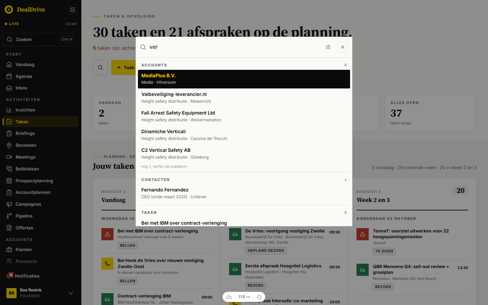

### Opbouw in HTML

```html
<div class="zoek-overlay">
  <div class="zoek-paneel" role="dialog" aria-modal="true" aria-label="Zoeken in Dealtrace">
    <div class="zoek-veld">
      <svg class="zoek-veld-icoon">...</svg>
      <input class="zoek-invoer" type="text" enterkeyhint="search" aria-label="Zoekterm">
      <button class="zoek-filterknop" aria-label="Kies waarin gezocht wordt">...</button>
      <button class="zoek-sluit" aria-label="Sluiten">...</button>
    </div>
    <div class="zoek-lijst" role="listbox" aria-label="Zoekresultaten">
      <section class="zoek-groep">
        <header class="zoek-groep-kop"><span class="zoek-groep-label">Klanten</span><span class="zoek-groep-telling">3</span></header>
        <button class="zoek-rij zoek-rij--actief" role="option" aria-selected="true">
          <span class="zoek-rij-titel">Van Dijk Installatietechniek</span>
          <span class="zoek-rij-detail">Zwolle · Installatie</span>
        </button>
      </section>
    </div>
  </div>
</div>
```

### Maten en kleuren (gemeten)

| Onderdeel | Waarde |
|---|---|
| Overlay | `--overlay` (inkt op 0.45), z-index `--z-toast` (50), padding 12vh 16px 24px (108px boven bij 900px) |
| Paneel | 640px breed (`--venster-w-ruim`), max 560px hoog, `--bg`, rand 1px `--border-strong` |
| Invoer | 16px, 44px hoog, zonder rand, placeholder `--muted-light` |
| Groepslabel | 11px 800, 0.14em, kapitalen, `--muted` |
| Rij | min 44px, padding 8px 10px, titel 14px 600, detail 12px `--muted` |
| Rij hover | `--surface` |
| Actieve rij | `--ink`, titel `--yellow`, detail `--wit-70` (DealDrive: wit op 68%) |
| Sluitknop | 32 bij 32, rand `--border`, hover rand en icoon `--ink` |
| Filter | balk op `--surface` met een checkbox per soort |

### Gedrag

1. Ctrl+K of Cmd+K opent en sluit. Escape sluit. Een klik op de overlay sluit.
2. Pijl omhoog en omlaag kiezen een rij, Enter opent hem. Hover licht een rij alleen op en verandert de keuze niet.
3. De filterknop opent de balk met soorten; een teller op geel toont hoeveel soorten aan staan zolang niet alles aan staat. Knop "Alles weer aan".
4. Overlay vervaagt in 120ms.
5. Telefoon: paneel van boven tot onder (padding 12px 10px), de toetsenhint verdwijnt.

### Teksten

Placeholder: "Zoek in klanten, contacten, taken, agenda, deals, offertes, inzichten, mail en documenten…". Hint: "↑ ↓ kiezen · Enter openen · Esc sluiten". Niets gevonden: "Niets gevonden voor **term**.". Meer: "nog 4, verfijn de zoekterm".

### Waar in DealDrive

`app/components/GlobaleZoek.vue`, `app/composables/useGlobaleZoek.ts`.

## Tabellen

### Wat het is

Een tabel voor cijfers en vergelijkingen: rapportages, analyses, instellingen. Kopcellen klein in kapitalen, rijen gescheiden door een lijn, getallen rechts met tabelcijfers.

### Wanneer wel en wanneer niet

- Wel: meer dan drie kolommen die je naast elkaar wilt vergelijken, of getallen die je optelt.
- Niet voor een lijst van accounts of contacten die je opent: dat is een lijstrij.

### Opbouw in HTML

```html
<div class="tabel-wrap">
  <table class="tabel">
    <thead><tr><th>Account</th><th class="cel-r">Waarde</th><th class="cel-r">Kans</th></tr></thead>
    <tbody>
      <tr><td class="cel-naam"><a class="tabel-link" href="#">Van Dijk Installatietechniek</a></td>
          <td class="cel-r">€ 48.000</td><td class="cel-r">60%</td></tr>
      <tr class="somrij"><td>Totaal</td><td class="cel-r">€ 48.000</td><td></td></tr>
    </tbody>
  </table>
</div>
```

### Varianten en toestanden

| Variant | Klasse | Kop | Cel |
|---|---|---|---|
| Standaard | `.tabel` | 11px 800 0.08em kapitalen `--muted` op `--surface` | 12px, padding 9px 11px, lijn `--border` |
| Rapport | `.tabel--rapport` | geen vlak, onderlijn 2px `--ink` | 14px, padding 10px 12px |
| Plakkende laatste kolom | `.tabel--plak` | idem | laatste kolom plakt rechts met lijn links |
| Rij hover | `tr:hover` | | `--bg` |
| Open rij | `tr.is-open` | | `--yellow-licht` (geel op 10%) |
| Somrij | `tr.somrij` | | `--bg`, bovenlijn `--border-strong`, 700 |
| Telefoon | onder 768px | padding 8px | naamcel breekt af |

Telling over 73 kopcelregels in 26 bestanden: 11px 27x, kapitalen 27x, `--muted` 28x, gewicht 800 17x tegen 700 11x, onderrand 1px `--border` 22x, 2px `--ink` 7x. De letterafstand varieert (0.06em tot 0.12em); 0.08em komt het vaakst voor. De klasse `.tabel` staat in 11 bestanden; 21 andere tabellen hebben een eigen naam met dezelfde opbouw.

### Gedrag

Een tabel scrolt horizontaal binnen `.tabel-wrap`. Een link in een tabel is `.tabel-link` uit deel A: inkt 600 zonder onderstreep, met een gele onderlijn bij hover. Sorteren staat in deel B.

### Waar in DealDrive

`pages/bezoek-analyse.vue`, `evaluaties.vue`, `rapportage-activiteiten.vue`, `startplannen.vue`, `instellingen/gebieden.vue`, `instellingen/verbruik.vue`, `components/MatrixAnalyse.vue`, `MeetingRitmeAnalyse.vue`, `AccountplanRitme.vue`, `EvaluatieBlokken.vue`, `WeekrapportFunnel.vue`.

## Lijstrijen

### Wat het is

Een rij in een lijst van accounts (of contacten) die als geheel klikbaar is: logo of initialen links, naam met fasepil, een regel met kanalen en feiten, de aanleiding met een gekleurde rand, en rechts de contactpersonen.

### Wanneer wel en wanneer niet

- Wel: lijsten van records die je opent (klanten, prospects, contacten).
- Niet voor cijfers die je vergelijkt (tabel) en niet in een kanban (kanbankaart).

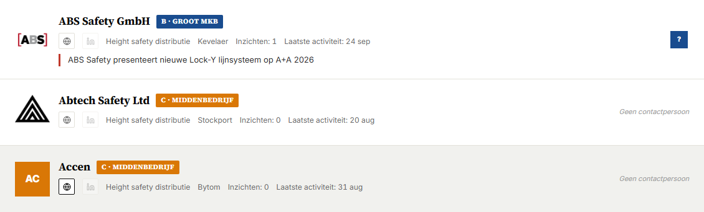

### Opbouw in HTML

```html
<div class="lijst">
  <article class="rij" role="button" tabindex="0">
    <span class="initialen">VD</span>
    <div class="rij-info">
      <h3 class="rij-titel">Van Dijk Installatietechniek <span class="pil pil--zwart">A</span></h3>
      <div class="rij-sub"><a class="kanaal" href="#" aria-label="Website">...</a> Zwolle · Installatie · 48 fte</div>
      <p class="rij-aanleiding">Nieuwe vestiging in Deventer geopend.</p>
    </div>
    <div class="rij-rechts">...</div>
  </article>
</div>
```

### Varianten en toestanden (gemeten op /klanten/alle)

| Onderdeel | Klasse | Waarde |
|---|---|---|
| Rij | `.rij` | padding 20px 24px, raster 56px 1fr auto, gap 14px, min 48px, wit, lijn onder `--border` |
| Hover | `.rij:hover` | `--surface`, overgang 150ms (`--duur-kort`) |
| Focus | `.rij:focus-visible` | omlijning 2px inkt binnen de rij |
| Compact | `.rij--compact` | padding 12px 16px |
| Ongelezen of nieuw | `.rij--ongelezen` | `--surface` |
| Titel | `.rij-titel` | serif 18px 700, -0.005em |
| Subregel | `.rij-sub` | 12px `--muted`, gap 12px |
| Aanleiding | `.rij-aanleiding`, `--heet`, `--let-op` | rand links 3px geel, rood of oranje, 13px `--ink-soft` |
| Kanaal | `.kanaal`, `.kanaal--leeg` | 26 bij 26, rand `--border`; zonder adres 35% en niet klikbaar |
| Telefoon | onder 800px | twee kolommen, rechterdeel onder de tekst |

### Gedrag

Klik, Enter of spatie opent het record (flyout of pagina). Rechtsklik opent het contextmenu (deel B). Een klik op een kanaal of contact opent alleen dat en niet de rij. Ontbrekende gegevens laten hun plek leeg in plaats van een streepje te tonen.

### Waar in DealDrive

`app/components/AccountRow.vue` op `pages/klanten/alle.vue` en `pages/prospects/alle.vue`; logo uit `AccountLogo.vue`, fasepil `acct-fase` (in Dealtrace een pil uit deel B).

## Kaarten

### Wat het is

Een afgebakend blok inhoud. DealDrive kent vier soorten: de basiskaart (wit met rand, op elke pagina eigen geschreven), de LeadCard (krantenopening met beeld en grote kop), de BriefingCard (vlak in donker, geel of licht) en de ResultaatTegel (klikbare cijfertegel). Statkaarten staan in deel A.

### Wanneer wel en wanneer niet

- Basiskaart: losse blokken naast elkaar in een raster, met `--kaart-gap` (16px) ertussen.
- LeadCard: de opening van een pagina (Vandaag, klantkaart, inzichten) met het belangrijkste inzicht. Eén per pagina.
- BriefingCard: een uitgelicht advies. Staat in de code maar wordt niet gebruikt.
- ResultaatTegel: een rij cijfers waarvan elke tegel een paneel eronder opent (team).

### Opbouw in HTML

```html
<article class="kaart kaart--klik">
  <header class="kaart-kop"><h3 class="kaart-titel">Kwartaalbezoek De Vries</h3><span class="pil">Bezoek</span></header>
  <div class="kaart-meta"><span>do 15 okt</span><span>Zwolle</span></div>
  <footer class="kaart-voet">...</footer>
</article>

<button class="tegel tegel--actief" aria-pressed="true">
  <span class="tegel-label">Afspraken</span>
  <span class="tegel-getal">23</span>
  <span class="tegel-onder tegel-onder--op">+4 op vorige week</span>
</button>
```

### Varianten en toestanden

| Kaart | Klasse | Maten en kleuren |
|---|---|---|
| Basis | `.kaart` | wit, rand `--border`, padding 16px; titel serif 18px |
| Vlak | `.kaart--vlak` | `--surface` |
| Accent | `.kaart--accent` | rand links 3px geel |
| Klikbaar | `.kaart--klik` | hover rand `--ink`, focus omlijning |
| LeadCard | `.lead-kaart` | padding 56px 0 40px; titel serif clamp(28px, 4vw, 48px); intro 18px; beeld 4:3 |
| LeadCard compact | `.lead-kaart--compact` | padding 20px 0 16px, geen beeld, titel clamp(20px, 2.4vw, 26px) |
| Kicker LeadCard | `.lead-kicker`, `--standaard`, `--opinie` | 11px 0.18em met streep van 24 bij 2; rood, inkt met geel, blauw |
| BriefingCard | `.briefing-kaart--donker`, `--geel`, `--licht` | padding 36px 40px, streep 60 bij 4, titel serif clamp(24px, 3vw, 34px) |
| Tegel | `.tegel` | `--surface`, rand `--border-strong`, label 11px 800, getal serif 21px |
| Tegel actief | `.tegel--actief` | rand 2px `--ink`, padding 1px kleiner zodat de tekst niet verspringt |
| Tegel alert | `.tegel--alert` | rand links 3px rood, getal rood |

### Waar in DealDrive

`app/components/LeadCard.vue`, `BriefingCard.vue` (niet in gebruik), `ResultaatTegel.vue` (`pages/team.vue`).

## Kanban

### Wat het is

Een bord met kolommen waarin kaarten door slepen van stap naar stap gaan. DealDrive heeft er twee: het campagnebord (Gespot, Open, Bezig, Klaar) en het pipelinebord (een kolom per fase).

### Wanneer wel en wanneer niet

- Wel: werk dat door vaste stappen gaat en waarbij je de verdeling over de stappen wilt zien.
- Niet als enige weergave: een kanban is een keuze in de weergaveschakelaar (deel B) naast een lijst.

### Opbouw in HTML

```html
<div class="kanban">
  <div class="kanban-col kanban-col--bezig">
    <header class="col-head"><h3 class="col-title">Bezig</h3><span class="col-count">4</span></header>
    <div class="col-items">
      <article class="kanban-kaart" draggable="true" role="button" tabindex="0">
        <h5 class="kanban-kaart-titel">Uitbreiding service-contract</h5>
        <div class="kanban-kaart-noot">Van Dijk Installatietechniek</div>
        <div class="kanban-kaart-voet"><span>€ 48.000</span><span>60%</span></div>
      </article>
    </div>
  </div>
</div>
```

### Varianten en toestanden

| Onderdeel | Campagnebord `.kanban` | Pipelinebord `.kanban--fase` (gemeten) |
|---|---|---|
| Kolommen | 4 gelijk, onder 960px één | 2, vanaf 700px 3, vanaf 1024px één per fase van minimaal 200px, bord scrolt opzij |
| Kolom | `--surface`, rand `--border`, bovenrand 4px in de stapkleur | wit, rand `--border` |
| Kop | padding 12px 14px, titel serif 14px, teller inkt met geel | padding 10px 12px op `--bg`, bovenrand 3px fasekleur, titel 11px 800 kapitalen, teller 12px `--muted` |
| Som | geen | `.col-som`: 12px 700 op `--surface` |
| Kaart | wit, padding 10px 12px, rand `--border` | `--bg`, padding 12px 14px, titel serif 14px 700 |
| Kaart hover | rand `--ink` | rand `--ink` |
| Slepen | kaart 40% doorzichtig, cursor grijpen | idem |
| Doelkolom | gestippelde omlijning 2px `--yellow-dark`, `--yellow-licht` (geel op 10%; DealDrive 8%) | idem |
| Lege kolom | "Sleep hier een kaart naartoe." 12px cursief | idem |

Stapkleuren campagne: Gespot rood, Open `--muted`, Bezig geel, Klaar groen. Fasekleuren pipeline: identificatie `--border-strong`, kwalificatie `--ink-soft`, behoefte blauw, voorstel geel, onderhandeling oranje, gewonnen groen.

### Gedrag

Slepen met HTML5 drag and drop; loslaten in een kolom verplaatst de kaart en schrijft de nieuwe stap weg. Klik, Enter of spatie op een kaart opent de flyout van het record. Een kolom in het campagnebord scrolt zelf (max 70vh). De kolom Gespot heeft bovenaan een filter en "Alles selecteren" met een knop "→ Open + taak (n)".

### Waar in DealDrive

`app/pages/campagnes/[id].vue` (campagnebord), `app/pages/pipeline.vue` (pipelinebord).

## Tijdlijn en activiteitenfeed

### Wat het is

Een verticale lijst van wat er met een account gebeurde: taken, afspraken, inzichten, deals, contactmomenten en notities, nieuwste boven. Elk item heeft links een spoor van 4px in de kleur van de soort en rechts een kaart.

### Wanneer wel en wanneer niet

- Wel: de geschiedenis van één account of contact (tabblad Tijdlijn, HistorieFlyout).
- Niet voor taken die nog moeten gebeuren: dat is de takenlijst.

### Opbouw in HTML

```html
<ol class="tijdlijn" role="list">
  <li class="tijdlijn-item">
    <span class="tijdlijn-spoor tijdlijn-spoor--afspraak" aria-hidden="true"></span>
    <button class="tijdlijn-kaart">
      <div class="tijdlijn-kop">
        <span class="tijdlijn-soort tijdlijn-soort--afspraak">Afspraak</span>
        <span class="tijdlijn-type">Bezoek</span>
        <span class="tijdlijn-datum">12 okt</span>
      </div>
      <h4 class="tijdlijn-titel">Kwartaalbezoek met Sanne Mulder</h4>
      <p class="tijdlijn-tekst">Uitbreiding besproken.</p>
      <span class="tijdlijn-status tijdlijn-status--klaar">Afgerond</span>
    </button>
  </li>
</ol>
```

### Varianten en toestanden

| Soort | Spoor en pil | Pil tekst |
|---|---|---|
| Inzicht | `--yellow` | inkt |
| Taak | `--blue` | wit |
| Afspraak | `--green` | wit |
| Deal | `--purple` (in DealDrive alleen de pil; het spoor valt terug op `--border-strong`) | wit |
| Contact | `--muted`, pil grijs met rand | `--muted` |
| Notitie | `--ink`, kaart zonder klik (`.tijdlijn-kaart--stil`) | geen pil |

Kaart: wit, rand `--border`, padding 12px 16px, hover `--surface` met rand `--ink`. Titel serif 15px 700, tekst 13px `--ink-soft`, datum 11px rechts. Status: `--klaar` groen op `--green-zacht` (12%), `--laat` rood op `--red-pil` (12%; DealDrive 10%). Items staan 8px uit elkaar.

### Waar in DealDrive

`app/pages/accounts/[id]/index.vue` (klassen `tl-*`), `app/components/HistorieFlyout.vue`, `app/composables/useTijdslijn.ts`. `ActivityFeed.vue` bestaat maar wordt niet gebruikt.

## Lege staten

### Wat het is

Wat je ziet als een lijst, kolom of blok niets bevat. Twee vormen: de LegeStaat (blok met kicker, kop en zin, voor een hele lijst) en de lege regel (één zin in een blok of kolom).

### Wanneer wel en wanneer niet

- LegeStaat: een lijstpagina zonder resultaat (pipeline, campagnes, kennisbank, offertes).
- Lege regel: een blok, kolom of flyoutsectie zonder inhoud.
- LegeStaat heeft in DealDrive geen knop. De actie staat al in de paginakop; herhaal hem niet. (Het vorige stijlbestand had `.lege-staat-actie`; die is vervallen.)

### Opbouw in HTML

```html
<div class="lege-staat">
  <span class="lege-staat-kicker">Niets hier</span>
  <h3 class="lege-staat-titel">Geen fases geselecteerd in het filter.</h3>
  <p class="lege-staat-tekst">Zet een fase aan of reset het filter.</p>
</div>
<p class="lege-regel">Nog niets vastgelegd voor dit account.</p>
```

### Varianten

| Variant | Klasse | Maten |
|---|---|---|
| Blok | `.lege-staat` | wit, rand `--border`, padding 48px 24px, gecentreerd; kicker 11px 0.2em; titel serif 22px; tekst 14px `--muted` |
| Regel | `.lege-regel` | 13px cursief `--muted`, padding 12px 0 |
| Regel midden | `.lege-regel--midden` | idem, gecentreerd |
| In een flyout | `.fo-leeg` | padding 40px 28px, 14px `--muted`, gecentreerd |
| In een kanbankolom | `.col-empty` | 12px cursief, gecentreerd |

Telling van de eigen leeg-regels (91 in 80 bestanden): `--muted` 82x, gecentreerd 37x, 13px 27x, 14px 21x, cursief 15x.

### Teksten

Kicker standaard "Niets hier". Zin zegt wat er niet is en, als het kan, waarom: "Nog niets vastgelegd voor dit account.", "Niets van deze soort vastgelegd voor dit account. Kies een andere soort of reset het filter.", "Geen notificaties.", "Alle accounts zitten al in deze campagne.".

### Waar in DealDrive

`app/components/LegeStaat.vue`; regels met klassen die eindigen op `-leeg` of `-empty`.

## Laden en skeletten

### Wat het is

Wat je ziet terwijl data nog komt. Een lijst die pas in de browser compleet is, toont een skelet met dezelfde vorm en hoogte als de lijst, zodat de pagina niet verspringt. Een blok dat laadt, toont een regel tekst.

### Wanneer wel en wanneer niet

- Skelet: een lijst waarvan de rijen pas na het laden bekend zijn (contacten). Geef het echte aantal rijen mee; bij nul geen skelet.
- Laadregel: een blok of venster dat iets ophaalt ("Server-versie ophalen…").
- Een knop die bezig is toont zelf "Opslaan…" (deel B); geen apart laadteken.
- Geen draaiende cirkel; het enige draaiende teken is het synchronisatie-icoon in de banner.

### Opbouw in HTML

```html
<div class="skelet" role="status" aria-busy="true" aria-label="Contacten laden">
  <div class="skelet-rij">
    <span class="skelet-avatar"></span>
    <span class="skelet-tekst"><span class="skelet-balk"></span><span class="skelet-balk"></span><span class="skelet-balk"></span></span>
  </div>
</div>
```

### Maten

| Onderdeel | Waarde |
|---|---|
| Rij | min 90px, padding 14px 18px, gap 16px, lijn onder `--border` |
| Avatar | 56 bij 56 |
| Balken | 12px hoog; eerste 15px hoog en 42% breed, dan 66%, 54%, verder 48% |
| Glans | verloop `--surface` naar `--border` naar `--surface`, 1400ms ease-in-out, oneindig |
| Bewegingsgevoelig | geen glans, effen `--surface` |
| Laadregel | 12px cursief `--muted` |

### Waar in DealDrive

`app/components/HydratieLijst.vue` (contacten/alle), `pages/contacten/index.vue` (`skelet-balk`), laadregels in `OrganisatieFlyout.vue` en `ConflictResolveModal.vue`.

## Foutstaten

### Wat het is

Een fout staat op de plek waar hij ontstond: boven de voet van een flyout, in een blok, of als pagina als het record niet bestaat. Rode tekst met een rode rand links op een lichtrode ondergrond.

### Wanneer wel en wanneer niet

- `.fout-blok` of `.fo-fout`: opslaan of ophalen mislukt binnen een flyout of blok. De invoer blijft staan.
- `.fout-pagina`: een record dat niet (meer) bestaat of niet van jouw organisatie is.
- Toast `--fout`: een fout na een actie zonder vaste plek.
- Fout bij één veld: deel B.

### Opbouw in HTML

```html
<p class="fout-blok" role="alert">Opslaan mislukt: taak niet gevonden. <button class="fout-blok-actie">Opnieuw proberen</button></p>
```

### Maten

| Onderdeel | Waarde | Telling |
|---|---|---|
| Tekst | 13px `--red` | rood 36x, 13px 19x |
| Rand | links 3px `--red` | 16x |
| Ondergrond | `--red-zacht` (rood op 0.08) | 16x |
| Padding | 10px 12px | 14x |
| Pagina | wit, rand `--border`, links 3px rood, padding 48px 24px, kicker rood | |

### Teksten

Wat er misging, dan wat je kunt doen: "Opslaan mislukt: taak niet gevonden.", "Vastleggen mislukt. Probeer het opnieuw.", "Dit account bestaat niet in jouw organisatie.". Noem nooit een medewerker bij naam in een foutzin.

### Waar in DealDrive

45 foutregels in 41 bestanden met klassen op `-error`, `-fout` en `-foutmelding`, bijvoorbeeld `tk-error` in TaakFlyout; `AccountNietGevonden.vue` voor de pagina.

## Grafieken

### Wat het is

Rapportagegrafieken zonder grafiekbibliotheek: een gestapelde staafgrafiek van activiteiten per dag of week, een trechter per pipelinefase en een dekkingsraster dat toont hoe lang geleden het laatste contact was. Alles is HTML en CSS.

### Wanneer wel en wanneer niet

- Staafgrafiek: aantallen over tijd, met maximaal zes soorten gestapeld.
- Trechter: aantal en waarde per fase; een klik op een fase opent de deals erachter (FaseDealsFlyout).
- Dekking: verdeling van accounts over leeftijd van het laatste contact; een klik opent de lijst (DekkingFlyout).
- Een cijfer zonder verdieping is geen knop: dan geen hover en geen cursor.

### Kleuren

| Reeks | Token |
|---|---|
| Calls | `--blue` |
| Afspraken | `--yellow` |
| Meetings | `--orange` |
| Mails | `--green` |
| Berichten | `--purple` |
| To-do's | `--ink-soft` |

Dekking van vers naar koud: `--green`, groen gemengd met `--bg` op 45% (`color-mix`), `--yellow`, `--orange`, `--red`, `--red-dark`. Lege vakken op 55%.

### Assen en maten

| Onderdeel | Waarde |
|---|---|
| Blok | wit, rand `--border`, padding 16px, titel serif 18px, meta 12px `--muted` |
| Plotvlak | 200px hoog, nullijn 2px `--ink`, staven gap 6px, minimaal 24px breed |
| Y-as | twee ticks (hoogste waarde en 0), 11px 700 `--muted`, even hoog als het vlak |
| X-as | dag of week, 11px `--muted`, tabelcijfers |
| Segment | min 2px, scheidingslijn `--wit-55` (DealDrive: wit op 50%) |
| Legenda | chips op `--surface`, blokje 10px, 12px 600 |
| Trechter | raster 110px 1fr 80px, baan 30px op `--bg`, staaf in fasekleur met het getal op een witte chip (serif 16px), groeit in 600ms |
| Dekking | 3 kolommen (prospects 6), getal serif 24px, label 11px |
| Hover en focus | omlijning 2px `--ink` om baan of vak |

### Waar in DealDrive

`app/components/RapportageGrafieken.vue` via `RapportagePagina.vue`.

## Minikaart

### Wat het is

Een kaart van de dagroute op de bezoekenpagina: een Google Maps-embed in een vak van 4 bij 5, met daaroverheen genummerde pinnen per stop. De volgende stop is rood en pulseert.

### Opbouw in HTML

```html
<div class="minikaart">
  <iframe class="minikaart-iframe" title="Routekaart" loading="lazy"></iframe>
  <div class="minikaart-laag" aria-hidden="true">
    <div class="minikaart-pin minikaart-pin--volgende" style="left: 42%; top: 38%">
      <span class="minikaart-druppel"><span class="minikaart-num">1</span></span>
      <span class="minikaart-label">09:30 Van Dijk</span>
    </div>
  </div>
</div>
```

### Varianten en toestanden

| Onderdeel | Waarde |
|---|---|
| Vak | 4:5, rand `--border`, achtergrond `--kaart-water` (#e6f0f5, zoals DealDrive) tot de kaart laadt |
| Pin | druppel 22px, inkt met gele rand 2px en geel cijfer 11px 800, hoeken 2px 50% 50% 0, 45 graden gedraaid |
| Volgende stop | rood met witte rand en wit cijfer, pulseert 1.8s tot 118% |
| Label | inkt met geel, 11px 800, 0.04em, rechts naast de pin |
| Bewegingsgevoelig | geen puls |

De pinnen zijn decoratie (`aria-hidden`); de route staat ook als lijst naast de kaart.

### Waar in DealDrive

`app/components/MiniMap.vue` op `app/pages/bezoeken.vue`.

## Afdrukken

### Wat het is

Drie pagina's hebben een knop die `window.print()` aanroept (briefing, team, team-weekrapport) en StartplanArchiefFlyout drukt een eigen venster af. Voor die gevallen is er een afdrukstijl.

### Regels

1. Bediening en navigatie gaan van het blad: toasts, banner, zoek, knoppenrijen, de voet en het sluitkruis van een flyout.
2. Donkere vlakken worden wit met een inktlijn van 2px links (weekrapport, briefinghero).
3. Grijze vlakken worden transparant met een rand `--border-strong` en een inktlijn links.
4. Blokken, kaarten, tegels en rijen breken niet over een pagina (`break-inside: avoid`).
5. Een flyout die je afdrukt wordt het document: geen overlay, geen eigen scrollgebied, volle breedte. Zet daarvoor op body een klasse (in DealDrive `dd-team-weekfly`, in Dealtrace `druk-flyout`) en verberg de rest van de app.
6. Tabellen in 11pt.

### Waar in DealDrive

`@media print` in `pages/accounts/[id]/briefing.vue`, `pages/team-weekrapport.vue`, `pages/team.vue`, `components/WeekrapportFunnel.vue`, `components/WeekrapportKansen.vue`.

